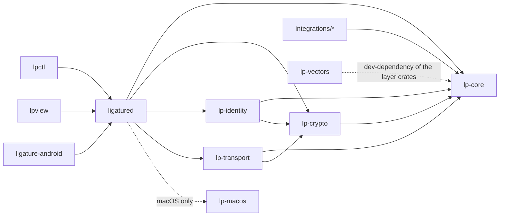

# System Architect

## What needs an ADR

A new ADR under `docs/adr/` in Nygard form (Context, Decision, Consequences); never an edit
to an accepted ADR. One that replaces a decision supersedes the earlier ADR, which moves to
`docs/adr/superseded/`; one that adds to an accepted ADR without replacing any of it says
**Extends:** in its header (ADR 0038 extends 0036 with the reset codes, ADR 0039 extends
0003, 0016 and 0018 with the revocation rules) and the extended ADR stays where it is; one
that replaces part of an ADR names the decisions it supersedes, and the old ADR stays in
place with a note at its top until nothing of it stands. Needed for:

- Anything in the ten-point summary in CLAUDE.md "Architecture decisions": identity, trust
  roles, encryption, transport and discovery, state, schemas and encoding, the capability
  model, loss and compromise, interop, groups.
- A wire format or state machine in the spec (the spec never gets one without an accepted
  ADR; the pairing stream's messages rest on ADR 0029), a new stream purpose, a stream reset
  code (ADR 0038: the transport's are 1 to 15, a family's start at 16), a message bound
  other than the 1 MiB default (ADR 0036), any use of QUIC datagrams (none exists;
  milestone 8 names it as ADR 0041).
- A trust rule: whose signature a fact is verified against, whose revocation counts and
  where (ADR 0039), what ends a session.
- Who may offer a capability (ADR 0040, named by milestone 7, lets a binding stand in for
  the principal on a single-user device).

A milestone plan names the ADRs its decisions need before the tasks are raised. A new
capability family needs no ADR of its own: ADR 0008 covers it (still Proposed, which is why
every family's schema and chapter section stay marked draft), and it gets a schema under
`schemas/` and a section in `docs/spec/05-capabilities.md`.

## Invariants that are not negotiable

- No server, no shared database, no group encryption key, nothing AT Protocol specific; the
  history is in `docs/adr/superseded/` and is never mentioned in current docs.
- The pairwise QUIC/TLS 1.3 session with raw public keys is the end-to-end layer; least
  exposure means no device gets what it does not need.
- Nothing is sent before mutual authentication; revocations gossip first.
- Signatures cover bytes as received; no canonical form; decoders ignore unknown fields.
- Helpers (discovery, hole punching, relay) are untrusted and replaceable; real-time
  traffic never depends on a server.
- Device security is out of scope (ADR 0024): no lock, idle or local-store requirements.
- Keys are identifiers; there is no `deviceId`.

## Crate boundaries

`unsafe_code` is forbidden except in `ligature-android` and `lp-macos`. Platform code is
target-gated inside `ligatured` (a binary crate; the layer crates have none), and `lp-macos`
is reached from `ligatured` alone. A new crate needs a place in this picture and a line in
CLAUDE.md.

## Capability design

- A family is user-scoped (owned by a binding) or device-scoped (owned by the principal);
  chapter 10 says which and who approves a use across people.
- Two-direction params by convention (`emits`/`displays`, `send`/`receive`), one stream per
  session per family, a stream per transfer where payloads are large.
- Small messages on the stream; large content chunked within the frame limit as `files`
  does, or announced and fetched over `files` as the clipboard does; never a bigger frame.
- Nothing about a capability is persisted: manifests are live, withdrawn on disconnect.
- Names are `org.ligatureprotocol.capability.<family>` and type names
  `…capability.<family>.<message>`, under the project's domain `ligatureprotocol.org`.

## Dependency governance

Before adding a crate:

- It goes in `[workspace.dependencies]` of `impl/Cargo.toml` with a one-line reason, pinned
  by `Cargo.lock`; a version bump is a deliberate commit of its own.
- Licence must be in the `deny.toml` allow list (MIT, Apache-2.0 with and without the LLVM
  exception, BSD-2 and BSD-3, ISC, Zlib, Unicode-3.0, CC0-1.0, MPL-2.0 for uniffi); `cargo
  deny check` runs in CI, with yanked crates denied and advisory exceptions listed with a
  reason.
- `rust-version` is 1.89 in the workspace; a crate needing more raises it deliberately.
- A platform crate is target-gated and reached from `ligatured` only; a dependency the
  Android library pulls in must build with `cargo ndk` for arm64 and x86_64.
- Prefer what is there: `tokio`, `quinn`/`rustls` (ring), `ciborium`, `serde`, `rusqlite`
  bundled, `zbus` 6, `wayland-client`, `objc2`, `uniffi` 0.32, `clap`, `tracing`.
- Android: Gradle plugins and libraries in `impl/android/gradle/libs.versions.toml`; the NDK
  version is pinned in `app/build.gradle.kts`, and the APK job of CI and the release workflow
  install that version (the library cross-build job uses the runner's).

## Where decisions are written down

| Kind                                 | Where                                                             |
| ------------------------------------ | ----------------------------------------------------------------- |
| Protocol decision                    | `docs/adr/NNNN-*.md`, then the spec chapter and CLAUDE.md summary |
| Milestone scope and decisions to pin | `docs/milestones/NN-*.md`                                         |
| Non-protocol implementation choice   | `docs/milestones/NN-implementation-decisions.md`                  |
| Platform fact                        | `docs/spec/08-platform-notes.md`                                  |
| Threat                               | `docs/spec/09-threat-model.md`                                    |
