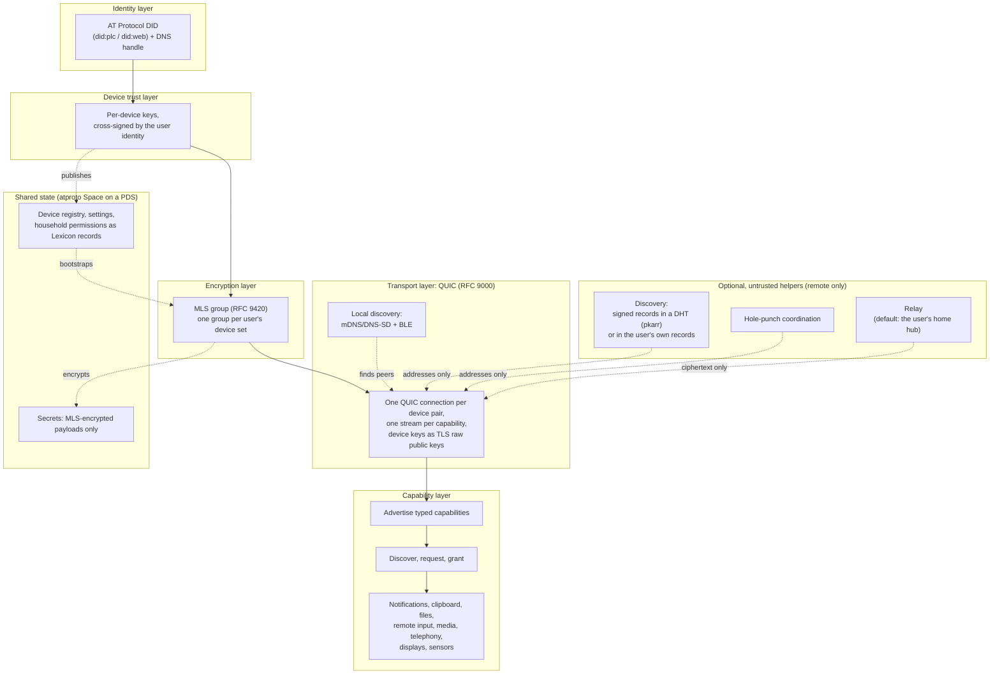

# Ligature Protocol (LP)

> **Status: pre-alpha.** Nothing here is stable. The specification is a draft, the
> reference implementation is a scaffold, and the Lexicon namespace is a placeholder.

Ligature Protocol binds a person's devices (Linux desktops, Android phones, tablets,
home hubs, and iPhones where the platform allows) into one trusted group, so any device
can discover and use the capabilities of the others. Think of it as an open,
Apple-Continuity-like ecosystem for Linux users, built on existing open standards.

## Principles

- **Local-first.** Devices talk to each other directly. Everything works on a LAN with no
  internet connection.
- **Self-hostable, no required central server.** The only hosted component is an
  AT Protocol Personal Data Server (PDS), and you can run your own.
- **End-to-end encrypted.** All device-to-device traffic is protected by an MLS group
  (RFC 9420). Secrets at rest are stored only as MLS-encrypted payloads.
- **Build on open standards.** AT Protocol for identity and shared state, MLS for group
  encryption, QUIC with raw-public-key TLS for transport, mDNS/DNS-SD and BLE for
  discovery.
- **Helpers are replaceable and untrusted.** Remote connectivity may use discovery,
  hole-punching and relay services. Any helper may be operated by anyone, is listed in the
  user's own records, and is never trusted with plaintext or identity.
- **Interoperate, don't replace.** Bridge to KDE Connect, LocalSend, Matter/Thread,
  CalDAV/CardDAV and Syncthing where practical.

## Architecture



Real-time traffic never routes through the PDS. The PDS holds the device registry and
other shared state so that devices can find and verify each other; the data itself flows
directly between devices over QUIC, or through a relay that sees only ciphertext when a
direct path is impossible. MLS is the end-to-end layer; QUIC/TLS underneath it is defence
in depth. WireGuard is not part of the protocol; an optional integration can generate
Headscale/WireGuard configurations for users who want a full home-network overlay.

## Repository layout

| Path | Contents |
| --- | --- |
| `docs/spec/` | The protocol specification (draft) |
| `docs/adr/` | Architecture decision records |
| `docs/glossary.md`, `docs/prior-art.md` | Terminology and related work |
| `lexicons/` | Draft AT Protocol Lexicons (`org.ligatureprotocol.*`, placeholder namespace) |
| `impl/` | Rust reference implementation (cargo workspace) |

## Reference implementation

The `impl/` workspace contains:

- `lp-core`: shared types and the capability model
- `lp-identity`: DID resolution and device key cross-signing
- `lp-crypto`: MLS wrapper (planned on OpenMLS)
- `lp-transport`: QUIC connections, local discovery (mDNS/BLE), remote discovery and
  relay clients
- `ligatured`: Linux user daemon (D-Bus, systemd user unit)
- `lpctl`: CLI for pairing and inspection
- `integrations/wireguard-integration`: non-core; generates Headscale/WireGuard peer
  configs from the device list

The implementation language is under review; see
[ADR 0014](docs/adr/0014-reference-implementation-language.md).

```sh
cd impl
cargo build
cargo test
```

## Documentation

- [Specification overview](docs/spec/00-overview.md)
- [Architecture decisions](docs/adr/)
- [Glossary](docs/glossary.md)
- [Prior art](docs/prior-art.md)
- [Contributing](CONTRIBUTING.md)
- [Security policy](SECURITY.md)

## License

Code is licensed under [Apache-2.0](LICENSE). The specification text under `docs/` is
licensed under [CC-BY-4.0](LICENSE-SPEC).
