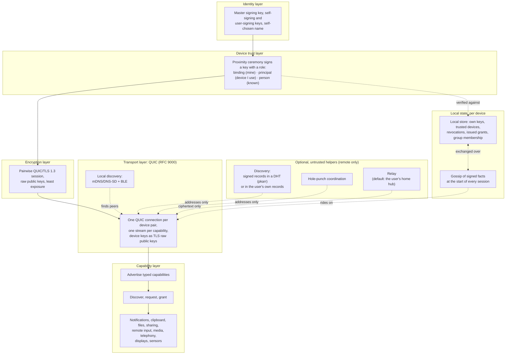

# Ligature Protocol (LP)

> **Status: pre-alpha.** Nothing here is stable. The specification is a draft, the
> reference implementation shares the clipboard, notifications and files between a Linux
> machine, a Mac and an Android phone (milestones 1 to 5), and the `org.ligatureprotocol`
> type names use a placeholder domain.

Ligature Protocol binds the devices a person owns, and the devices a household shares,
into one trusted group, whatever they run: Linux and macOS desktops and laptops, Android
phones and tablets, home hubs. Any device can discover and use the capabilities of the
others: paste on the laptop what was copied on the phone, see the phone's notifications on
the desktop, send a file to the tablet, put a photo on the living-room TV. It is an open
protocol with no vendor, account or server behind it, built on existing open standards, so
that devices from different makers work together the way one maker's devices do.

## Principles

- **Local-first.** Devices talk to each other directly. Everything works on a LAN with no
  internet connection.
- **No server, no database, nothing to recover.** Devices keep a small local store of
  signed facts and gossip them to each other. Lose every device and you rebuild by
  re-pairing; nothing else is lost.
- **Capabilities are live.** A device announces what it can do when it connects and the
  offer disappears when it leaves. Nothing about capabilities is ever stored.
- **No account.** You are a signing key, created on your first device. Pairing is a
  proximity ceremony: scan a code, compare a short code, done. One ceremony makes a device
  known to all your devices.
- **End-to-end encrypted, with least exposure.** Every pair of devices talks over its own
  QUIC/TLS 1.3 session authenticated by device keys. No hub, relay or other device of yours
  can decrypt data it does not need.
- **Build on open standards.** QUIC with raw-public-key TLS for transport and encryption,
  mDNS/DNS-SD and BLE for discovery, Matrix-style cross-signing for device trust, JSON
  Schema for records and messages.
- **Helpers are replaceable and untrusted.** Remote connectivity may use discovery,
  hole-punching and relay services. Any helper may be operated by anyone, is listed in the
  user's own records, and is never trusted with plaintext or identity.
- **Permission across people, not just devices.** Shared devices with several accounts
  and groups such as a household are first-class. Your own devices work together without
  prompts; using someone else's device or capability asks the person who is there. A
  device the household owns, like a lamp or the living-room TV, is registered to the
  group, paired once and works for every member. With nobody signed in it can reach
  nothing of anyone's: your data gets to the TV because you send it there. Sending a
  photo to a family member's phone asks them, then it arrives.
- **Interoperate, don't replace.** Bridge to KDE Connect, LocalSend, Matter/Thread,
  CalDAV/CardDAV and Syncthing where practical.

## Architecture



Nothing routes through a server. A device proves it belongs to you by presenting its key
signed by your self-signing key; revocations and other signed facts travel between your
devices when they meet. Data flows directly between devices over QUIC, or through a relay
that sees only ciphertext when a direct path is impossible. The QUIC/TLS session between
two devices is the end-to-end encryption; there is no group key, so nothing can be read by
a device that was not meant to read it. An optional integration generates
Headscale/WireGuard configurations for users who want a full home-network overlay.

## Repository layout

| Path | Contents |
| --- | --- |
| `docs/spec/` | The protocol specification (draft) |
| `docs/adr/` | Architecture decision records |
| `docs/glossary.md`, `docs/prior-art.md` | Terminology and related work |
| `schemas/` | Draft JSON Schemas for LP's records and messages (`org.ligatureprotocol.*` type names, placeholder domain) |
| `impl/` | Rust reference implementation (cargo workspace) |
| `vectors/` | Conformance vectors any implementation can run |

## Reference implementation

The `impl/` workspace contains:

- `lp-core`: shared types and the capability model
- `lp-identity`: master key, pairing ceremony, cross-signing roles, local trust store,
  optional key publication
- `lp-crypto`: signing and session key material for raw-public-key TLS
- `lp-transport`: QUIC connections, local discovery (mDNS/BLE), remote discovery and
  relay clients
- `ligatured`: the user daemon (control socket; systemd user unit and launchd agent)
- `lpctl`: CLI for pairing and inspection
- `lp-vectors`: conformance vector formats and loader (test support; the vectors live in
  `vectors/`)
- `ligature-android`: the daemon as a library for the Android app in `impl/android`, with
  Kotlin bindings generated by UniFFI
- `integrations/wireguard-integration`: non-core; generates Headscale/WireGuard peer
  configs from the device list

`packaging/` holds the install and uninstall scripts and the tarball packaging the release
workflow uses, `scripts/` the release script, and `CHANGELOG.md` the release notes.

What works today: a Linux machine, a Mac and an Android phone (LineageOS) on the same LAN
pair with the proximity ceremony, started from `lpctl pair` on the desktops and from the
app on the phone, which shows its offer as a QR code; text copied on any of them can be
pasted on the others, with no server, account or internet connection. The clipboard
carries rich text, images and files too: small content is pushed as it is copied, and large
content is announced and fetched only when an application pastes it. The phone receives
by itself and sends with a tap (a quick-settings tile, the notification, the share sheet),
because Android lets only a focused app read the clipboard. A notification posted on the
phone or the Linux machine appears on the other devices, with the app's name and icon and
the device it came from, and dismissing it anywhere clears it elsewhere where the platform
allows; the Mac displays but cannot read its own. Revoking a device stops it connecting,
and pairings survive a restart. A file shared from the phone, or sent with `lpctl files
send` from a desktop, lands in the other device's download folder, several at once where the
receiver allows, with progress and a cancel at either end, and a device can fetch a file
another has offered. This is the scope of
[milestone 1](docs/milestones/01-clipboard-poc.md),
[milestone 2](docs/milestones/02-android-clipboard.md),
[milestone 3](docs/milestones/03-notifications.md),
[milestone 4](docs/milestones/04-files.md) and
[milestone 5](docs/milestones/05-rich-clipboard.md); everything else in the
specification is unimplemented. Apple phones and tablets are off the roadmap for now; what
the platform would allow is recorded in the
[platform notes](docs/spec/08-platform-notes.md#4-ios-and-ipados).

### Install

Each [release](https://github.com/ligature-protocol/ligature-protocol/releases) carries a
tarball for Linux (x86_64 and aarch64) and macOS (universal) and an APK for Android. On a
desktop, unpack the tarball and run `./install.sh`: it puts `ligatured` and `lpctl` in
`~/.local/bin` and runs the daemon as a user service that starts at login, a systemd user
unit on Linux and a launchd agent on macOS (`./uninstall.sh` reverses it, leaving your
identity in place). Then `lpctl init --name "Your Name"` on your first device, or
`lpctl pair` with the offer shown by a device that already has your keys; `lpctl status`
shows the daemon. The service fixes the UDP port at 47471, so one firewall rule lets your
other devices dial in. On the phone, install the APK and open it (the
[app's README](impl/android/README.md) has the first run).

From a checkout, the same install with the binaries you build:

```sh
cd impl
cargo build --release -p ligatured -p lpctl
../packaging/install.sh target/release
```

State lives in the platform's data directory, `~/.local/share/ligature` on Linux
(`$XDG_DATA_HOME`) and `~/Library/Application Support/ligature` on macOS, and the control
socket in `$XDG_RUNTIME_DIR/ligature` or `$TMPDIR/ligature`; `--data-dir`, `--runtime-dir`
or `LIGATURE_DATA_DIR` and `LIGATURE_RUNTIME_DIR` move them, for a daemon run by hand
(`cargo run -p ligatured -- --data-dir data`) or two on one machine. `--port` or
`LIGATURE_PORT` fixes the UDP port, which is otherwise one the system assigns. A daemon that
ran by hand with `--data-dir data` keeps its identity when that directory is moved to the
platform location before the service starts.

### Releases

The version under `[workspace.package]` in `impl/Cargo.toml` is the project's: every crate
and the Android app take theirs from it, and `CHANGELOG.md` records what each release
carries. `scripts/release.sh LP-NNN X.Y.Z` bumps it, dates the changelog section, commits
and tags `vX.Y.Z`; pushing the tag runs the release workflow, which builds the installers
for every platform and publishes them as a GitHub release with the changelog section as its
notes, marked a pre-release while the version is below 1.0. The APK is signed with the
keystore in the repository secrets (`ANDROID_KEYSTORE_BASE64`, `ANDROID_KEYSTORE_PASSWORD`,
`ANDROID_KEY_ALIAS`, `ANDROID_KEY_PASSWORD`); without them it is signed with a key made for
the run, which installs but cannot update an app signed with another key.

## Roadmap

Each milestone has a plan under `docs/milestones/` with its scope, non-goals, decisions, exit
criteria and task breakdown, written before the work starts. One person's devices on one
LAN remain the setting until these are done; groups, relays and sharing between people
follow them.

1. **Clipboard between a Linux machine and a Mac.** Done
   ([plan](docs/milestones/01-clipboard-poc.md)).
2. **An Android phone joins them.** Done ([plan](docs/milestones/02-android-clipboard.md)).
3. **Notifications among all of a person's devices.** Done: a notification posted on any
   device that can see its own appears on every device that displays them, dismissed
   everywhere at once ([plan](docs/milestones/03-notifications.md)).
4. **File transfer among a person's devices.** Done: a file chosen on any device lands on
   another over the LP session itself, several at once where the receiver allows, with
   progress and cancel, and a receiver can fetch content a sender has offered
   ([plan](docs/milestones/04-files.md)).
5. **A clipboard that carries rich text, images and files.** Done: a `set` carries several
   representations of one selection, small content is pushed on copy as text is today, and
   large content is announced and fetched only when pasted
   ([plan](docs/milestones/05-rich-clipboard.md)).
6. **The phone's SMS and calls, and media control.** Planned: messages and calls that
   reach the phone shown and answered on the desktops, a message or a call placed through
   the phone from a desktop, and any device's player driven from the others
   ([plan](docs/milestones/06-phone-and-media.md)).

Not planned: Apple phones and tablets, for the reasons in the
[platform notes](docs/spec/08-platform-notes.md#4-ios-and-ipados).

## Documentation

- [Specification overview](docs/spec/00-overview.md)
- [Shared devices and groups](docs/spec/10-shared-devices-and-groups.md)
- [Milestone 1 plan: a Linux machine and a Mac share the clipboard](docs/milestones/01-clipboard-poc.md)
- [Milestone 2 plan: an Android phone joins them](docs/milestones/02-android-clipboard.md)
  and [the Android app](impl/android/README.md)
- [Milestone 3 plan: notifications between all the devices](docs/milestones/03-notifications.md)
- [Milestone 4 plan: file transfer among a person's devices](docs/milestones/04-files.md)
- [Milestone 5 plan: the clipboard carries rich text, images and files](docs/milestones/05-rich-clipboard.md)
- [Milestone 6 plan: the phone's SMS and calls, and media control](docs/milestones/06-phone-and-media.md)
- [Architecture decisions](docs/adr/)
- [Glossary](docs/glossary.md)
- [Prior art](docs/prior-art.md)
- [Contributing](CONTRIBUTING.md)
- [Security policy](SECURITY.md)

## License

Code is licensed under [Apache-2.0](LICENSE). The specification text under `docs/` is
licensed under [CC-BY-4.0](LICENSE-SPEC).
