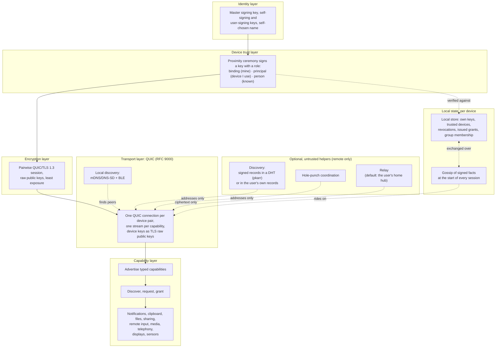

# Ligature Protocol (LP)

> **Status: pre-alpha.** Nothing here is stable. The specification is a draft, the
> reference implementation shares the clipboard between a Linux machine, a Mac and an
> Android phone (milestones 1 and 2), and the `org.ligatureprotocol` type names use a
> placeholder domain.

Ligature Protocol binds a person's devices (Linux and macOS desktops and laptops, Android
phones and tablets, home hubs, and iPhones where the platform allows) into one trusted
group, so any device can discover and use the capabilities of the others. Think of it as an open,
Apple-Continuity-like ecosystem for Linux users, built on existing open standards.

## Principles

- **Local-first.** Devices talk to each other directly. Everything works on a LAN with no
  internet connection.
- **No server, no database, nothing to recover.** Devices keep a small local store of
  signed facts and gossip them to each other. Lose every device and you rebuild by
  re-pairing; nothing else is lost.
- **Capabilities are live.** A device announces what it can do when it connects and the
  offer disappears when it leaves. Nothing about capabilities is ever stored.
- **No account.** You are a signing key, created on your first device. Pairing is a
  proximity ceremony: scan a code, compare a short code, done. One ceremony makes a device
  known to all your devices.
- **End-to-end encrypted, with least exposure.** Every pair of devices talks over its own
  QUIC/TLS 1.3 session authenticated by device keys. No hub, relay or other device of yours
  can decrypt data it does not need.
- **Build on open standards.** QUIC with raw-public-key TLS for transport and encryption,
  mDNS/DNS-SD and BLE for discovery, Matrix-style cross-signing for device trust, JSON
  Schema for records and messages.
- **Helpers are replaceable and untrusted.** Remote connectivity may use discovery,
  hole-punching and relay services. Any helper may be operated by anyone, is listed in the
  user's own records, and is never trusted with plaintext or identity.
- **Permission across people, not just devices.** Shared devices with several accounts
  and groups such as a household are first-class. Your own devices work together without
  prompts; using someone else's device or capability asks the person who is there. A
  device the household owns, like a lamp or the living-room TV, is registered to the
  group, paired once and works for every member. With nobody signed in it can reach
  nothing of anyone's: your data gets to the TV because you send it there. Sending a
  photo to a family member's phone asks them, then it arrives.
- **Interoperate, don't replace.** Bridge to KDE Connect, LocalSend, Matter/Thread,
  CalDAV/CardDAV and Syncthing where practical.

## Architecture



Nothing routes through a server. A device proves it belongs to you by presenting its key
signed by your self-signing key; revocations and other signed facts travel between your
devices when they meet. Data flows directly between devices over QUIC, or through a relay
that sees only ciphertext when a direct path is impossible. The QUIC/TLS session between
two devices is the end-to-end encryption; there is no group key, so nothing can be read by
a device that was not meant to read it. An optional integration generates
Headscale/WireGuard configurations for users who want a full home-network overlay.

## Repository layout

| Path | Contents |
| --- | --- |
| `docs/spec/` | The protocol specification (draft) |
| `docs/adr/` | Architecture decision records |
| `docs/glossary.md`, `docs/prior-art.md` | Terminology and related work |
| `schemas/` | Draft JSON Schemas for LP's records and messages (`org.ligatureprotocol.*` type names, placeholder domain) |
| `impl/` | Rust reference implementation (cargo workspace) |
| `vectors/` | Conformance vectors any implementation can run |

## Reference implementation

The `impl/` workspace contains:

- `lp-core`: shared types and the capability model
- `lp-identity`: master key, pairing ceremony, cross-signing roles, local trust store,
  optional key publication
- `lp-crypto`: signing and session key material for raw-public-key TLS
- `lp-transport`: QUIC connections, local discovery (mDNS/BLE), remote discovery and
  relay clients
- `ligatured`: the user daemon (control socket; systemd user unit and launchd agent)
- `lpctl`: CLI for pairing and inspection
- `lp-vectors`: conformance vector formats and loader (test support; the vectors live in
  `vectors/`)
- `ligature-android`: the daemon as a library for the Android app in `impl/android`, with
  Kotlin bindings generated by UniFFI
- `integrations/wireguard-integration`: non-core; generates Headscale/WireGuard peer
  configs from the device list

What works today: a Linux machine, a Mac and an Android phone (LineageOS) on the same LAN
pair with the proximity ceremony, started from `lpctl pair` on the desktops and from the
app on the phone, which shows its offer as a QR code; text copied on any of them can be
pasted on the others, with no server, account or internet connection. The phone receives
by itself and sends with a tap (a quick-settings tile, the notification, the share sheet),
because Android lets only a focused app read the clipboard. Revoking a device stops it
connecting, and pairings survive a restart. This is the scope of
[milestone 1](docs/milestones/01-clipboard-poc.md) and
[milestone 2](docs/milestones/02-android-clipboard.md); everything else in the
specification is unimplemented.

```sh
cd impl
cargo build
cargo test
```

The daemon keeps its state in `data/` under the project root for now (ignored by git);
`--data-dir` or `LIGATURE_DATA_DIR` moves it. The daemon listens on a UDP port the system
assigns; `--port` or `LIGATURE_PORT` fixes it so a firewall rule can let other devices dial
in. The Android app builds from `impl/android` (see its [README](impl/android/README.md)).

## Documentation

- [Specification overview](docs/spec/00-overview.md)
- [Shared devices and groups](docs/spec/10-shared-devices-and-groups.md)
- [Milestone 1 plan: a Linux machine and a Mac share the clipboard](docs/milestones/01-clipboard-poc.md)
- [Milestone 2 plan: an Android phone joins them](docs/milestones/02-android-clipboard.md)
  and [the Android app](impl/android/README.md)
- [Architecture decisions](docs/adr/)
- [Glossary](docs/glossary.md)
- [Prior art](docs/prior-art.md)
- [Contributing](CONTRIBUTING.md)
- [Security policy](SECURITY.md)

## License

Code is licensed under [Apache-2.0](LICENSE). The specification text under `docs/` is
licensed under [CC-BY-4.0](LICENSE-SPEC).
