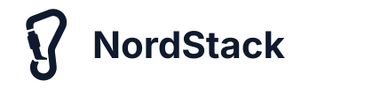

# Ligature Protocol

**Your devices, working as one.** What you copy, the notifications you get, the files you
share, and your keyboard, mouse and screen move between the devices you own, directly, over
your own network: no account, no server, no company in between. An open protocol, with apps
for Linux, macOS and Android.

**[Install the apps](guide/install.md)** · [Read the user guide](guide/index.md) ·
[Releases](https://github.com/garth/ligature-protocol/releases)

## What it does

### One clipboard

Copy on the laptop, paste on the phone. Text, formatted text, images and files; large
content is fetched only when you paste it. [The clipboard](guide/clipboard.md)

### Notifications everywhere

A message that pops up on the phone shows on the desktop with the app's icon, and
dismissing it anywhere clears it everywhere the platform allows.
[Notifications](guide/notifications.md)

### Files between devices

Share from the phone or send from the command line; files land in the other device's
download folder, with progress and a cancel at either end. [Files](guide/files.md)

### One keyboard and mouse

Push the pointer off the edge of one desktop and it drives the next, typing what your own
keyboard says; the phone is a touchpad for either, and your desktops can drive the phone.
[Keyboard and mouse](guide/input.md)

### Screens from anywhere

Watch another of your devices' screens in a window or on the phone, and click to drive it;
the phone can be watched with nobody at it once you allow it. [Screens](guide/screen.md)

### Yours alone

You are a key your first device creates. Devices join by an in-person ceremony, every
session is end-to-end encrypted, and nothing lives outside your devices.
[First steps](guide/first-steps.md)

## How it works

Ligature binds a person's devices into one trusted group. A person is an Ed25519 key,
created on their first device; each device gets its own keys, signed in by the person's
introducer devices in a proximity ceremony with a QR code and a six-digit code. Devices find
each other on the local network and hold one QUIC connection per pair, with TLS 1.3 and
their own keys as the credentials, so the session itself is the end-to-end layer. Over it,
devices advertise capabilities (clipboard, notifications, files, the keyboard and mouse,
screens, and more to come) and use
each other's. There is no shared database: each device keeps its own signed facts and
gossips them to its peers, revocations first. The [specification](spec/00-overview.md) has
the whole design, and the
[repository](https://github.com/garth/ligature-protocol) holds the decisions behind it, the
plans for what comes next and the Rust implementation, which is both the reference and the
product.

## Status

Alpha. The releases carry pairing, the clipboard with text, HTML, images and files,
notifications, file transfer, one keyboard and mouse across your devices (the pointer
crossing from one desktop to the next at the edge of the screen, the phone a touchpad for
either or driven from them) and screens watched and driven from another device, in a window
on a desktop or in the app on the phone, between a Linux machine, a Mac and an Android
phone on one network. Next come the phone's messages and calls and media control.
Remote connections, sharing between people and shared household devices are specified and
not yet built. Each release is reviewed against the project's threat model before it goes
out; the reports are in the
[repository](https://github.com/garth/ligature-protocol/tree/main/docs/security-audit).

## Sponsors

Organisations that support the project's development. Tiers are Gold, Silver and Bronze;
a tier appears here as soon as it has a sponsor. To sponsor Ligature, get in touch through
the [discussions](https://github.com/garth/ligature-protocol/discussions).

### Gold

<a href="https://nordstack.co.uk"><picture>
<source media="(prefers-color-scheme: dark)" srcset="assets/sponsors/nordstack-dark.svg">

</picture></a>

[NordStack Ltd](https://nordstack.co.uk), an independent UK software firm.

<small>Specification and documentation
[CC-BY-4.0](https://github.com/garth/ligature-protocol/blob/main/LICENSE-SPEC), code
[Apache-2.0](https://github.com/garth/ligature-protocol/blob/main/LICENSE).</small>
