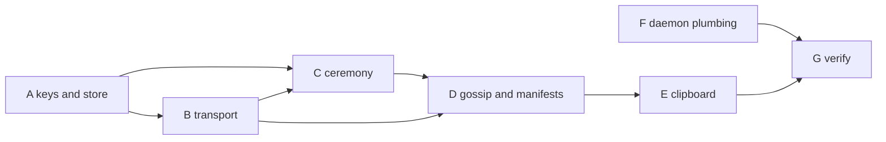

# Milestone 1: a Linux machine and a Mac share the clipboard

**Status:** Plan.

## 1. Goal

One person. One Linux machine and one Mac on the same LAN. Pair them with the proximity
ceremony, then copy text on either and paste it on the other, in both directions, with no
server, no account and no internet. Revoke one and show it can no longer connect. Restart
both and show the pairing survived.

The milestone is deliberately cross-platform from the first commit: it proves the design
on both desktop platforms at once, and it forces the platform-specific parts (clipboard,
daemon lifecycle, presence) behind traits from the start rather than after a Linux-only
proof.

## 2. Non-goals for this milestone

Groups and group devices (chapter 10), relays, hole punching and the DHT (chapter 04
section 5), the `share` family, non-text clipboard content, BLE, headless pairing pages,
Android or iOS, the system-level principal daemon as a separate process (section 5, phase
F), D-Bus desktop integration on Linux, code signing or notarisation on macOS, and the
optional WireGuard integration.

## 3. Decisions

All five are decided; each has its ADR. Implementation choices that are not protocol are
recorded in [01-implementation-decisions.md](01-implementation-decisions.md) as they are
made.

1. **Signature algorithm.** Ed25519 only ([ADR 0027](../adr/0027-ed25519.md)), rendered as
   multibase/multicodec `z6Mk…`.
2. **Wire encoding.** CBOR from the start ([ADR 0025](../adr/0025-cbor-wire-encoding.md)).
   Byte fields are CBOR byte strings, timestamps and keys stay text. Signed facts travel in
   an envelope and are verified over their bytes as received, never re-encoded
   ([ADR 0035](../adr/0035-byte-exact-signatures-forgiving-decoding.md)). `lpctl` may
   print messages as diagnostic notation for debugging.
3. **QUIC stack.** quinn over rustls ([ADR 0028](../adr/0028-quinn-over-rustls.md)); mutual
   raw-public-key authentication, rustls default suites, no 0-RTT. Task B1 is the
   verification gate, on both platforms.
4. **Ceremony code.** A six-digit (or two-word) short authentication string derived from the
   TLS exporter ([ADR 0029](../adr/0029-ceremony-code-from-tls-exporter.md)).
5. **Implementation language.** Rust, the existing workspace under `impl/`
   ([ADR 0026](../adr/0026-rust-reference-implementation.md)), building and running on
   Linux and macOS ([ADR 0033](../adr/0033-supported-platforms.md)).

One plumbing choice made here rather than in an ADR, because it is an implementation
convenience: the control channel between `lpctl` and `ligatured` is a Unix domain socket
carrying the same CBOR messages on both platforms. D-Bus integration for Linux desktops is
deferred to a later milestone.

## 4. Exit criteria

- A freshly initialised Linux daemon and a freshly initialised macOS daemon pair in one
  ceremony started from `lpctl pair`.
- After pairing, each daemon's `lpctl devices` lists the other as a binding of the same
  person with a verified role signature.
- Text copied on either machine appears in the other's clipboard within a second on a LAN,
  in both directions.
- `lpctl revoke` on either side stops the other from authenticating on its next connection
  attempt, and the revocation survives restarts.
- Both daemons restart with their trust store intact and reconnect without a new ceremony.
- Every message exchanged is CBOR that, decoded, validates against a schema under
  `schemas/`, and the fixtures used in tests are committed as the first conformance
  vectors.
- CI builds and tests the workspace on Linux and macOS.

## 5. Work breakdown

Each task is intended to be one ticket and one commit. Phases may overlap where their
dependencies allow.

### Phase A: keys and local store

- A1. Ed25519 key generation and multibase rendering; `PersonKey`, principal key, binding
  key types in `lp-core` and `lp-crypto`.
- A2. The three-key structure (chapter 01 section 3): master key signs a self-signing key
  and a user-signing key; the master private key lives on the first device for this
  milestone, with offline or passphrase-derived storage as a later task.
- A3. Envelopes, person facts and role facts (`lp-identity::cross_signing`): sign and
  verify an envelope over its payload bytes; build and verify the person fact (master key,
  display name, subordinate keys with the master's signatures); build role facts for
  `binding` and `principal`; verify the chain to a master key. The tests write and check
  vectors under `vectors/keys/` and `vectors/facts/` through `lp-vectors`
  ([decisions](01-implementation-decisions.md), LP-33).
- A4. Local store on disk: a SQLite database of signed facts plus a separate 0600 key file,
  under `data/` in the project root for this milestone, behind one path-resolution
  function with `--data-dir` and `LIGATURE_DATA_DIR` overrides (see
  [implementation decisions](01-implementation-decisions.md), LP-25 and LP-32). Load, save,
  round-trip and quarantine tests.
- A5. Revocation fact: create, verify, apply to the store (`revoked` flag retained).

### Phase B: transport

- B1. QUIC endpoint with raw-public-key TLS (`lp-crypto::session`,
  `lp-transport::quic`): listen, dial, present the device key, read the peer's. Confirm
  mutual authentication, access to the peer's key bytes, the exporter, and migration, on
  Linux and on macOS, before anything is built on it.
- B2. Recognition check on connect: the peer key is a binding of mine (chain verifies
  against my master key) or the connection proceeds no further than the pairing offer.
- B3. mDNS/DNS-SD advertise and browse (`_ligature._udp`) with one Rust implementation on
  both platforms (`mdns-sd`, LP-28), with a random per-boot identifier in the TXT record as the placeholder
  for the per-epoch identifier of chapter 04 section 4.1. Confirm it coexists with Bonjour
  on macOS.
- B4. Connection manager: one connection per peer, reconnect on loss, ALPN `ligature/1`,
  the frame codec and the stream header, stream open per purpose
  ([ADR 0036](../adr/0036-stream-framing-and-message-typing.md)).
- B5. Integration test: two endpoints on loopback discover each other and open an
  authenticated connection. Runs on both platforms in CI.

### Phase C: the ceremony

- C1. Newcomer side (`lp-identity::pairing::Newcomer`): generate device keys only (the person
  arrives through the ceremony; `lpctl init` is for the first device, LP-32), show fingerprint and
  QR in the terminal, accept an incoming pairing connection, derive the short code from the TLS
  exporter, display it.
- C2. Introducer side (`Introducer`): scan or type the fingerprint, connect, derive the same
  code, ask the user to confirm it matches, sign the newcomer's binding (and principal) with
  the chosen roles, send signatures, the self-signing key if the newcomer is to be an
  introducer, and current gossip.
- C3. Both sides store the result; the newcomer is now an introducer too (configurable
  later).
- C4. `lpctl pair` (both roles) and `lpctl devices`, over the control channel: the pairing
  request stays open and the daemon streams the offer and the code as events (LP-30).
- C5. Negative tests: wrong code, tampered fingerprint, connection replaced mid-ceremony.

### Phase D: gossip and manifests

- D1. Gossip exchange after authentication (`lp-identity::trust_store`) on the `gossip`
  stream with `gossip.have`, `gossip.want` and `gossip.fact`: list fact identifiers, send
  what the peer lacks, revocations first; apply what verifies.
- D2. `lpctl revoke` and the propagation test: revoke on A, B learns on next connect to A.
- D3. Manifest after gossip (`lp-core::Manifest`): send current capabilities, update on
  change, withdraw on disconnect. `lpctl caps` shows the live view.
- D4. Manifest messages added to `schemas/` beside the stream header and gossip messages
  of `message.schema.json`; tests decode CBOR and validate the result against the schema.

### Phase E: clipboard

- E1. `org.ligatureprotocol.capability.clipboard` schema: text/plain only, a `set`
  operation, a size cap.
- E2. A `Clipboard` trait: watch for changes, read text, set text.
- E3. Linux implementation via `wlr-data-control` on Wayland (Hyprland is the first
  target); detect changes, suppress echoes by content hash.
- E4. macOS implementation via the pasteboard: poll the change count at a short interval,
  read and set text; the same echo suppression.
- E5. Clipboard stream handler: on local change send to every connected binding of mine;
  on receive, set locally. Last-writer-wins by timestamp.
- E6. Implicit same-person grant recorded with basis `implicit` so the grant path exists
  even though no prompt is shown.

### Phase F: daemon plumbing

- F1. `ligatured` holds both the binding and, for this milestone, the principal key (a
  personal device's principal and binding share a process; the separate system-level
  daemon is deferred). One binary, platform differences behind traits. No configuration
  file; it starts without an identity until `lpctl init` or a pairing gives it one
  (LP-32).
- F2. Control channel: a Unix domain socket in the runtime directory carrying
  length-prefixed CBOR messages (`schemas/control.schema.json`,
  [decisions](01-implementation-decisions.md), LP-30), used by `lpctl` for status, pair,
  devices, revoke and caps. Identical on both platforms.
- F3. Linux service: systemd user unit (`crates/ligatured/systemd/`).
- F4. macOS service: launchd agent plist (`crates/ligatured/launchd/`), stderr to
  `~/Library/Logs/ligature/ligatured.log`, run from a local build without signing or
  notarisation.
- F5. Persistence across restart: keys, store, and reconnection without a new ceremony, on
  both platforms.

### Phase G: verification and write-up

- G1. End-to-end script for two machines on one LAN: pair, copy both ways, revoke, restart.
  Run by hand between a Linux machine and a Mac and recorded in the ticket.
- G2. Loopback end-to-end test with two daemons in `data/a` and `data/b` on one machine,
  runs in CI on Linux and macOS.
- G3. Review the vector set under `vectors/` for coverage (every fact type, every rule in
  `vectors/README.md`, negative cases) and fill the gaps.
- G4. Update chapters 02, 03, 04, 05, 06 and 08 with what was actually built, still marked
  draft; record any deviation as an ADR.

## 6. Risks

- The QUIC stack's raw-public-key support may be incomplete on one side or one platform.
  B1 checks both before anything is built on it.
- Pasteboard polling on macOS adds latency and a little CPU; the interval needs choosing
  against the one-second exit criterion.
- Two mDNS stacks on one Mac (ours and Bonjour) may interfere; B3 confirms coexistence or
  falls back to Bonjour through `astro-dnssd` behind the same trait (LP-28).
- The Wayland clipboard path differs by compositor; `wlr-data-control` covers Hyprland and
  other wlroots-style compositors but not GNOME. Out of scope here, behind the trait.
- Cross-platform end-to-end runs cannot happen in hosted CI; G1 is a manual run and G2 is
  the automated stand-in.

## 7. After this milestone

Milestone 2 candidates, in no order: offline or passphrase-derived master keys and the
introducer choice at pairing; D-Bus desktop integration on Linux; the `share` family between
two people (requires the `person` role and the second master key); the headless pairing
page; a group with one group device; relays and the DHT for the away-from-home case; the
separate system-level principal daemon.
