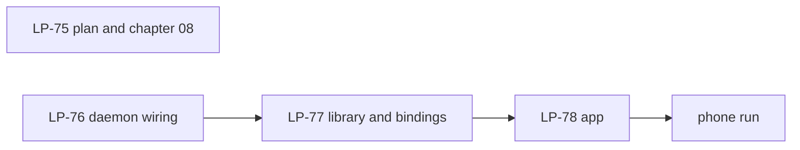

# Milestone 2: an Android phone shares the clipboard with Linux and macOS

**Status:** Done on a phone, two checks outstanding. The library, the app and the host-side
tests are done (LP-76, LP-77, LP-78), and on 2026-10-20 a Pixel 8 Pro on LineageOS 24.0
(Android 17) joined the Linux machine and the Mac (LP-74; section 4 says what was seen).
Still to record on LP-74: `lpctl revoke` of the phone and the reboot. The platform-signed
build turned out to be impossible on an official LineageOS build (section 6), so the
automatic send on an unmodified ROM is an open item for the next milestone (section 7).

## 1. Goal

One person. The Linux machine and the Mac of milestone 1, plus an Android phone running
LineageOS, on the same LAN. The phone joins the person's device set through the proximity
ceremony as a newcomer. Text copied on the Linux machine or the Mac appears on the phone;
text copied on the phone reaches both, automatically where Android allows it and on a tap
where it does not. Revoke the phone from a desktop and show it can no longer connect.
Reboot the phone and show it reconnects without a new ceremony.

LineageOS is the first target because the app must work without Google services, because
sideloading is the normal way to install there, and because a LineageOS built from source
can sign the app with the platform key, which is the one way Android lets an app read the
clipboard in the background (section 3). The project's own builds are signed with keys it
keeps, so that path needs a self-built ROM.

## 2. Non-goals for this milestone

Groups and group devices, relays, hole punching and the DHT, the `share` family, non-text
clipboard content, BLE, notifications, remote input, iOS, a camera-based QR scanner in the
app (the phone is the newcomer and shows the code), F-Droid or Play Store distribution,
reading the clipboard through an input method, and any change to the protocol: the phone
speaks exactly what the desktops speak.

## 3. Decisions

Protocol decisions are unchanged: Android is platform 3 of
[ADR 0033](../adr/0033-supported-platforms.md) and the device record's `platform` is
`android`. The implementation choices are in
[02-implementation-decisions.md](02-implementation-decisions.md):

1. **One implementation.** The Rust daemon is built as a library for Android and embedded
   in a Kotlin app through UniFFI (LP-77). The app writes no protocol code.
2. **The clipboard is the app's.** Android lets a library do nothing with the clipboard;
   the app reads it when Android allows and tells the node, and sets it when the node asks.
3. **Sending is automatic only with `READ_CLIPBOARD_IN_BACKGROUND`**, a signature-level
   permission granted to a platform-signed build. Otherwise the user sends with a tap: a
   quick-settings tile, a notification action, the main screen, or the share sheet.
   Receiving always works.
4. **The phone is the newcomer.** It shows the offer as a QR code and as text with Share
   and Copy; a desktop introduces it with `lpctl pair '<offer>'`. The app can also
   introduce another device from a pasted offer, for a phone that is the first device.
5. **A foreground service** of type `connectedDevice` keeps the node alive, holds the Wi-Fi
   multicast lock that mDNS needs, and starts at boot.

## 4. Exit criteria

- A freshly installed app on a LineageOS phone pairs with the Linux daemon in one ceremony
  started from **Show pairing offer** on the phone and `lpctl pair` on the Linux machine;
  the same code shows on both; after it, `lpctl devices` on both desktops lists the phone
  as a binding of the same person.
- Text copied on the Linux machine or the Mac appears on the phone's clipboard within a
  second or two on a LAN, with the app in the background.
- Text copied on the phone appears on both desktops after a tap on the tile, the
  notification action or the share sheet; on a platform-signed build it appears without a
  tap.
- `lpctl revoke` on a desktop stops the phone from authenticating on its next connection,
  and the phone's screen lists itself as revoked after the gossip.
- Rebooting the phone restarts the node, which reconnects to both desktops with no new
  ceremony.
- CI cross-builds the library for `aarch64-linux-android` and `x86_64-linux-android`,
  generates the Kotlin bindings and assembles the debug APK on Linux.

Seen on 2026-10-20 with a Pixel 8 Pro on LineageOS 24.0 (Android 17), the Linux machine
and the Mac on one Wi-Fi: the ceremony from the phone's offer with the same code on both
sides, and the phone listed on both desktops; Linux to phone in under a second; phone to
Linux through the app's button, the tile, the notification action and the share sheet;
the Mac in session with the phone once the introducer pushed the phone's facts (LP-80);
a reinstall and an app restart keeping the identity and reconnecting. Not yet seen:
revoke, reboot, and a copy observed on the Mac itself. The automatic send needs a
platform-signed build, which the phone's official nightly cannot have.

## 5. Work breakdown

- LP-75. This plan, the implementation decisions, chapter 08 section 3, the README and
  CLAUDE.md.
- LP-76. `ligatured::run` exposes its connection-event loop and discovery loop as functions
  an embedding host can call without the control socket; `platform()` reports `android`.
- LP-77. `crates/ligature-android`: `Node`, `Pairing`, the `Host` trait and events behind
  UniFFI; the clipboard fed by the host; logging through the host; `ceremony::join` and
  `ceremony::introduce` in `ligatured`; a two-node host-side test; the CI cross-build.
- LP-78. `impl/android`: the Gradle project with `cargo ndk` and `uniffi-bindgen` as build
  steps, the service, the holder, the activities, the tile, the boot receiver, the Compose
  screen, the README; the CI APK job; then the run on a phone.

## 6. Risks

- **mDNS on the phone.** Wi-Fi drivers drop multicast without the multicast lock, and some
  access points filter it entirely. The lock is held while the service runs; an access
  point that filters multicast is a network problem the plan does not solve (the phone
  can still be dialled by an introducer from the offer's addresses, so pairing works even
  then).
- **Background execution.** Android stops services under battery pressure despite the
  foreground type. The app asks for unrestricted battery use; LineageOS honours it.
- **Clipboard read.** The transparent-activity trick (a focused window may read) is what
  other clipboard tools use on Android 10 and later; a future Android may close it. The
  share sheet and the platform-signed path do not depend on it.
- **Platform signing.** `READ_CLIPBOARD_IN_BACKGROUND` is `signature|role`; the one role
  that carries it (`SYSTEM_TEXT_INTELLIGENCE`) is system-only and named in the ROM's
  config. An official LineageOS build is signed with keys the project keeps, so a
  sideloaded app on one never gets the permission: automatic sending needs a ROM built
  from source with one's own keys. Seen on the Pixel 8 Pro nightly (LP-74).
- **Firewalls.** A desktop behind a host firewall cannot be dialled by the phone; it
  connects only when it dials, on an mDNS event, which after a restart of the phone's node
  took about two minutes. `ligatured --port` plus one firewall rule fixes it (LP-81).
- **Facts for live peers.** A device in session with the introducer learnt the newcomer
  only on its next session; the introducer now pushes the new facts at once (LP-80).
- **Toolchain drift.** The Gradle, Kotlin and Compose versions are pinned in
  `gradle/libs.versions.toml`; the Android Gradle plugin is held on the 8.x line.
- **No device in CI.** The exit criteria on a phone are a manual run recorded on LP-74;
  the two-node host test is the automated stand-in.

## 7. After this milestone

Candidates, in no order: automatic sending on an unmodified ROM, either by starting the
send activity from the clip listener under the "display over other apps" permission (the
listener fires in the background on LineageOS 24 even though the read is refused) or by a
notification on every copy whose action sends; a QR scanner in the app so the phone can
introduce a desktop without typing; `lpctl pair --scan` with a webcam for the other direction; notifications
from the phone to the desktops (the first capability Android offers that desktops cannot
return); the platform locations for the desktops' data directories; and the milestone 1
carry-overs (offline master keys, D-Bus, the `share` family, groups, relays).
