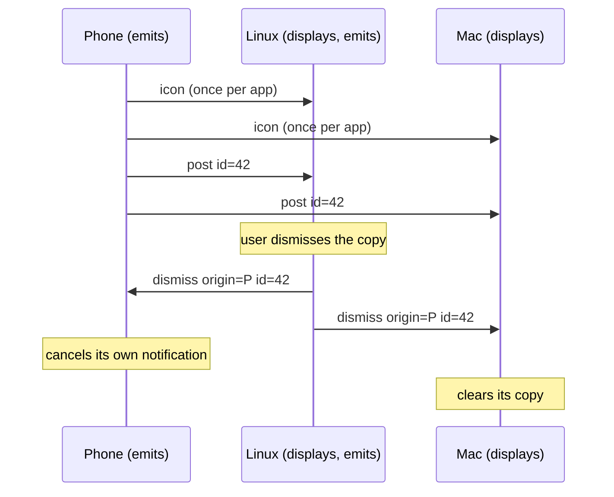
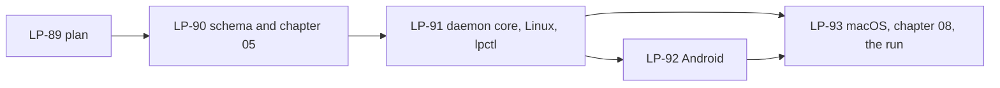

# Milestone 3: notifications flow between all of a person's devices

**Status:** Done. The tasks LP-90 to LP-93 under the epic LP-86 are done, and the owner ran
the exit criteria on the Pixel, the Linux machine and the Mac on 2026-10-21 and 2026-10-22
(LP-93). The run found two things: a pair could hold two connections for a moment and each
end kept a different one (LP-98), and a Mac where Script Editor has never posted drops
`display notification` silently until the user allows it once (chapter 08 section 2b).

## 1. Goal

One person, the Android phone, the Linux machine and the Mac of milestone 2. A notification
posted by an app on any device that can see its own notifications appears on every other
device of the person that can display notifications, with the app's name and icon, the
device it came from, the title and the text. Dismissing it anywhere removes it everywhere
it was shown. The phone-to-laptop case is the one most people meet first, but the capability
is symmetric: a desktop's notifications reach the phone and the other desktop by the same
path, and a device that can only display still takes part.

Notifications are the second capability family after the clipboard and the first that one
of the platforms cannot return: a Mac can display but not emit. The milestone proves the
capability model carries a family with two directions, and it is the capability people use
KDE Connect for most.

## 2. Non-goals for this milestone

Replies and actions beyond dismiss (answering a message from the desktop); routing rules
beyond the phone's per-app exclusions, which are the configuration app of LP-88; other
people's devices and groups; notification history or persistence of any kind; a signed
macOS helper application (section 3, decision 8); bridging KDE Connect; and any change to
the protocol's framing, sessions or trust.

## 3. Decisions

Protocol decisions are unchanged: a capability is advertised in a manifest, used on its
own stream, and a same-person use needs no prompt (chapter 05, ADR 0008, ADR 0015, ADR
0036). What this milestone pins:

1. **One family, two directions.** `org.ligatureprotocol.capability.notifications` is
   user-scoped. Its descriptor's `params` say which directions the device offers,
   `emits` and `displays`, with `maxIconBytes` for what it accepts. A device advertises
   the capability if it offers either; one stream per session carries both directions,
   as the clipboard's does. Section 2 of chapter 05 records the convention that a
   family's `params` may declare directions, so `files` (send, receive) and media control
   (control, be controlled) follow it without a new rule.
2. **All to all.** An emitting device sends every notification it forwards to every
   connected peer whose descriptor says `displays`. Nothing depends on presence or on
   which desktop is in use. Shaping that is LP-88's configuration app, later.
3. **What travels.** `post` carries a stable `id` chosen by the emitting device, the app
   (`id` and display name), `title`, `body`, `postedAt`, and the hash of the app's icon;
   a `post` with an `id` already shown replaces it in place. `dismiss` carries the
   `origin` (the emitting device's key, since ids are chosen per device), the `id` and
   `dismissedAt`. `icon` carries the hash, the MIME type and the PNG bytes, sent once
   per app per session before the first `post` that names it and cached by the receiver
   for the session; `maxIconBytes` bounds it, 64 KiB by default. Everything fits the 1 MiB
   message of ADR 0036 with room to spare.
4. **Dismissal fans out directly.** The device on which the user dismisses a
   notification, whether its own or a copy it displayed, sends `dismiss` in one hop to the
   origin and to every connected peer that displays. The origin cancels the real one, the
   others clear their copies. No relay, so clearing a copy on the Linux machine still
   clears the Mac while the phone is out of range; a device that is away keeps a stale
   copy until the user clears it.
5. **The loop rule.** A notification displayed on behalf of another device is never
   emitted as this device's: on Android the listener ignores Ligature's own package; on
   Linux the daemon's own `Notify` calls carry an `x-ligature-origin` hint that its
   monitor skips; and the daemon never forwards a `post` it received. Only a dismissal
   the user makes on this device is sent; a received `dismiss` is acted on and never
   forwarded, so dismissals cannot cycle either.
6. **Never forwarded.** Ongoing notifications (foreground services, media players,
   navigation), silent or minimum-importance ones, group summaries, Linux `transient`
   ones, and any from an app the user excluded on the phone. The emitting device decides;
   a displaying device shows what it is sent. This list is a first cut and may be
   revisited once the run shows what people miss or tire of.
7. **Linux emits by monitoring the session bus.** The daemon becomes a monitor of
   `org.freedesktop.Notifications` on the user's session bus, found at
   `$XDG_RUNTIME_DIR/bus` the way the compositor socket is found, and sees every `Notify`
   call, the reply that assigns its id, and every `NotificationClosed` signal, whatever
   notification daemon is in use. It displays by calling `Notify` itself with the origin
   device named beside the app, and dismisses with `CloseNotification`. A user dismissal
   of a displayed copy shows as `NotificationClosed` with reason 2 and goes back to the
   origin. `zbus` does the talking, in the daemon, Linux only.
8. **macOS displays through `osascript`.** A plain daemon has no bundle identifier, which
   the user notification centre requires, so the Mac displays with
   `osascript -e 'display notification'` and reports `emits: false`. Such a notification
   cannot be dismissed from outside; a dismissal that arrives for it is dropped and
   chapter 08 says so. A signed helper application that can both display and dismiss is
   LP-94, a later improvement and not a protocol matter.
9. **Android emits and displays.** A `NotificationListenerService`, enabled by the user
   under notification access, forwards posts and removals and dismisses a phone
   notification when the origin rule asks; received notifications are shown through the
   notification manager in a channel per origin device, and the removal of one of those
   copies by the user goes back as a dismiss. The descriptor's `emits` follows whether
   access is granted. Per-app exclusions live in the app's preferences and apply at the
   listener.
10. **Nothing persists.** Notification content lives in memory for the session on both
    ends; a session ending drops the cache and the id map, and displayed copies stay as
    ordinary notifications the user clears. Chapter 09 gains the sentence.

No decision above changes an accepted ADR, so the plan asks for none. If the owner wants
the directions convention of decision 1 recorded as an ADR rather than a chapter 05
paragraph, LP-90 writes it.

## 4. Exit criteria

- A notification posted on the phone appears on the Linux machine and the Mac within a
  second or two, with the app's name and icon and the phone named as its origin.
- A `notify-send` on the Linux machine appears on the phone and the Mac the same way.
- Dismissing a notification on the phone removes its copies on the Linux machine;
  dismissing the Linux copy removes the original on the phone and the copy on the Mac is
  dismissed where the platform allows (not on macOS in this milestone, by decision 8).
- An app the user excluded on the phone never appears anywhere.
- A copy displayed on behalf of another device is never forwarded again: a notification
  from the phone shown on Linux does not come back to the phone or reach the Mac twice.
- Revoking notification access on the phone withdraws `emits` from its descriptor within
  the session, and granting it restores it, with no restart.
- CI compiles the schema, builds the daemon on Linux and macOS and the APK, and the
  two-daemon test with fake backends passes.
- Everything is recorded on LP-86 from a run with the real devices, as LP-74 was.

## 5. Work breakdown

- LP-89. This plan.
- LP-90. `schemas/capability.notifications.schema.json`; chapter 05 section 3c and the
  directions convention in section 2; the privacy sentence in chapter 09.
- LP-91. `ligatured::notification_sync` beside `clipboard_sync`: the capability with its
  directions, the stream, fan-out, the origin rule, the loop rule, the icon cache; a
  `Notifications` trait with a fake; the Linux backend over the session bus; `lpctl notify`
  for a test notification; the two-daemon test.
- LP-92. The Android backend behind UniFFI; the listener service, display, the
  notification-access section and the per-app exclusions in the app.
- LP-93. The macOS backend; chapter 08 per platform; README and CLAUDE.md; the run with
  the real devices; the milestone status.

## 6. Risks

- **Monitoring the session bus.** `BecomeMonitor` is granted to the bus owner on the
  usual session buses (dbus-daemon and dbus-broker), which is the user the daemon runs
  as; if a distribution's policy refuses it, Linux falls back to display-only and the
  descriptor says so. Checked first on the owner's machine.
- **Volume.** A chatty app can post many notifications a minute; each is one small
  message per displaying peer, and icons go once per app, so the cost is bounded, but a
  flood on the phone becomes a flood on two desktops. The per-app exclusions are the
  user's control; a rate limit is not planned unless the run shows the need.
- **Notification access on Android** can be revoked by the system (an update, a
  battery-saving ROM). The descriptor tracks the listener's connected state, so the
  desktops see `emits` disappear rather than a silent stop.
- **Icons.** Android small icons are often monochrome masks that look wrong on a
  desktop; the large icon or the app icon is sent when there is one. A 64 KiB cap keeps
  a bad actor from stuffing the channel.
- **macOS dismissal.** Decision 8 leaves copies on the Mac undismissable from elsewhere;
  acceptable for the milestone, and the first thing the helper application of LP-94 fixes.
- **Privacy.** Notification text is among the most sensitive data a phone holds. It
  travels only on the authenticated pairwise session to the person's own devices, is held
  in memory, and is never stored; the threat model says so and the implementation has no
  code path that writes it.

## 7. After this milestone

Candidates, in no order: replies and actions carried back to the origin (the natural next
step once the id map exists); the signed macOS helper that displays and dismisses (LP-94); the
configuration app of LP-88, which this family makes necessary; file transfer (milestone 4,
LP-87); and the milestone 1 carry-overs (offline master keys, D-Bus for `lpctl`, the
`share` family, groups, relays).
