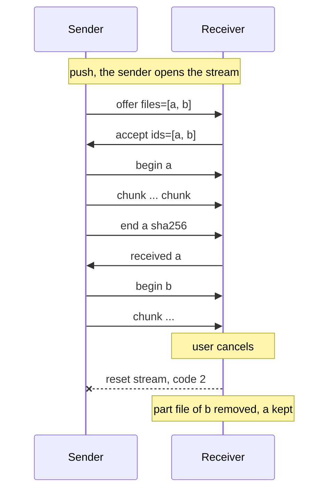
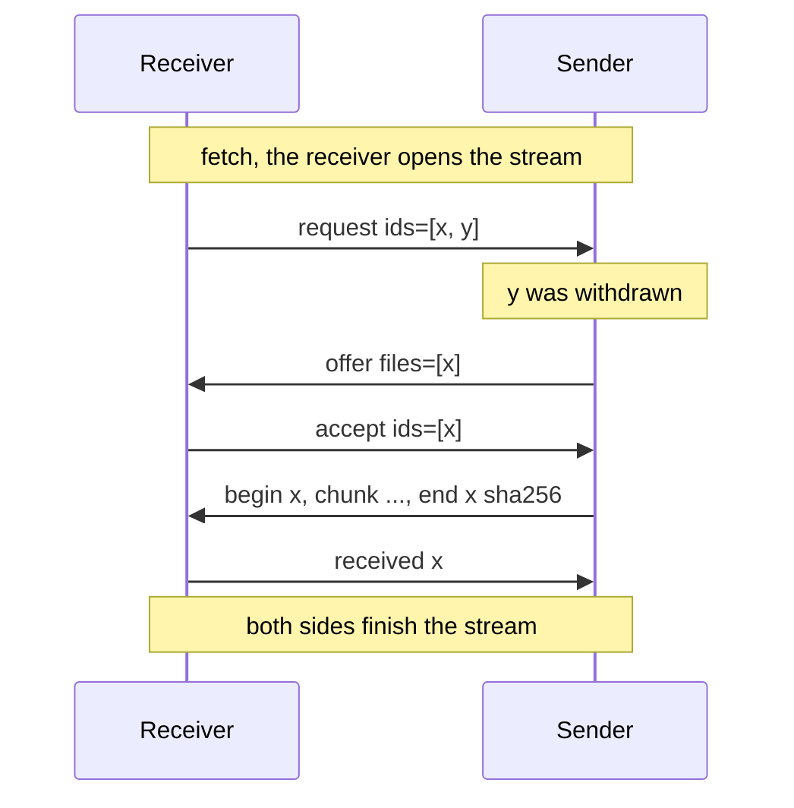
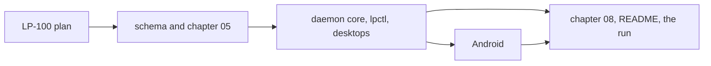

# Milestone 4: file transfer among a person's devices over the LP session

**Status:** Planned. The design points in section 3 are put to the owner before any code; the
tasks are raised as sub-tickets of the epic LP-87 when the plan is accepted.

## 1. Goal

One person, the Android phone, the Linux machine and the Mac of milestone 3. A file chosen
on any of the three lands on another, in both directions, with progress shown at both ends
and a cancel at either. The transfer is native to LP: a `files` stream on the pairwise QUIC
session, which already gives mutual authentication, encryption, flow control and connection
migration, so a transfer needs no second channel, port, certificate or firewall rule.

The milestone also shapes `files` for milestone 5 (LP-95), where the clipboard announces a
large selection instead of pushing it and the receiving device fetches the bytes only when
an application pastes. So besides the push, a receiver can start a transfer by asking for
an id the sender offered earlier, the thing behind a file descriptor may be bytes in memory
rather than a path, and the requesting side chooses where the bytes land. Milestone 4
proves all of that with files: pushed from a picker and `lpctl`, and pulled by `lpctl
files get` against an id the sender offered. Nothing of the clipboard changes here.

## 2. Non-goals for this milestone

Browsing a remote file system (a fetch by an announced id is not browsing); sync of any
kind; resumption of an interrupted transfer; directories (a folder is sent as its files, or
not at all, in a later milestone); transfers to other people, which is `share` (chapter 05
section 3a); a desktop drag-and-drop or file-manager picker (the desktops send with `lpctl`
in this milestone); previews or thumbnails; interoperation with LocalSend, which stays a
possible bridge under [ADR 0010](../adr/0010-interop-bridges.md) and is recorded as
rejected for the transfer itself on LP-87; and any change to the protocol's framing,
sessions or trust.

## 3. Decisions

Protocol decisions are unchanged: a capability is advertised in a manifest, used on its
own stream, and a same-person use needs no prompt (chapter 05, ADR 0008, ADR 0015, ADR
0036). ADR 0036 bounds a message at 1 MiB and says the `files` family defines its own
chunking, which is what section 3d of chapter 05 will do. What this milestone pins:

1. **One family, two directions.** `org.ligatureprotocol.capability.files` is
   user-scoped. Its descriptor's `params` follow the directions convention of chapter 05
   section 2: `send` (this device offers content and answers fetches), `receive` (it
   accepts pushed files), and `maxChunkBytes`, the largest `chunk` payload it takes, 256 KiB
   by default and never more than the frame limit less headroom. Every daemon advertises
   `send`; `receive` is advertised while the download directory of decision 7 is writable.
2. **The file descriptor is a standalone definition.** `file` in the capability's schema
   carries `id` (chosen by the sender, opaque, unique among what that device offers),
   `name` (a base name, never a path), `size` (exact, in bytes), `mime`
   (`application/octet-stream` when unknown), an optional `sha256` (base64url, unpadded,
   as the notifications icon hash) and an optional `modified` timestamp. Other capability
   schemas reference it by `capability.files.schema.json#/$defs/file`; the clipboard
   announcement of milestone 5 is the first. The vocabulary maps one-to-one onto
   LocalSend's file entry (`id`, `fileName`, `size`, `fileType`, `sha256`,
   `metadata.modified`) so a bridge later translates without loss. What is behind a
   descriptor is the sender's business: a path, bytes in memory, a clipboard selection.
3. **One stream per transfer, files one after another.** Whoever starts a transfer opens a
   stream with the capability type as its purpose (ADR 0036): the sender for a push, the
   receiver for a fetch. A fetch is a push the receiver asked for, so the two share one
   state machine after the first message. The messages, all under the capability's type
   name:
   - `request` (fetch only, from the receiver): the `ids` it wants.
   - `offer` (from the sender): the `files` on offer. For a push it is the first message.
     For a fetch it answers the `request` with the files the sender still holds among those
     asked, so an id missing from the offer is gone.
   - `accept` (from the receiver): the `ids` it will take, or `decline` with a `reason`
     (`gone`, `refused`, `too-large`, `no-space`, `busy`). Either side may `decline`.
   - For each accepted file, in the offer's order: `begin` with the `id`, then `chunk`
     messages each carrying `bytes` (a CBOR byte string of at most the receiver's
     `maxChunkBytes`), then `end` with the `id` and the `sha256` the sender computed while
     sending, so every file is verified even when the descriptor had no hash.
   - `received` with the `id` from the receiver once the size and hash check out and the
     file is in place, or `failed` with the `id` and a `reason`.
   The sender finishes its side after the last `end`, the receiver after the last
   `received`. Progress is counted locally from bytes sent or received against `size`:
   nothing on the wire carries it. Several transfers to one peer are several streams with
   the same purpose, which ADR 0036 already allows; this answers chapter 04's open question
   on one stream per file in flight. One stream per transfer rather than per file because
   files land on one disk in sequence anyway, one `accept` covers a selection and one
   cancel drops the lot, while the clipboard and notifications streams are untouched by it.
4. **Cancel is a stream reset.** Either side cancels by resetting the stream (application
   error code `2` for a cancel the user asked for, `3` for a failure); a stream that ends
   before `end` is a failure. The receiver removes the partial file; the sender stops
   reading its source. No `cancel` message, since a message queues behind the chunks it is
   meant to stop.
5. **Chunks within the frame, not raw bytes.** A `chunk` is an ordinary typed message, so
   one codec serves every stream and a corrupt frame is bounded. The overhead per 256 KiB
   chunk is a few dozen bytes; the run measures throughput against a plain copy over the
   same Wi-Fi, and `maxChunkBytes` is the knob if it falls short.
6. **The sender's offer registry.** Each daemon keeps in memory what it currently offers:
   id, descriptor, source, and how long it stands. A push registers its files for the
   stream's lifetime. `lpctl files offer <path>` registers a file until `lpctl files
   withdraw <id>` or the daemon stops, and prints the id; milestone 5 registers clipboard
   content with its own window. A `request` for an id not in the registry is declined as
   `gone`. Ids are 128 random bits in base64url, chosen per sender, and a peer learns one
   only from an offer or an announcement on another stream: the registry lists nothing on
   request, so a fetch is not browsing. Any binding of the same person may fetch what is
   offered; nothing is scoped to one peer in this milestone.
7. **The receiver decides where a file lands, per request.** A transfer writes to a sink
   chosen on the receiving side: the download directory for a push and for `lpctl files
   get` without `--to`; the path `--to` names; or, for a capability inside the daemon
   (milestone 5), a temporary file or memory. Sink and source are daemon interfaces
   (`FileSink`, `FileSource`), not wire concepts: the sender never learns or chooses a
   destination. The download directory is `$XDG_DOWNLOAD_DIR` from `user-dirs.dirs`, else
   `~/Downloads`, with `/Ligature` appended on Linux; `~/Downloads/Ligature` on macOS;
   MediaStore's Downloads collection under `Download/Ligature` on Android, the entry
   pending until the file is complete and visible in the Files app after. It is created on
   first use.
8. **Names and partial files.** The receiver keeps the base name of `name` only, drops
   control characters and a leading dot, trims to 255 bytes keeping the extension, and uses
   `file` if nothing is left. A clash gets a space and `(2)`, `(3)` and so on before the extension;
   nothing is ever overwritten. Bytes go to `<name>.ligature-part` beside the destination
   (a pending MediaStore entry on Android) and are renamed into place on a verified `end`;
   a cancel, failure or lost connection removes the part file. `modified` is applied to the
   file where the platform allows.
9. **The same-person grant.** A receiver advertising `receive` accepts a push from a
   binding of the same person with no prompt, and a sender advertising `send` answers its
   fetch; the implicit grant is recorded as the clipboard's is (chapter 05 section 4,
   ADR 0015). The descriptor carries no size cap: a receiver that cannot take a file
   declines it (`too-large`, `no-space`) after checking free space against `size`. Anything
   across people is `share` and not this family.
10. **Surfaces.** `lpctl files send <device> <path>...` pushes, shows progress on standard
    error and cancels on Ctrl-C; `lpctl files get <device> <id> [--to <path>]` fetches;
    `lpctl files offer`, `offers` and `withdraw` drive the registry. The phone gets a
    **Send with Ligature** share target for one or several files with a picker of the
    connected same-person devices that advertise `receive`, a progress notification with a
    cancel action for every transfer in or out, and a notification for a received file that
    opens it. A desktop that receives a file posts a local notification naming the file and
    the device; it carries the origin hint of milestone 3, so it is never forwarded as a
    notification of this device.
11. **Migration and interruption.** A transfer rides the connection, so QUIC migration
    carries it across the dialling side's address change, which is the phone roaming
    between access points on one network when the phone dialled. A connection that dies
    (idle timeout, a move to another network) fails the transfer at both ends: the receiver
    removes the partial file and the user sends again. Resumption is left out; the
    one-stream shape leaves room for an offset in `accept` later.
12. **Nothing stored.** Offers and transfer state live in memory for the session; the only
    thing written is the received file at its destination. File content travels only on
    the authenticated pairwise session, a device never writes outside its download
    directory or the destination the requesting capability chose, and a name is never a
    path. Chapter 09 gains the sentence.
13. **The meaning of `files`.** ADR 0022 and chapter 05 section 3a describe `files` as
    browsing and transferring among a person's own devices. This milestone specifies the
    transfer and the fetch by an offered id; browsing stays unspecified and the registry
    deliberately lists nothing. Section 3a's wording is brought in line; ADR 0022 is about
    `share` and stands.

No decision above changes an accepted ADR, so the plan asks for none. The one decision the
owner may want as an ADR rather than a ticket comment is the transport itself: that a
transfer is native to the session, with LocalSend's HTTPS transfer API recorded as the
rejected alternative (LP-87, 2026-10-21). If so, the schema task writes it.

## 4. Exit criteria

- `lpctl files send` on the Linux machine lands a file on the Mac and on the phone, under
  `Downloads/Ligature` on each, with the same name, size and SHA-256 and the modification
  time kept; the same from the Mac to the other two.
- A file shared from the phone's share sheet to a chosen desktop lands there; two files
  shared at once arrive as two files.
- A file larger than the phone's free memory streams to disk with progress shown at both
  ends and the daemon's and the app's memory use flat.
- A cancel from the sending end and a cancel from the receiving end, each mid-transfer,
  leave no partial file on the receiver, and the next transfer between the two works.
- Sending the same file twice yields two files, the second with `(2)` in its name.
- A transfer in progress while the phone roams between two access points completes; the run
  records which end had dialled.
- `lpctl files offer` on one device and `lpctl files get` on another yield identical bytes;
  after `lpctl files withdraw`, the same `get` is refused as gone and writes nothing.
- Two transfers to the same peer at once both complete, and clipboard text crosses in under
  a second while a large transfer runs.
- CI compiles the schema, builds the daemon on Linux and macOS and the APK, and the
  two-daemon test covers a push of several files, a fetch, a withdrawn fetch, a cancel from
  each end and a file of several hundred chunks.
- Everything is recorded on LP-87 from a run with the real devices, as LP-74 was.

## 5. Work breakdown

The tasks after the plan are raised when the plan is accepted, one ticket each:

- LP-100. This plan.
- **Schema and chapter 05.** `schemas/capability.files.schema.json` with `file`, `params`
  and the eight messages; chapter 05 section 3d, the `files` wording in section 3a and the
  directions line in section 2; chapter 04's open question on streams per file answered;
  the privacy sentence in chapter 09; the ADR of section 3 if the owner wants it.
- **Daemon core, `lpctl` and the desktops.** `lp-core` message and descriptor types;
  `ligatured::files_sync` beside the other two synchronisers: the offer registry,
  `FileSource` and `FileSink`, the transfer state machine for both roles, the download
  directory, the name rule, part files, hashing while streaming, the received-file
  notification; control-channel requests and progress events; `lpctl files`; the
  two-daemon test. `04-implementation-decisions.md` records the choices as they are made.
- **Android.** The `Host` trait grows what the platform keeps from a library: open a
  content URI for reading with its name, size and type, create and finish a pending
  MediaStore entry, post and update a progress notification; the node gains send, fetch and
  cancel calls with progress callbacks behind UniFFI; the share target takes files with the
  device picker; the progress and received notifications.
- **Chapter 08, README, the run.** The platform notes per device, README and CLAUDE.md for
  milestone 4, the run with the real devices and the milestone status.

## 6. Risks

- **Throughput.** Every chunk is a CBOR map decoded into an owned buffer; a copy or two
  per 256 KiB is cheap, but quinn's flow-control windows and the receiver's write path
  decide the rate. The run compares with a plain copy over the same network; the knobs are
  `maxChunkBytes`, the stream receive window and writing chunks from a dedicated task.
- **Content URIs without a size.** Android's share sheet may hand over a URI whose
  `OpenableColumns.SIZE` is unknown, and `size` is exact in the descriptor. The app reads
  such a file once into its cache to learn the size before offering it, and declines it if
  the cache cannot hold it.
- **MediaStore on LineageOS.** Pending entries, the `Download/Ligature` relative path and
  the rename on completion are exercised in the run before the design is taken as settled;
  the fallback is the app's external files directory, which the Files app also shows.
- **macOS Downloads.** A launchd agent writing under `~/Downloads` may be met by a
  Transparency, Consent and Control prompt on first write; the run records whether it is,
  and the plist gains what it needs.
- **Migration.** Only the dialling side's address can change under QUIC version 1, and the
  phone is the dialler only when it connected first. The exit criterion holds either way
  for a roam that keeps the address and is recorded honestly for one that does not.
- **Disk full mid-transfer.** The free-space check before `accept` is advisory; a write
  that fails later is a `failed` with `no-space` and a removed part file, and the sender
  moves on to nothing, since the stream is reset.
- **Battery.** A large transfer on the phone is minutes of radio and disk in the foreground
  service; acceptable for a user-started action, and the progress notification is where a
  cancel lives.

## 7. After this milestone

Candidates, in no order: the rich clipboard of milestone 5 (LP-95), which fetches over
`files`; resumption with an offset in `accept`; folders; a desktop picker and a file-manager
action; the LocalSend bridge under ADR 0010 as its own component; the milestone 1
carry-overs (offline master keys, D-Bus for `lpctl`, the `share` family, groups, relays).
