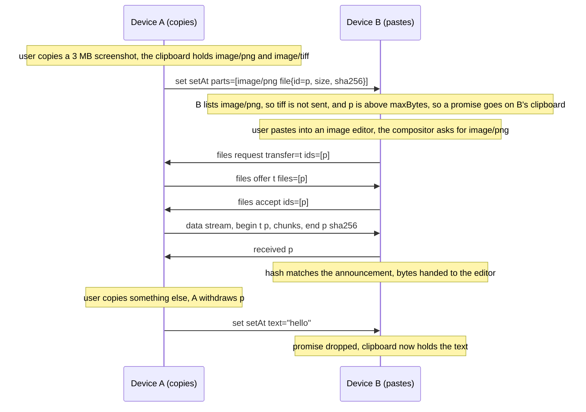
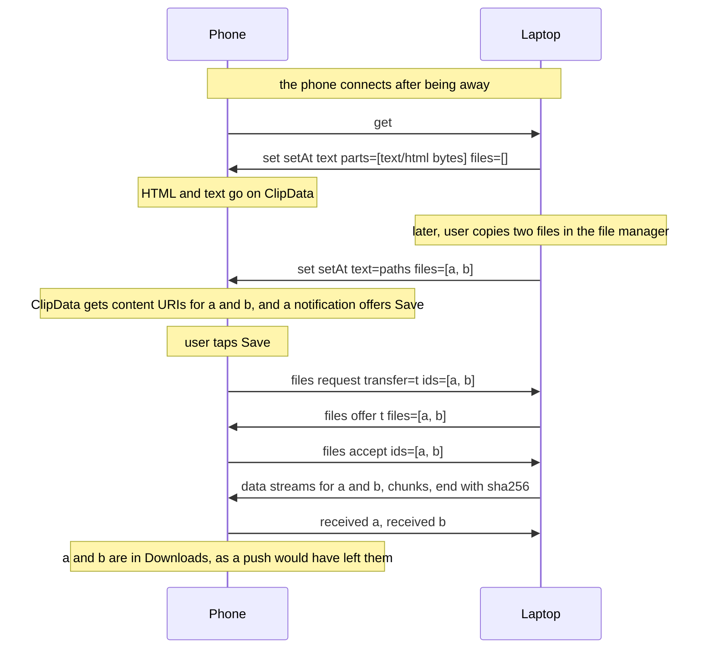
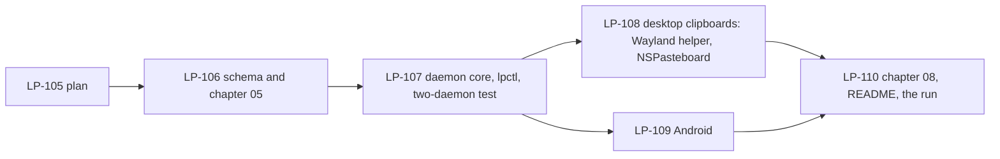

# Milestone 5: the clipboard carries rich text, images and files

**Status:** Done. Accepted by the owner on 2026-10-22, with the push bound at 512 KiB, the
sender keeping announced bytes up to 64 MiB for at most an hour, and files reaching the phone
through a Save action; the tasks LP-106 to LP-110 under the epic LP-95 are done, and the exit
criteria were run on the Linux machine, the Mac and the Pixel on 2026-10-22 (LP-110, recorded
on LP-95). The run found and fixed, under LP-108 and LP-109: the Mac's pasteboard delivers a
request for a promised type to the daemon's main thread, which now runs the Cocoa run loop;
TextEdit took the plain string until the data types were listed first; Android's copy overlay
fetched a promised image for its thumbnail, which now gets a placeholder; and the Linux helper
died on a would-block read. Two platform facts stand: a desktop clipboard manager that reads
every selection (Omarchy's does) fetches a promised image once as soon as it appears, and
`get` and a textless set go only to devices of this version. Not run: a device without
`fetch`, timing text during a large fetch, and CI, since nothing was pushed.

## 1. Goal

One person, the Android phone, the Linux machine and the Mac of milestone 4. The clipboard
of milestones 1 and 2 carries plain text only. After this milestone a copy of rich text, an
image or files on any of the three reaches the others, and a paste there yields what the
pasting application can take: formatted text in a document, plain text in a plain editor,
the image in an image editor, the files in a file manager. Small content still arrives the
moment it is copied, as text does today. Large content is announced on copy and fetched
only when an application pastes it, over the `files` capability of milestone 4, which was
shaped for exactly this: a transfer the receiver starts for an id the sender offered, bytes
that come from memory rather than a path, and a destination the requesting capability
chooses.

## 2. Non-goals for this milestone

Clipboard history; a device asking another for its clipboard without a copy having
happened there (a `get` asks for the current value, decision 5, and that is all); clipboards
across people, which is `share` (chapter 05 section 3a); converting between formats on the
wire (a receiver gets the representations the sender has, never a transcoding); anything
about which application pasted, or when; the primary selection on Linux (the clipboard
only); drag and drop; pasting into the phone's file manager (files reach the phone through
a Save action, decision 10); and any change to the protocol's framing, sessions or trust.

## 3. Decisions

Protocol decisions are unchanged: a capability is advertised in a manifest, used on its own
stream, and a same-person use needs no prompt (chapter 05, ADR 0008, ADR 0015, ADR 0036).
ADR 0036 bounds a message at 1 MiB, which is what makes decision 3 necessary, and ADR 0019
(least exposure) is why a large image is never pushed to every binding. The `files`
capability of chapter 05 section 3d carries every fetch unchanged. What this milestone pins:

1. **A `set` carries representations, not one string.** The clipboard holds one selection
   in several forms at once, and the `set` message of section 3b grows a `parts` list,
   each part a `mime` and either `bytes` (a CBOR byte string, pushed) or `file` (a
   descriptor from `capability.files.schema.json#/$defs/file`, announced, decision 3).
   The `text` field stays and is the plain-text representation: present whenever the
   source offers plain text, so a receiver that accepts nothing else, and a receiver of
   milestone 2, still gets something. `setAt` stays, and the newest wins as before. A
   selection of files is a `files` list of descriptors beside `parts` (decision 4). A
   `set` with neither `text`, `parts` nor `files` says the sender's clipboard emptied.
2. **`mimeTypes` is the negotiation.** The descriptor's `mimeTypes` lists what a device
   accepts and can put on its clipboard; a sender includes only parts whose `mime` the
   receiver lists, plus `text`. The reference implementation lists `text/plain`,
   `text/html`, `image/png` and `text/uri-list` on every platform, `text/rtf` and
   `image/tiff` on macOS as well. HTML is the one interoperable rich-text form: RTF
   travels beside it where the source has it and is never sent alone. Platform mapping
   stays in the implementations: Wayland data-control speaks MIME types directly,
   NSPasteboard speaks UTIs (`public.utf8-plain-text`, `public.html`, `public.rtf`,
   `public.png`, `public.tiff`, `public.file-url`) through a table, and Android `ClipData`
   carries text, HTML text and content URIs. A type a platform cannot represent is not
   listed and so never sent to it.
3. **Push small, announce large.** The descriptor's `maxBytes` is the push bound: the
   largest total of `text` and pushed `bytes` a device accepts in one `set`, 512 KiB by
   default and never more than the frame limit less 64 KiB of headroom. A sender pushes
   every part that fits within the receiver's `maxBytes`, largest first until the budget
   is spent, and announces the rest: a part with a `file` descriptor instead of `bytes`,
   carrying `id`, `size`, `mime` and a required `sha256`. The receiver puts a promise for
   each announced part on its local clipboard and fetches the bytes only when an
   application pastes that type (decision 6). So text and short HTML stay instant, and a
   screenshot costs nothing until it is pasted. Which parts are pushed is decided per
   receiver: one `set` may push a part to a desktop and announce it to the phone.
4. **Files are always announced.** A copied file selection is a `files` list of
   descriptors (name, size, mime, optional modified, a `sha256` when the sender has one
   cheaply, which is not required for files) and never bytes in a `set`, whatever its
   size. A paste in a file manager fetches them (decision 6). The `text` of such a `set`
   is what the source platform offers as text, usually the paths, and `parts` may carry
   the platform's own list form (`text/uri-list`) for a paste on the same platform, with
   the URIs rewritten by the receiver to where the fetched files landed.
5. **`get` asks for the current value.** A device sends `get` on the clipboard stream
   when it wants the peer's current clipboard: on connecting, so a device that was away
   holds the latest copy, and from the phone's **Receive now**. The peer answers with its
   current `set`, built as decision 3 says, or with an empty `set` when it holds nothing
   it may send. A `get` is answered only within the same-person grant and never carries a
   value the peer would not have pushed. This settles section 3b's open question in
   favour of asking as well as waiting.
6. **A fetch is a `files` transfer the receiver starts.** The sender registers each
   announced part and each file in its `files` offer registry under the descriptor's `id`
   for the availability window (decision 7). A paste makes the receiver's daemon open a
   `files` control stream with a `request` for the ids it needs, exactly as `lpctl files
   get` does; the bytes land where the clipboard chose, not in the download folder: in
   memory for a part up to 16 MiB, else a file under the daemon's own cache (decision 9).
   The receiver checks the `sha256` of a part against the announcement and gives the
   application nothing on a mismatch. A fetch runs at the `files` data-stream priority
   and within the receiver's `maxStreams`, like any transfer.
7. **The availability window.** Announced content stays offered until the sender's
   clipboard changes, or for one hour, whichever is first; then the sender withdraws the
   ids and a later `request` is declined as `gone`. The sender serves a fetch from the
   bytes it kept at copy time, since a phone cannot re-read its clipboard later and a
   desktop's clipboard may have been replaced by the time the paste comes. What it keeps
   is bounded: 64 MiB per clipboard value in the reference implementation; a selection
   beyond that is announced only up to the bound, largest parts dropped first, and files
   are read from disk at fetch time rather than kept. The receiver, on `gone`, on a hash
   mismatch, or on losing the connection to the sender, drops its promises and leaves its
   clipboard holding the parts it was pushed (`text` at least) or empty, so a paste never
   hangs and never yields stale bytes. A receiver whose own clipboard changes drops its
   promises likewise.
8. **The echo rule covers the representation set.** Milestone 1's echo filter hashes the
   text; it now hashes the whole value: for each part in `mime` order, the `mime`, a zero
   byte and the SHA-256 of its bytes (the announced `sha256` for an announced part), then
   the same for each file by `name`, all under one SHA-256. A device that receives a
   `set`, applies it, and sees its own clipboard change to the same hash does not send it
   back, and a `set` equal to what was last sent is not applied. A platform that reports
   the local change with fewer types than were set (the phone reports text only) compares
   the text hash alone, as today, so it never re-sends what it just received.
9. **Where fetched bytes live before the paste completes.** A part fetched to memory is
   handed to the pasting application straight from memory. A part or file fetched to
   disk goes under the daemon's clipboard cache: `$XDG_RUNTIME_DIR/ligature/clipboard/` on
   Linux, `~/Library/Caches/org.ligatureprotocol.ligatured/clipboard/` on macOS, the app's
   cache directory on Android. Files keep their names under the name rule of milestone 4
   in a directory per clipboard value, so a file manager that pastes `text/uri-list` gets
   local `file://` URIs it can copy from. The cache for a value is removed when the local
   clipboard changes to a different value or the daemon starts, and is never where a
   user's file ends: the file manager, or the Save action on the phone, makes the copy.
10. **A device that cannot hold a promise.** The descriptor's `fetch` flag says whether
    the device fetches announced parts; a device without it is sent only what fits in its
    `maxBytes` and no `file` parts, so it loses large representations and gets no files.
    All three platforms of this milestone hold promises: Wayland's data source answers a
    request for a type when the compositor asks for it, NSPasteboard takes a lazy data
    provider per type and a file promise provider for files, and Android `ClipData` takes
    content URIs served by the app's `ContentProvider`, whose `openFile` fetches on first
    open. On the phone, files on the clipboard are also offered by a notification with a
    **Save** action that fetches them into Downloads through the milestone 4 path, since
    few Android applications paste file URIs.
11. **Surfaces.** The desktops' clipboards are watched and set by the daemons as today,
    now for every listed type; `lpctl clipboard` shows the types and sizes of the current
    value, which of them are promises, and sets text. The phone's app reads `ClipData` at
    the moments it may (its screen, the tile, the notification action, the share sheet),
    including HTML text and content URIs, which it reads into bytes while it has focus,
    and sets `ClipData` with text, HTML and the content URIs of decision 10; **Receive
    now** on its screen sends a `get`. Nothing new is stored: the cache of decision 9 is
    the only thing written, and it is removed as said there.
12. **Migration from milestone 2.** A milestone 2 receiver ignores `parts` and `files`
    (decoders ignore unknown fields, ADR 0035) and reads `text`, so a mixed set of
    devices keeps working during the roll-out; a milestone 2 sender sends `text` only,
    which a new receiver takes as a one-part value. The schema's `mimeTypes` default stays
    `text/plain`, so a device that advertises nothing new is sent text only.
13. **Chapter 09.** Clipboard bytes travel only on the authenticated pairwise session, a
    large value reaches only the device that pastes it, a device learns an id only from a
    `set` it was sent, and the sender's registry lists nothing on request, as section 3d
    already says for files.

No decision above changes an accepted ADR: the frame limit and the stream model of ADR
0036 hold, `files` is used as section 3d specifies, and ADR 0019 is the reason for
announcing rather than pushing. The plan asks for no new ADR.

## 4. Exit criteria

- Rich text copied from a browser on the Linux machine pastes with its formatting into a
  document on the Mac and as plain text into a plain editor there, and reaches the phone,
  where it pastes as text into a plain field and as formatted text into one that takes
  HTML; the same from the Mac to the other two.
- A screenshot copied on one desktop pastes on the other desktop and on the phone; the
  daemon's log and `lpctl files transfers` show nothing transferred until the paste, and
  the bytes pasted have the SHA-256 the announcement carried.
- A file copied in the Linux file manager pastes into the Mac's Finder and the reverse,
  with the same name, size and SHA-256; the same files land in the phone's Downloads from
  the Save action, and the phone's file manager can share a file from its clipboard to a
  desktop.
- A paste on the receiver after the sender's clipboard changed yields the sender's newer
  value, not the old bytes; a paste after the sender disconnected fails cleanly, the
  pasting application gets the pushed text or nothing, and the receiver's clipboard is
  left holding that, with no promise outstanding.
- The sender's announced content is withdrawn when its clipboard changes and after the
  window, and a `lpctl files get` for its id is then refused as gone.
- Plain text still crosses in under a second in every direction, as in milestones 1 and
  2, including while a large fetch runs.
- A device with `fetch` false receives the text and the parts within its `maxBytes` and
  nothing else, and no promise is ever put on its clipboard.
- The `get` on connect leaves a device that was away holding the latest value.
- CI compiles the schema, builds the daemon on Linux and macOS and the APK, and the
  two-daemon test covers a pushed multi-part `set`, an announced part fetched on demand,
  a fetch after withdrawal, a file list fetched to the cache, the echo rule over parts,
  and `get`.
- Everything is recorded on LP-95 from a run with the real devices, as LP-74 was.

## 5. Work breakdown

- LP-105. This plan.
- **LP-106. Schema and chapter 05.** `schemas/capability.clipboard.schema.json` with
  `parts`, `files`, `get`, the new `params` (`maxBytes` as the push bound, `mimeTypes`,
  `fetch`), referencing `capability.files.schema.json#/$defs/file`; chapter 05 section 3b
  rewritten with the open question answered; the sentence in chapter 09.
- **LP-107. Daemon core, `lpctl` and the two-daemon test.** `lp-core` clipboard types with
  the representation set and its hash; `ligatured::clipboard` grows from text to a value of
  typed parts and files, the `Clipboard` trait reading and setting every listed type and
  holding promises; `ClipboardSync` builds a `set` per receiver, registers announced
  content in `FilesSync`'s registry with the window, fetches on a promise's request into
  memory or the cache of decision 9, answers `get`, and applies the echo rule over the set;
  `lpctl clipboard` shows types, sizes and promises; the two-daemon test with an in-memory
  clipboard. `05-implementation-decisions.md` records the choices as they are made.
- **LP-108. Desktop clipboards.** The Linux helper offers and reads every listed MIME type
  and serves a data source whose requests for an announced type come back to the daemon
  for the fetch, with `text/uri-list` rewritten to the cache; the macOS clipboard reads
  and writes through the UTI table, with a lazy data provider per announced type and a
  file promise provider for files.
- **LP-109. Android.** `ClipData` with HTML text and content URIs read while focused; the
  app's `ContentProvider` serving announced parts and files from the node on first open;
  **Receive now** as a `get`; the notification with **Save** for files on the clipboard.
- **LP-110. Chapter 08, README, the run.** The platform notes per device, README and
  CLAUDE.md for milestone 5, the run with the real devices and the milestone status.

## 6. Risks

- **Paste latency.** A paste of an announced part is a fetch over the network before the
  application gets a byte: a 3 MB screenshot is well under a second on the LAN, a 50 MB
  image to the phone is around ten seconds at the throughput milestone 4 measured. Wayland
  and NSPasteboard hand the application a pipe or a block, and most applications wait;
  the run records any that give up, and the knob is `maxBytes`, which pushes more.
- **Many requests for one paste.** GTK and Qt applications may ask for several types in
  a row before settling, and Finder asks for each promised file. A fetch is per id and
  the receiver caches what it fetched for the value's lifetime, so a second request for
  the same part costs nothing; the first request for each type costs one transfer.
- **Pasteboard ownership from a background process.** On macOS the daemon's lazy data
  provider lives only while the daemon runs; if it stops, a paste gets nothing. The
  daemon writes the pushed parts eagerly and promises only the announced ones, so a
  restart loses at most the large parts of the last value.
- **The Wayland helper's data source.** `wl-clipboard-rs` copies from bytes it holds;
  serving a type on demand needs the helper to own the data-control source itself and ask
  the daemon over its stdio frames when the compositor requests an announced type. The
  helper grows by that protocol, which also carries the multi-type read.
- **Android reads.** The app may read `ClipData` only while focused, and an image or a
  file on the Android clipboard is a content URI from another app that must be opened
  then, not later. The app reads the bytes at that moment, within the 64 MiB bound, and
  announces what it read; a selection it cannot open is sent as text only.
- **HTML as it is.** A receiver puts the sender's HTML on its clipboard untouched; what a
  document application does with a browser's HTML is that application's business. No
  sanitising or transcoding happens in LP; a paste that looks wrong is pasted as the
  source produced it, and the run records how the common applications cope.
- **Memory on the phone.** Keeping announced bytes for the window costs memory in the
  foreground service; the 64 MiB bound and the one-hour window keep it bounded, and the
  node drops the bytes as soon as the clipboard changes.
- **File names in `files`.** A copied file list carries base names only, as every
  descriptor does; a directory in the selection is sent as its files or not at all, as
  milestone 4 left it.
