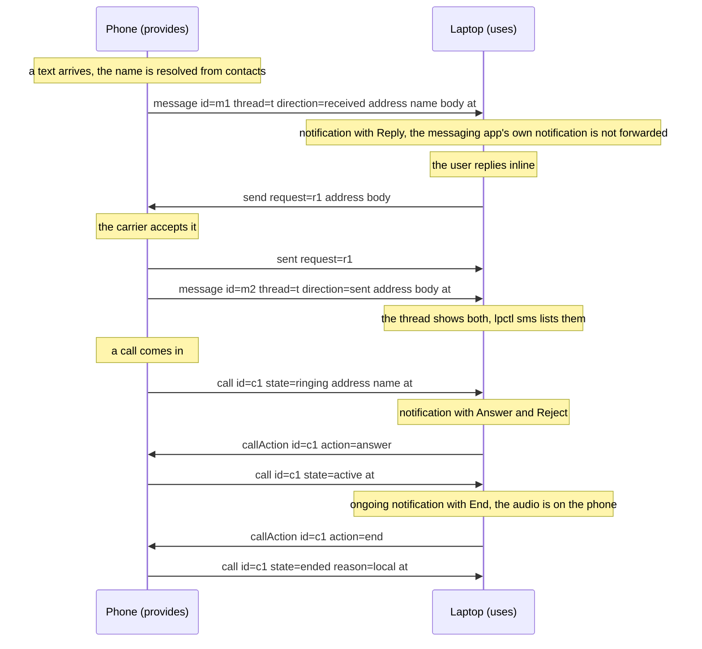
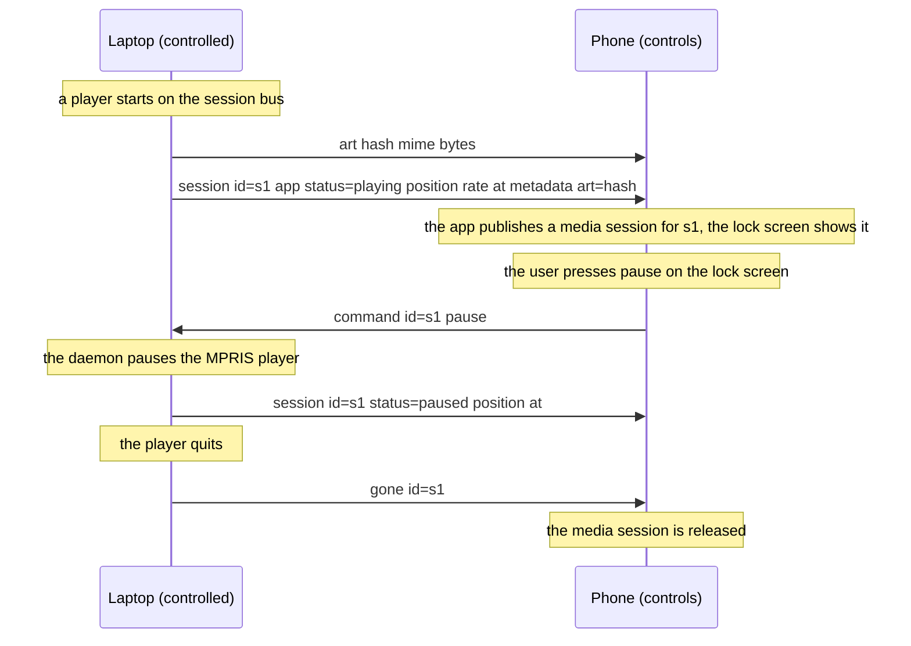
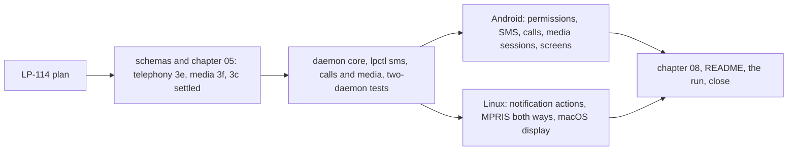

# Milestone 6: the phone's SMS and calls, and media control, among a person's devices

**Status:** Draft, for acceptance by the owner. Raised as the epic LP-111 on 2026-10-23 from
the feasibility assessment of the candidate capability families (shared input, remote
desktop, phone functions, audio and video): the phone functions are the most feasible, they
are user-scoped like notifications so they raise no device-principal question, macOS needs
nothing new but a sink, and they reuse the notification machinery of milestone 3. Media
control comes with them because it is cheap on Linux and Android and shares the shape.

## 1. Goal

One person, the Android phone, the Linux machine and the Mac of milestone 5. After this
milestone a text message that reaches the phone shows on both desktops within a second,
with the sender's name, and can be answered from either; a message composed on a desktop
leaves through the phone; an incoming call rings on the desktops with the caller's name
and can be answered or rejected there, and a number can be dialled from a desktop, the
audio staying on the phone. Whatever is playing on any device, a player on the Linux
machine or the phone's music app, can be paused, resumed, skipped and sought from the
others, with what is playing shown, and each device presents a peer's player as one of its
own so the desktop's media keys drive the phone and the phone's lock screen drives the
desktop.

Both are what a person expects of a phone and a computer that belong together, and both
are things KDE Connect proves a sideloaded app can do on Android. They are user-scoped
capabilities (chapter 10 section 3): a message is the person's, a player is the person's
session on that device, and between one person's devices their use needs no prompt (ADR
0015).

## 2. Non-goals for this milestone

Call audio on a desktop (a third-party Android app cannot capture or route the voice path;
a Linux machine can take a call's audio as a Bluetooth hands-free unit, which is a bridge
under [ADR 0010](../adr/0010-interop-bridges.md) and not LP traffic); being the default
SMS app on the phone (a message sent through LP is therefore not written to the phone's
message store, decision 4); MMS and RCS; synchronising message history (a bounded recent
window on request is all, decision 3); contacts as a capability (names are resolved on the
phone and travel with the message or call); the Mac emitting its own media state (the only
API is private and restricted since macOS 15.4; the Mac controls, decision 7); volume
control; a per-device choice of which peers see messages, which is LP-88; and any change
to the protocol's framing, sessions or trust.

## 3. Decisions

Protocol decisions are unchanged: a capability is advertised in a manifest, used on its own
stream, and a same-person use needs no prompt (chapter 05, ADR 0008, ADR 0015, ADR 0036).
Both families follow the two-direction convention of chapter 05 section 2. What this
milestone pins:

1. **Two families, both user-scoped.** `org.ligatureprotocol.capability.telephony`
   (chapter 05 section 3e, `schemas/capability.telephony.schema.json`) and
   `org.ligatureprotocol.capability.media` (section 3f,
   `schemas/capability.media.schema.json`). The telephony descriptor's `params` say
   `provides` (this device has the modem and forwards what arrives on it: the phone),
   `uses` (this device shows messages and calls and may act on them: the desktops, and the
   phone too, for a second phone later), and, for a provider, `sms` and `calls`, each true
   only while the platform permission behind it is granted, so the manifest changes live
   when the user grants or revokes one (chapter 05 section 2a). The media descriptor's
   `params` say `controlled` (this device reports its players and takes commands),
   `controls` (this device shows peers' players and sends commands) and `maxArtBytes`, as
   `maxIconBytes` bounds a notification icon. One stream per session per family carries
   both directions, as the clipboard and notifications do.
2. **The telephony vocabulary.** On the stream: `message` (provider to user: an `id` the
   provider chooses, stable for the message, a `thread` id, `direction` `received` or
   `sent`, `address` as the platform gives it and in E.164 where it can be normalised, the
   contact `name` the phone resolved if any, `body`, `at`); `send` (user to provider: a
   `request` id, `address`, `body`) answered by `sent` or `failed` with the `request` id
   and, for `failed`, a reason; `recent` (user to provider: a `count`) answered by a
   `message` per entry, newest last, with `direction` set, so a desktop that connects
   shows the latest conversation (decision 3); `call` (provider to user: an `id`, `state`
   `ringing`, `dialing`, `active` or `ended`, `address`, `name`, `at`, and for `ended` a
   `reason`), `callAction` (user to provider: `id`, `action` `answer` or `end`) and `dial`
   (user to provider: `address`). A `message` or `call` carries no attachment and no
   media; bodies are bounded at 16 KiB.
3. **Live messages, plus a recent window on request.** The provider forwards every
   message as it arrives, and every message sent from the phone's own messaging app too,
   which it sees by observing the platform's message store (decision 4 says why that
   matters). A user device may ask for `recent` once per session, with a count bounded at
   100 and 20 by default, and the provider answers from the message store. Nothing is
   stored on a user device beyond the session (chapter 09): a desktop keeps the messages
   it has shown in memory for `lpctl sms` to list, and loses them when the daemon stops.
   The phone's store is the platform's and LP never writes to it.
4. **A message sent through LP is forwarded back as `sent`.** Only the default SMS app
   may write to Android's message store, and LP's app is not it, so a message a desktop
   sends exists nowhere on the phone but in LP. The provider therefore emits a `message`
   with `direction` `sent` to every user device after `sent`, so both desktops show the
   conversation whole, and it is absent from the phone's messaging app. That is the price
   of not being the default SMS app, and the plan accepts it; a later milestone may offer
   the default-app role as an option.
5. **One call at a time, audio on the phone.** The provider reports the state of the
   current call as the platform reports it: `ringing` for an incoming call, `dialing` for
   an outgoing one, `active`, `ended` with the platform's reason. `answer` and `end` act
   through the platform's telecom service, `dial` places a call directly (the platform
   permission for it is a provider's `calls` prerequisite). A user device shows an active
   call as an ongoing notification with an End action and does nothing with audio. Holding,
   merging and a second call are reported as the platform's state and not acted on.
6. **How a user device shows and acts.** A received message is a local notification with
   the sender's name and the body, with a Reply action where the platform's notification
   service takes one with inline text (the freedesktop `inline-reply` capability, which
   the daemon checks on the session bus), else a Reply action that opens nothing and
   `lpctl sms reply` beside it. A ringing call is a notification with Answer and Reject
   actions; an active one has End. `lpctl sms` lists, sends and replies; `lpctl calls`
   shows, answers, ends and dials. This settles the open question in chapter 05 section
   3c: an action a user takes on a shown notification is carried back by the stream of the
   capability that posted it, never by the notifications family, which keeps its
   fire-and-dismiss shape. On the Mac, which shows notifications through AppleScript
   without actions until LP-94, `lpctl` is the only way to act; LP-94 adds the actions.
7. **Media sessions and their precedence.** A controlled device reports every player the
   platform exposes (every MPRIS player on the session bus on Linux, every active media
   session on Android) as a `session` with an `id` stable for the player's life, the app's
   `id` and `name`, `status` (`playing`, `paused`, `stopped`), `position` with a `rate` and
   the `at` it was sampled, so a controller extrapolates between updates, `metadata`
   (`title`, `artist`, `album`, `duration`), `canSeek`, `canGoNext`, `canGoPrevious`, and
   the hash of the art; `art` carries the hash, a MIME type and the bytes, sent once per
   session per connection before the first `session` that names it, cached for the
   session only, as icons are; `gone` names a session that ended. A controller sends
   `command` with a session `id` and one of `play`, `pause`, `playPause`, `next`,
   `previous`, `stop`, `seek` with a `position`. The wire has no precedence between
   sessions: a controller shows every session of every peer and treats as current the one
   that reported `playing` most recently, which is what a person means by "what is
   playing". The Mac advertises `controls` only (non-goals).
8. **A peer's player is presented as a local one.** On Linux the daemon registers each
   peer session as an MPRIS player on the session bus
   (`org.mpris.MediaPlayer2.ligature.<session>`), so the desktop's media keys, bar widgets
   and `playerctl` drive the phone's music with nothing new to learn; a local MPRIS
   player's own events are reported out the same way. On Android the app publishes a
   media session for the current peer session, so the lock screen, the notification and a
   headset's buttons drive the Linux player. On the Mac, `lpctl media` is the surface.
   A loop is impossible by construction: a presented session is never reported back as a
   local one (the daemon skips the players it registered itself, as a received
   notification is never emitted again).
9. **No duplicates with milestone 3.** The phone's messaging app and dialler post
   notifications that milestone 3 already forwards. To a peer that uses telephony the
   provider stops emitting the notifications of the default SMS app and of the dialler
   (it knows both from the platform's role manager), so a message or a call shows once,
   by the telephony family, with its actions. To a peer without telephony those
   notifications flow as before. Media notifications are ongoing and were never forwarded.
10. **Permissions on the phone are opt-in, in the app.** The app's settings screen offers
    SMS (receive, send, read for `recent`), calls (phone state, call log for the caller,
    answer, dial) and contacts (names), each granted separately through the platform's
    runtime prompt, and the descriptor reflects what is held. The notification listener the
    app already holds serves the media sessions. Nothing is asked at first run.
11. **What each platform advertises.** The phone: telephony `provides` with `sms` and
    `calls` as granted, `uses` false until a second phone exists, media `controlled` and
    `controls`. Linux: telephony `uses`, media `controlled` and `controls`. macOS:
    telephony `uses`, media `controls`. A device that advertises neither family is sent
    nothing of them, so the roll-out with an un-updated device changes nothing for it.
12. **Chapter 09.** Message bodies, numbers, names and what is playing travel only on the
    authenticated pairwise session to devices of the same person, are held in memory for
    the session on user devices and are never written by LP on any device. A desktop's
    notification history (a daemon that keeps closed notifications) is that platform's
    behaviour, recorded in chapter 08. A paired device that is lost can send a message as
    the person until it is revoked, which is already true of the clipboard and is the
    reason revocation is a gossiped fact (ADR 0003).

No decision above changes an accepted ADR: both families are capabilities under ADR 0008
on streams under ADR 0036, and the grant rule is ADR 0015's. The plan asks for no new ADR.

## 4. Exit criteria

- A text message sent to the phone from another number shows on the Linux machine and
  the Mac within a second of the phone's own notification, with the sender's name from
  the phone's contacts, and the phone's messaging-app notification is not forwarded
  beside it.
- A reply typed into the Linux notification, and one sent with `lpctl sms reply` on the
  Mac, reach the other number through the phone, and both desktops then list the reply in
  the thread; `lpctl sms send <number> <text>` from a desktop does the same to a new
  number.
- `lpctl sms list` on a desktop that has just connected shows the phone's twenty most
  recent messages, received and sent.
- A call to the phone rings on both desktops with the caller's name; Answer on the Linux
  notification connects the call on the phone, End from `lpctl calls end` on either
  desktop ends it, and Reject on the next call rejects it. `lpctl calls dial <number>`
  places a call from the phone. The phone's dialler notification is not forwarded beside
  the call.
- Music playing on the Linux machine shows on the phone's lock screen with title, artist
  and art and pauses, resumes and skips from there and from `lpctl media` on the Mac; the
  phone's music app shows as an MPRIS player on the Linux machine and pauses, resumes and
  skips from the desktop's media keys and from `lpctl media` on the Mac; a seek lands
  within a second of the position asked for.
- Position shown on a controller drifts by less than a second over a minute without an
  update, and a player that quits disappears from every controller.
- Revoking the SMS permission on the phone drops `sms` from its descriptor on every
  connected desktop without a restart; granting it again restores it.
- A desktop running the milestone 5 build against the phone sees neither family and keeps
  its clipboard, notifications and files.
- CI compiles both schemas, builds the daemon on Linux and macOS and the APK, and the
  two-daemon tests cover a message both ways with `recent`, a call through its states, a
  session with art, a command and `gone`, with in-memory providers and players.
- Everything is recorded on LP-111 from a run with the real devices, as the earlier
  milestones were.

## 5. Work breakdown

- LP-114. This plan.
- **Schemas and chapter 05.** `schemas/capability.telephony.schema.json` and
  `schemas/capability.media.schema.json` with the params and messages of decisions 1, 2
  and 7; chapter 05 sections 3e and 3f; section 3c's open question answered as decision 6
  says; the sentence in chapter 09 (decision 12).
- **Daemon core, `lpctl` and the two-daemon tests.** `lp-core` types for both families;
  `ligatured::telephony` with a `Telephony` trait a provider implements (the Android node)
  and a `TelephonySync` that routes messages, calls, sends and `recent` per peer and holds
  the session's messages for `lpctl sms`; `ligatured::media` with a `Players` trait
  (local players reported, commands applied) and a `Presenter` trait (a peer's session
  presented locally), and a `MediaSync` with the art cache and the no-loop rule of
  decision 8; the notification actions path from the display side back to the family
  that posted (decision 6); `lpctl sms`, `lpctl calls`, `lpctl media`; the tests with
  in-memory providers and players. `06-implementation-decisions.md` records the choices
  as they are made.
- **Android.** The settings screen with the three permission groups (decision 10); the
  SMS receiver, sender with its sent and failed results, the message-store observer for
  the phone's own sends and `recent`; call state through the telephony callback, answer
  and end through the telecom service, `dial` through the call intent; the role manager
  lookup that silences the messaging app's and the dialler's notifications to telephony
  users (decision 9); media sessions through the session manager and the published media
  session for a peer's current session; screens for messages, calls and players as the
  `lpctl` commands have them.
- **Linux and macOS.** On Linux, actions on the notifications the daemon posts
  (`inline-reply` where offered, the action signal otherwise); the MPRIS client that
  reports local players and applies commands, and the MPRIS server that presents peers'
  sessions (decision 8), both over the session bus the daemon already uses. On macOS,
  telephony `uses` with notifications without actions and `lpctl` to act; media
  `controls` through `lpctl media`.
- **Chapter 08, README, the run.** The platform notes per device, the README's "what
  works today" and roadmap, CLAUDE.md, the run with the real devices recorded on LP-111,
  and the milestone status.

## 6. Risks

- **Delivery to a non-default SMS app.** Android delivers the received-message broadcast
  to every app holding the receive permission, but a ROM may route differently, and
  LineageOS 24's behaviour on the owner's phone is confirmed by the first task on the
  phone before anything else is built on it. The fallback is observing the message store,
  which also carries received messages, at the cost of a short delay.
- **Answering a call programmatically.** The answer-calls permission is a runtime one and
  the telecom service honours it on stock Android; a ROM may refuse. If it does, Answer
  degrades to showing the call and the exit criterion is amended, recorded in the run.
- **The message that is not in the phone's app.** Decision 4 means a thread read on the
  phone lacks what was sent from a desktop. The run records how confusing that is in
  practice; the remedy is the default-app role, which is a later choice, not this one.
- **MPRIS variety.** Players implement MPRIS unevenly: some report no position, some no
  art, some ignore seek. The `can*` flags and absent fields carry that through, and the
  controller shows what it has. Art is bounded by `maxArtBytes` and sent once.
- **Media on the Mac.** Nothing reports the Mac's own players, and the plan accepts a Mac
  that controls only. If per-application scripting is wanted later it is a task of its
  own, not a change here.
- **Notification daemons without inline reply.** Omarchy's notification daemon is checked
  in the first Linux task; without `inline-reply` the Reply action can do nothing but
  point at `lpctl sms reply`, which is the exit criterion's fallback on that machine.
- **Bodies in notification history.** A desktop notification daemon that keeps a history
  keeps message bodies in it, which is that daemon's behaviour; chapter 08 says so and a
  later per-device setting (LP-88) can stop forwarding messages to a given desktop.
- **Two phones.** A second provider makes two sources of messages; the vocabulary keys
  everything by provider (the sender of the stream) and nothing merges, which is right,
  but no second phone exists to test it, so `uses` on the phone stays false.

## 7. After this milestone

Candidates, in no order: shared input (milestone 7, LP-112) and remote desktop (milestone
8, LP-113), which follow this one; the default-SMS-app role as an option; notification
actions on the Mac through LP-94; call audio over Bluetooth as an ADR 0010 bridge; a
per-device choice of which peers see messages and players (LP-88); the milestone 1
carry-overs (offline master keys, D-Bus for `lpctl`, the `share` family, groups, relays).
