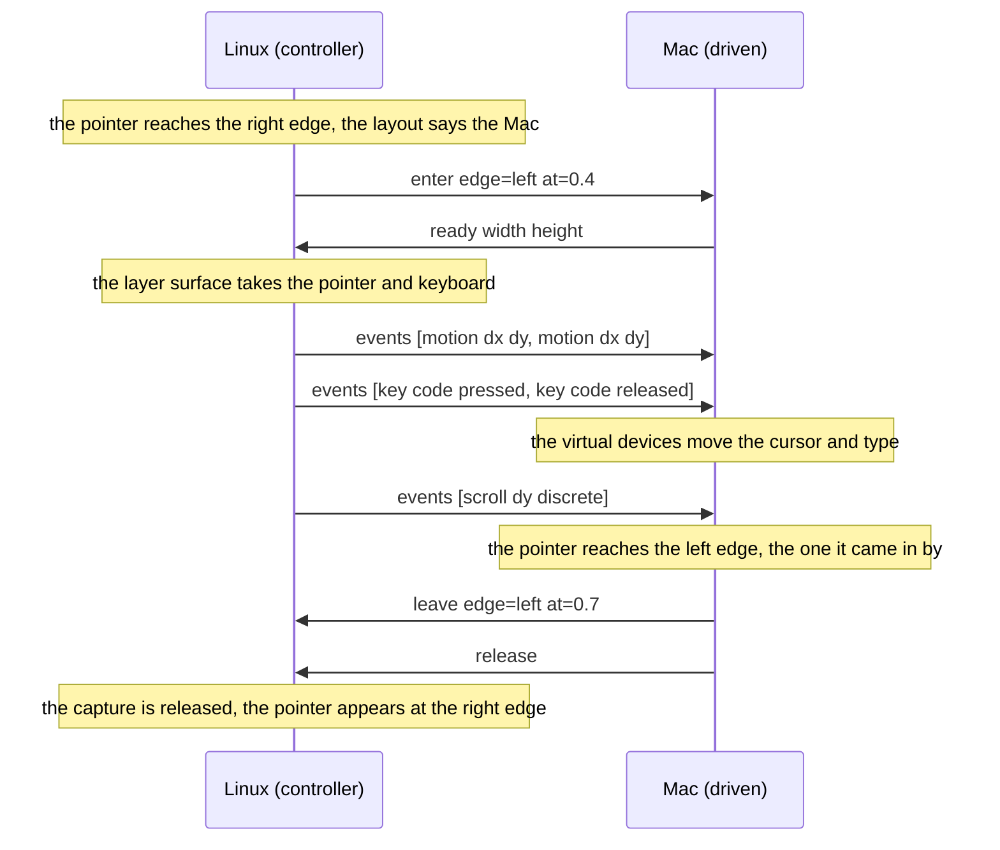
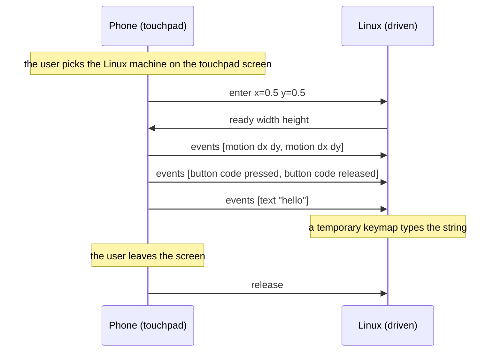
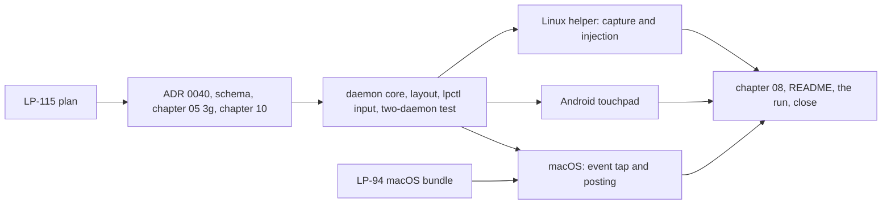

# Milestone 7: one keyboard and mouse across a person's desktops, and the phone as a touchpad

**Status:** Accepted by the owner on 2026-10-24; implemented as LP-141 to LP-145, LP-160 and
LP-161 under the epic LP-112, and the run with the real devices and the close are LP-146.
Raised on 2026-10-23
from the feasibility assessment of the candidate capability families: shared input is
feasible on both desktops today, it is the first device-scoped capability, so it pins the
device-principal question and the configuration of which edge leads where, and remote
desktop (milestone 8) reuses it for control.

## 1. Goal

One person, the Linux machine, the Mac and the Android phone of milestone 6. After this
milestone the keyboard and mouse of either desktop drive the other when the pointer
crosses the edge of the screen that leads to it, as a software KVM such as Deskflow or
lan-mouse does, with the pointer coming back the way it went; keyboard shortcuts,
modifiers and scrolling work on the driven device; and the phone's screen is a touchpad
and keyboard for either desktop. The round trip is measured, since a pointer that lags is
worse than none.

Input is a `device`-scoped capability (chapter 10 section 3): a keyboard and mouse belong
to the device, not to an account on it, and a request to drive a device is answered by the
person present on it. Between one person's own devices that is implicit, as user-scoped
use is (chapter 10 section 6, ADR 0015). The daemons today run a person's binding only,
so this milestone also decides who offers a device-scoped capability until the principal
service exists (decision 2).

## 2. Non-goals for this milestone

Controlling the phone from a desktop (Android lets a third-party app dispatch gestures
through an accessibility service and nothing more precise without privileged access; the
phone sends and never accepts); game controllers, pens, touch screens and tablets; remote
desktop viewing, which is milestone 8; a graphical layout editor, which is LP-88's
configuration app; clipboard and drag-and-drop between the desktops (the clipboard
already crosses, drag-and-drop does not and is not attempted); a QUIC datagram path
(decision 5 measures and names the ADR); sharing input with another person's device,
which comes with the grant rules of chapter 10 section 6 and groups; and any change to
the protocol's framing, sessions or trust.

## 3. Decisions

Protocol decisions are unchanged: a capability is advertised in a manifest, used on its own
stream, and a same-person use needs no prompt (chapter 05, ADR 0008, ADR 0015, ADR 0036).
What this milestone pins:

1. **One family, device-scoped.** `org.ligatureprotocol.capability.input` (chapter 05
   section 3g, `schemas/capability.input.schema.json`), `scope` `device`, the first of
   its kind. The descriptor's `params` follow the two-direction convention: `accepts`
   (this device injects what it is sent), `provides` (this device captures its keyboard
   and mouse and sends them), `absolute` (this device accepts pointer positions as
   fractions of its screen beside relative motion, which milestone 8 uses) and `text`
   (this device can type a string of characters, decision 6). The desktops advertise all
   four; the phone advertises `provides` only.
2. **A binding stands in for the principal on a single-user device.** Chapter 10 gives a
   device-scoped capability to the device principal, which on Linux is a system service
   and on macOS a launchd daemon, neither of which exists yet. Until they do, the account
   daemon of a device with one account offers the device-scoped capabilities in its own
   manifest, marked by the descriptor's `scope` alone, and a peer treats such a
   descriptor exactly as it would one from a principal: the grant question is who is
   present on the device, and for a person's own desktop that is the person. When the
   principal service arrives it offers the same descriptors and the binding stops, so the
   owner changes and nothing else. This is **ADR 0040**, written and accepted before the
   schema, since it touches the ownership model of ADR 0023 without changing it.
3. **The event vocabulary.** On the stream, from the controller to the controlled device:
   `enter` (the pointer arrives: the `edge` it crosses, `left`, `right`, `top` or
   `bottom`, and `at`, its position along that edge as a fraction, or `x` and `y` as
   fractions for an absolute entry) and `events`, a list of up to a frame's worth of
   `motion` (`dx`, `dy` in pixels of the controller, decision 4), `position` (`x`, `y`
   fractions, absolute), `button` (`code`, `pressed`), `scroll` (`dx`, `dy`, with
   `discrete` for wheel steps), `key` (`code`, `pressed`) and `text` (a string). From the
   controlled device: `leave` (the pointer reached the `edge` to go back by, at `at`) and
   `ready` after `enter` with the controlled screen's `width` and `height` in pixels so
   the controller scales motion. Either side sends `release` to lift every held key and
   button, and does so itself on `leave` and on disconnect, so nothing stays pressed.
4. **Codes, meanings and layouts.** A key travels as its Linux evdev key code, the code
   space every platform maps to and from (macOS virtual key codes through a table, Android
   key codes through another), which names the physical key as USB HID does, and, from a
   controller that knows its layout, as what it means there: Synergy's key ID and the
   controller's modifier mask (ADR 0043). The controlled device types the meaning with its
   own keys, so a key typed on a British Mac into a Linux machine set to US yields what the
   Mac's keycap says, and places a key that carries no meaning by its code, as a USB
   keyboard plugged into it would. Buttons are evdev button codes. Motion is relative, in
   the controller's pixels, scaled by the ratio of the two screens' widths as `ready`
   reports them, so a sweep across one screen is a sweep across the other; acceleration
   is applied on the controller, where the device is, and never again.
5. **Small messages on the stream, measured.** Events are batched per input frame into one
   `events` message, which keeps a message small (tens of bytes) and the stream in order,
   as ADR 0036 wants. The reference implementation measures the round trip from a
   captured event to the injected one on the LAN; the plan expects a few milliseconds
   over the QUIC stream. If loss on wireless shows the stream's head-of-line blocking,
   the remedy is QUIC datagrams for `events`, which would be **ADR 0041** beside ADR
   0036; this milestone records the measurement and does not write that ADR. The
   measurement has a hook on the wire (LP-141): the controller may set `seq` on an
   `events` batch and the driven device answers `injected` with it once the batch is
   in its input system.
6. **Text as well as keys.** The phone's keyboard produces characters, not key codes, and
   a character may not exist on the controlled device's layout. A `text` event carries a
   string, and the controlled device types it: on macOS as a keyboard event with the
   string attached, on Linux through a temporary keymap on the virtual keyboard that maps
   the characters, as `wtype` does. A desktop controller sends keys, never text.
7. **The layout is local and set by hand.** Each device records which of its edges leads
   to which peer, by the peer's device key, in its store (there is no configuration file,
   milestone 1): `lpctl input layout set right <device>`, `lpctl input layout` to show,
   `unset` to clear. The pointer returns through the edge it entered by: a driven device
   sends `leave` when the pointer reaches that edge, and never follows its own layout
   while driven, so two devices need one mapping each and nothing cycles. The layout is
   the hook LP-88 keeps open: making it a signed fact so one app configures the whole
   set is that ticket's decision, not this one's.
8. **Capture and injection on Linux.** The Wayland helper of milestones 1 and 5 grows
   both. Injection uses the virtual pointer and virtual keyboard protocols, which
   Hyprland implements, with the seat's own keymap on the virtual keyboard so evdev codes
   land as the layout says. Capture uses a layer-shell surface on the configured edge
   that takes the pointer with the pointer-constraints protocol and reads relative motion
   while driving, and takes the keyboard with exclusive interactivity, as lan-mouse does,
   because Hyprland's portal does not implement the InputCapture portal (checked at the
   start of the Linux task; if it does, the portal is preferred and recorded in the
   implementation decisions). An evdev grab is the fallback and needs membership of the
   `input` group, which the task documents if it comes to that.
9. **Capture and injection on macOS, after LP-94.** Injection posts events through
   Quartz; capture is an event tap that swallows events while driving, with the cursor
   warped to the edge and hidden. Both need the Accessibility and Input Monitoring
   permissions, which macOS grants to an application bundle, so **LP-94** (the daemon in
   its own bundle) precedes the macOS task, and the Mac advertises `accepts` and
   `provides` only once the permissions are held, which the daemon checks at start and
   when the manifest is rebuilt.
10. **The phone as a touchpad.** A screen in the app: one finger moves, a tap clicks, two
    fingers scroll, a long press drags, a keyboard field types `text`, with a picker for
    which desktop. The phone's `enter` is an absolute entry at the pointer's current
    position (the desktop answers `ready` with its size and keeps the pointer where it
    is), and leaving the screen sends `release`; there is no edge.
11. **Letting go.** Control returns when the pointer leaves through its edge (decision 7),
    when the driven device disconnects (the controller releases the capture at once and
    the driven device lifts every key), and on the release chord on the controller,
    both Control keys together, for a driven device that has frozen; `lpctl input
    release` does the same from a terminal.
12. **Same person, no prompt.** The devices of this milestone belong to one person, who
    is present on each, so a drive needs no grant and no prompt (chapter 10 section 6).
    The manifest to another person's device does not list the family at all (audience
    filtering, chapter 05 section 2a); what a prompt looks like when it does is the
    cross-person grant work that comes with groups.
13. **Chapter 09.** Input is the first capability by which a peer acts on a device rather
    than reads from or shows on it. A paired device of the same person has the person's
    authority, which is the design, and a lost one can type on the desktop until it is
    revoked, which is why revocation is a gossiped fact that takes effect at the next
    session start (ADR 0003, chapter 06). The driven device shows nothing while driven
    (the pointer moving is the indication), and the threat model records that a
    compromised peer of the same person is the one this family cannot defend against.

Decision 2 is a new ADR; the rest change no accepted one. The datagram question is named
and deferred.

## 4. Exit criteria

- With the Linux machine's right edge mapped to the Mac, moving the pointer off that edge
  moves it onto the Mac's screen at the matching height, where it moves, clicks, scrolls
  and types, and moving it back off the Mac's left edge returns it to the Linux screen;
  the same from the Mac with its layout mapped to the Linux machine.
- Shortcuts with modifiers (a copy, a window switch, a shifted letter) and a scroll wheel
  work on the driven device, and nothing stays pressed after the pointer returns or after
  the driven device's daemon is stopped mid-drive, which returns the pointer at once.
- The round trip from a captured motion event on the controller to the injected one on
  the driven device, measured by the daemons over the LAN, is reported, and is under ten
  milliseconds at the median.
- The phone's touchpad screen moves the pointer on either desktop, taps click, two fingers
  scroll, and its keyboard field types into a text editor there, including a character
  that is not on the desktop's layout.
- The release chord on the controller returns control, and `lpctl input release` does.
- A desktop running the milestone 6 build sees no `input` descriptor and nothing else
  changes for it; a manifest built for another person's device would not list the family
  (covered by the two-daemon test).
- On the Mac, the family is advertised only once the Accessibility and Input Monitoring
  permissions are granted to the LP-94 bundle, and revoking one drops it from the manifest
  of every connected peer.
- CI compiles the schema, builds the daemon on Linux and macOS and the APK, and the
  two-daemon test covers an edge entry and return with motion, keys and scroll, an
  absolute entry, `text`, a disconnect mid-drive and the manifest filtering, with
  in-memory capture and injection.
- Everything is recorded on LP-112 from a run with the real devices.

## 5. Work breakdown

- LP-115. This plan.
- **ADR 0040, schema and spec.** The ADR of decision 2; `schemas/capability.input.schema.json`
  with the params and events of decisions 1, 3 and 4; chapter 05 section 3g; a sentence in
  chapter 10 section 3 pointing at the ADR; the sentences in chapter 09 (decision 13).
- **Daemon core, layout, `lpctl input` and the two-daemon test.** `lp-core` types for the
  family; `ligatured::input` with a `Capture` trait (the controller's device, taken and
  released, reporting events) and an `Inject` trait (the driven device's), an `InputSync`
  that follows the layout, runs the handoff, batches events per frame, scales motion,
  lifts everything on `leave` and disconnect, honours the release chord and measures the
  round trip; the layout in the store; `lpctl input layout`, `status`, `release`; the
  test with in-memory capture and injection. `07-implementation-decisions.md` records the
  choices as they are made.
- **Linux helper.** Injection through the virtual pointer and virtual keyboard protocols
  with the seat's keymap and the temporary keymap for `text`; capture through the
  layer-shell edge surface with pointer constraints and exclusive keyboard interactivity,
  or the InputCapture portal if Hyprland's implements it by then; the helper's stdio
  frames grow by both.
- **macOS.** After LP-94: the event tap and cursor warp for capture, event posting for
  injection with the string form for `text`, the permission checks that gate the
  descriptor.
- **Android touchpad.** The screen of decision 10 and the node's `provides` side.
- **Chapter 08, README, the run.** The platform notes per device, the README, CLAUDE.md,
  the run with the real devices recorded on LP-112, the measurement, and the milestone
  status.

## 6. Risks

- **Hyprland's portal.** If the InputCapture portal is unavailable, the layer-shell
  capture is a technique rather than an API: it works on wlroots-style compositors and
  Hyprland today, and may need adjusting across Hyprland releases. The evdev grab is the
  fallback and needs a group membership. The task starts by checking both and records
  what it found.
- **Latency over the stream.** A QUIC stream retransmits a lost packet before delivering
  what follows; on a clean LAN the measured round trip should be a few milliseconds, on a
  congested wireless link it may stutter. The measurement is an exit criterion and ADR
  0041 is the named remedy.
- **The Mac's permissions.** Accessibility and Input Monitoring are granted per bundle
  and reset when the bundle's signature changes; a rebuilt daemon may lose them until the
  user grants again. LP-94's bundle and its signing, even ad hoc, decide how often that
  happens, and the task records it.
- **Key code mapping.** The three code tables (evdev, macOS, Android) cover the common
  keys; media keys, function rows and laptop specials differ and some will not map. The
  run records which, and an unmapped key is dropped, never guessed.
- **Text injection on Wayland.** The temporary keymap trick types any character but
  swaps the virtual keyboard's keymap while it does, which a few applications notice as
  a layout change. Accepted for the phone's keyboard, where it is the only way.
- **Stuck input.** A key held when the connection drops would stay pressed on the driven
  device without `release` on disconnect; the driven side lifts everything itself when the
  session ends, whether or not a `release` arrived.
- **A frozen driven device.** The controller's capture is local, so a driven device that
  stops injecting leaves the user with a captured pointer; the release chord of decision
  11 is why it exists.

## 7. After this milestone

Candidates, in no order: remote desktop (milestone 8, LP-113), which drives a watched
screen with this family's absolute events; ADR 0041 if the measurement calls for it; the
principal service that takes the family over from the binding (ADR 0040's end state); the
layout as a signed fact and its app (LP-88); input to a group device under the grant rules
of chapter 10 when groups arrive.
