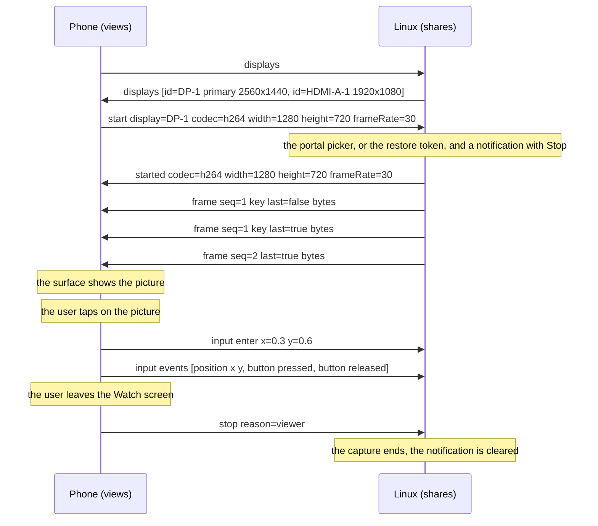
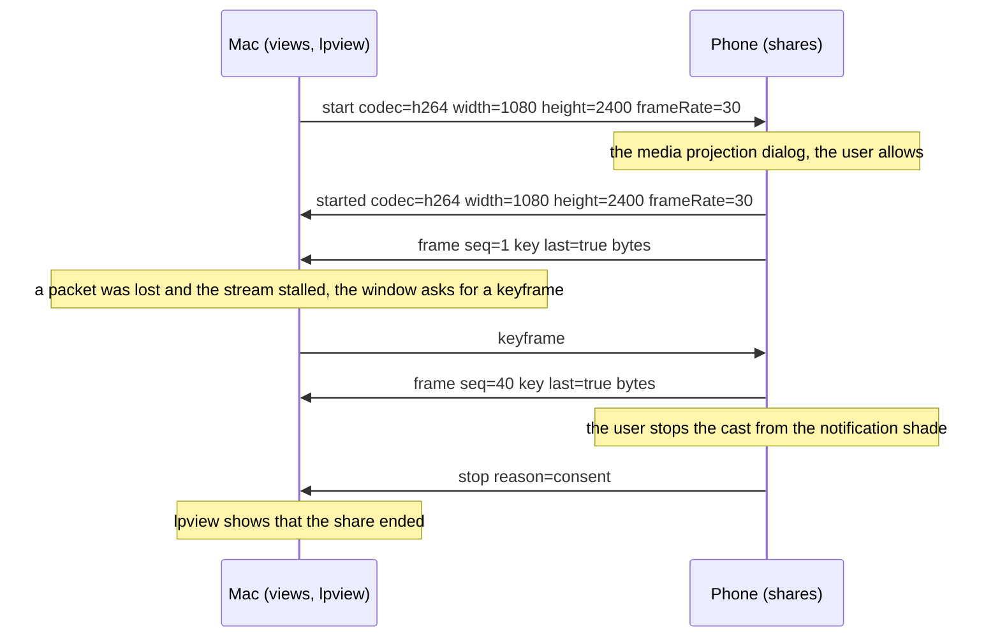
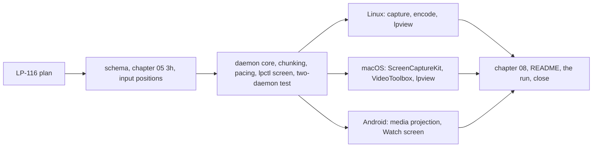

# Milestone 8: a device's screen viewed, then controlled, from another of the person's devices

**Status:** Accepted by the owner on 2026-10-24; implemented as LP-147 to LP-151 under the
epic LP-113, with the negotiated picture format of ADR 0044 as LP-162, and the run
with the real devices and the close are LP-152. Raised on 2026-10-23
from the feasibility assessment of the candidate capability families: viewing is feasible
on all three platforms, with the phone as viewer the easy end, and control is the `input`
family of milestone 7 with absolute positions; the new work is capture, encoding, transport
and a viewer on each platform.

## 1. Goal

One person, the Linux machine, the Mac and the Android phone of milestone 7. After this
milestone the screen of either desktop, or of the phone, can be watched live on any other
of the three, at a usable rate with the latency measured; a watched desktop can be driven
from the viewer, the pointer landing where it is put in the picture and typing going
through; and a share ends cleanly however it ends. The picture is encoded with the
platform's hardware encoder where it has one and carried on the session, which already
gives the share mutual authentication, encryption and flow control.

Screen sharing is `device`-scoped (chapter 10 section 3), offered by the binding standing
in for the principal under ADR 0040 (milestone 7), and between one person's own devices it
needs no LP prompt: the platform's own consent, where the platform has one, is the gate
(decision 6).

## 2. Non-goals for this milestone

Audio with the picture (a later milestone on audio and video, which needs the datagram
decision this one measures for); controlling the phone, as milestone 7 says; recording or
screenshots; more than one viewer per share (a second viewer is a second share and a
second encode); sharing a window rather than a display; sharing with another person's
device (a device-scoped grant across people under chapter 10 section 6, which comes with
groups); a desktop viewer with anything beyond a window that shows the picture and passes
input; a QUIC datagram path (decision 5 measures and names the ADR); and any change to the
protocol's sessions or trust.

## 3. Decisions

Protocol decisions are unchanged: a capability is advertised in a manifest, used on its own
stream, and a same-person use needs no prompt (chapter 05, ADR 0008, ADR 0015, ADR 0036).
ADR 0036 bounds a message at 1 MiB unless a family says otherwise, which decision 4 does by
chunking rather than by a larger bound. What this milestone pins:

1. **One family, device-scoped.** `org.ligatureprotocol.capability.screen` (chapter 05
   section 3h, `schemas/capability.screen.schema.json`), `scope` `device`, offered under
   ADR 0040 as `input` is. The descriptor's `params` follow the two-direction convention:
   `shares` (this device captures and encodes a display), `views` (this device decodes
   and shows one), `encodes` and `decodes` (the picture formats it encodes and decodes,
   in preference order, ADR 0044), `maxWidth` and `maxHeight` (the largest picture a viewer takes),
   and `maxFrameRate`. The desktops advertise both directions; the phone advertises both
   too, its share behind the platform's consent (decision 6).
2. **The share vocabulary.** On the stream, which the viewer opens: `displays` (viewer to
   sharer) answered by `displays` listing each display's `id`, `name`, `width`, `height`
   and whether it is primary; `start` (viewer to sharer: a display `id` or none for the
   primary, the `formats` it takes, the largest `width` and `height` it wants, the
   `frameRate` it wants) answered by `started` (the `format`, `width`, `height` and `frameRate` the
   sharer settled on, which may be smaller) or `refused` with a reason (no consent, no
   encoder, busy); `frame` messages (decision 4); `keyframe` (viewer to sharer: send one
   now, after a loss or a late join); `stop` from either side with a reason (`viewer`,
   `sharer`, `consent`, the platform withdrew it). One stream carries one share for its
   life; stopping closes the stream.
3. **H.264 first, as a byte stream.** The codec of this milestone is H.264 in Annex B form
   with the parameter sets repeated in every keyframe, so a decoder can start at any
   keyframe and a viewer that joins late asks for one. Each platform's hardware encoder
   and decoder produce and take it (VA-API and software on Linux, VideoToolbox on macOS,
   MediaCodec on Android), and it is the one codec all three are sure to have. A share's
   format is H.264 with its chroma sampling, 4:2:0 everywhere and 4:4:4 where both ends
   handle it, offered by the viewer and picked by the sharer (ADR 0044), so a later
   milestone can add AV1 or VP9 without a new message. The sharer
   scales the picture down to the viewer's `maxWidth` and `maxHeight` keeping its aspect,
   and never up.
4. **Frames are chunked within the message bound.** A keyframe at a large resolution can
   exceed 1 MiB. A `frame` carries `seq`, `at` (the capture time), `key` (whether it is a
   keyframe), `last` (whether this is the frame's final chunk) and `bytes` of up to 256
   KiB, the chunk size `files` uses; a frame is the concatenation of its chunks in order,
   which the stream guarantees. So no message exceeds the bound and ADR 0036 stands as it
   is. The sharer paces frames to the agreed rate and drops rather than queues when the
   stream's flow control holds it back, so the picture stays current rather than complete.
5. **The reliable stream first, measured.** A video share wants unreliable delivery: a lost
   packet should cost one frame, not stall the ones behind it. On a LAN the loss is rare
   and a QUIC stream serves; on wireless it may stutter. This milestone runs on the stream,
   measures glass-to-glass latency and the stall rate on the owner's network, and records
   them. If they call for it, QUIC datagrams for `frame` are **ADR 0041**, the same ADR
   milestone 7 names for `events`, and this milestone does not write it.
6. **Consent is the platform's, once per share.** On Android a share starts with the media
   projection dialog every time and runs in a foreground service of the media projection
   type, with the platform's cast indicator showing. On macOS the Screen Recording
   permission is granted once to the LP-94 bundle and the platform shows its own
   indicator. On Linux the ScreenCast portal shows its picker and the daemon keeps the
   restore token it hands back, so a second share of the same display does not ask again;
   where the portal is unavailable the helper captures through `wlr-screencopy` without a
   prompt, and in either case the daemon posts a local notification "sharing <display>
   with <device>" with a Stop action for the share's life, since the compositor shows no
   indicator. Between one person's devices LP itself asks nothing (chapter 10 section 6);
   the platform's consent is the gate, and a withdrawn consent ends the share with `stop`
   `consent`.
7. **Control is `input` with absolute positions.** A viewer that drives sends an `enter`
   with `x` and `y` on the `input` stream (milestone 7, decision 10) and then `position`
   events, each a fraction of the shared display, which the viewer computes from where
   the pointer is in its picture; keys, buttons, scroll and `text` are as milestone 7
   has them. The shared display is the one the `input` positions refer to, so a
   multi-monitor sharer maps a fraction to that display's area. Viewing and driving are
   two streams of two families on one session, and a viewer may watch without driving.
8. **Viewers.** On the desktops, `lpview <device>` is a small program beside `lpctl`: a
   window that shows the picture, scaled to fit, and when focused captures the pointer and
   keyboard inside it as `input` events, with a key chord to release (the chord of
   milestone 7). It talks to the daemon over the control socket, which carries the
   decoded picture as a shared buffer or the encoded stream for the viewer to decode; the
   implementation decisions choose, with GStreamer the proposal on Linux for decode and
   display and VideoToolbox with AppKit on macOS. On the phone a Watch screen lists the
   desktops that share, shows the picture in a surface, and drives with touch (a tap
   clicks where it lands, a drag moves the pointer, two fingers scroll, the keyboard
   types). `lpctl screen displays`, `start`, `stop` and `status` drive a share without a
   viewer, for tests.
9. **Capture and encode per platform.** Linux: PipeWire through the portal (or the helper's
   `wlr-screencopy`) into the encoder, GStreamer proposed for the pipeline, VA-API where
   the machine has it and software otherwise. macOS: ScreenCaptureKit into VideoToolbox.
   Android: the media projection's virtual display into a MediaCodec encoder surface. The
   encoder is set for low latency: no B-frames, a keyframe on request and otherwise every
   few seconds, a bit rate chosen from the size and rate.
10. **Chapter 09.** A screen is the most sensitive thing LP has carried: everything on it,
    including other people's messages and secrets shown briefly. It travels only on the
    authenticated pairwise session to a device of the same person, nothing of it is
    stored, and the platform's indicator or the daemon's notification shows while it is
    shared. A paired device that is lost can watch the screen until it is revoked, which
    adds weight to revocation taking effect at the next session start, and the threat
    model says so beside milestone 7's sentence.

No decision above changes an accepted ADR: chunking keeps ADR 0036's bound, the family is a
capability under ADR 0008 offered under ADR 0040, and the grant rule is chapter 10's. The
datagram ADR is named and deferred.

## 4. Exit criteria

- The Linux machine's primary display is watched in `lpview` on the Mac and in the app on
  the phone, and the Mac's display on the Linux machine and the phone, at the agreed rate
  with the picture current (a clock on the shared screen reads within the measured
  latency on the viewer).
- The phone's screen is watched on a desktop after its media projection dialog, and
  stopping the cast on the phone ends the share on the desktop cleanly.
- Glass-to-glass latency on the owner's network, measured from a change on the shared
  screen to its appearance on the viewer, is reported for each pair, with the stall rate
  over a minute; the plan expects under 150 milliseconds on the wired-to-wireless pairs.
- From the phone and from the other desktop, a watched desktop is driven: a tap on the
  picture clicks where it lands, a drag moves the pointer there, typing goes into an editor,
  and the release chord in `lpview` gives the pointer back.
- A second display of the Linux machine is listed and can be shared in place of the
  primary, with control mapped to it.
- A share ends cleanly when the viewer closes, when `lpctl screen stop` runs on the
  sharer, when the platform withdraws consent, and when the session drops; the next share
  between the same two works.
- Clipboard text still crosses in under a second while a share runs, and a file transfer
  started during a share completes.
- A device running the milestone 7 build sees no `screen` descriptor and nothing else
  changes for it.
- CI compiles the schema, builds the daemon on Linux and macOS and the APK, and the
  two-daemon test covers `displays`, a share with chunked keyframes and a late keyframe
  request, a stop from each side and from consent, and the pacing that drops rather than
  queues, with synthetic frames and no encoder.
- Everything is recorded on LP-113 from a run with the real devices.

## 5. Work breakdown

- LP-116. This plan.
- **Schema and spec.** `schemas/capability.screen.schema.json` with the params and
  messages of decisions 1, 2 and 4; chapter 05 section 3h; the absolute entry and
  `position` in section 3g if milestone 7 left them minimal; the sentences in chapter 09
  (decision 10).
- **Daemon core, `lpctl screen` and the two-daemon test.** `lp-core` types for the
  family; `ligatured::screen` with a `Capture` trait (displays listed, a share started
  with a size and rate, encoded frames delivered, stopped) and a `Viewer` sink, a
  `ScreenSync` that negotiates, chunks and reassembles frames, paces and drops, answers
  `keyframe`, and ends a share on every path of decision 2; the control-socket carriage
  of a share to `lpview`; `lpctl screen`; the test with synthetic frames.
  `08-implementation-decisions.md` records the choices as they are made, the viewer's
  architecture first.
- **Linux.** The portal capture with restore tokens and the `wlr-screencopy` fallback in
  the helper, the encoder pipeline, the sharing notification with Stop, and `lpview`
  with decode, display and input capture.
- **macOS.** ScreenCaptureKit and VideoToolbox behind the LP-94 bundle's permission, and
  `lpview` there.
- **Android.** The media projection service and encoder for sharing, the Watch screen with
  decode into a surface and touch as `input` for viewing.
- **Chapter 08, README, the run.** The platform notes per device, the README, CLAUDE.md,
  the run with the real devices recorded on LP-113, the measurements, and the milestone
  status.

## 6. Risks

- **Stalls on the stream.** Decision 5's measurement may show that a reliable stream is
  not good enough on the owner's wireless link; the picture then stutters rather than
  degrades. The milestone still completes on the stream, and ADR 0041 is the named next
  step, with the measurement as its evidence.
- **Encoder availability.** VA-API on the Linux machine depends on the GPU and driver;
  software H.264 at 1440p and 30 frames costs a core or two. The sharer scales down to
  what the viewer asked for before encoding, and the run records the CPU cost.
- **A viewer is a new program.** `lpview` is the first graphical program in the workspace,
  with a windowing and decoding dependency on each desktop; the implementation decisions
  pick the smallest that works and keep it out of the daemon.
- **Consent dialogs.** The portal picker on Linux and the projection dialog on Android
  appear on the sharer, which may be across the room; a share started from the viewer
  waits for it, and a `refused` after a timeout is a normal outcome, shown as such.
- **Control mapping.** A scaled or letterboxed picture maps viewer coordinates to the
  shared display through the `started` size and the display's aspect; an off-by-one in
  that mapping puts clicks beside their target, and the two-daemon test covers the
  arithmetic.
- **Phone decode at desktop resolutions.** The phone takes what its decoder can; its
  `maxWidth` and `maxHeight` keep a 4K desktop at 1080p on the wire.
- **Secrets on screen.** Decision 10's notification and the platform indicators are the
  mitigation; the share is to the person's own device, and anyone who holds that device
  already holds the person's authority on every other capability.

## 7. After this milestone

Candidates, in no order: ADR 0041 and the datagram path for frames and input events; audio
with the picture, then microphone and camera as devices (the audio and video family of the
assessment); AV1 where the hardware has it; a window share; a share to a group device such
as a TV, which needs groups and the device-scoped grant rules; the principal service that
takes `screen` and `input` over from the binding.
