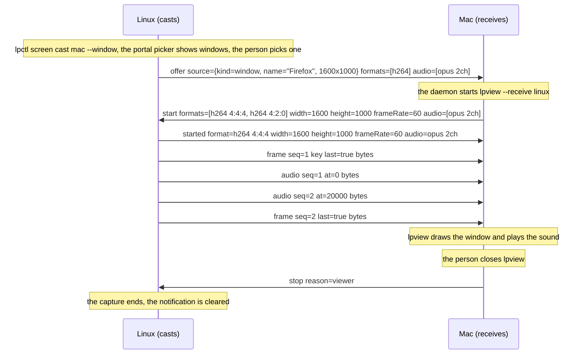
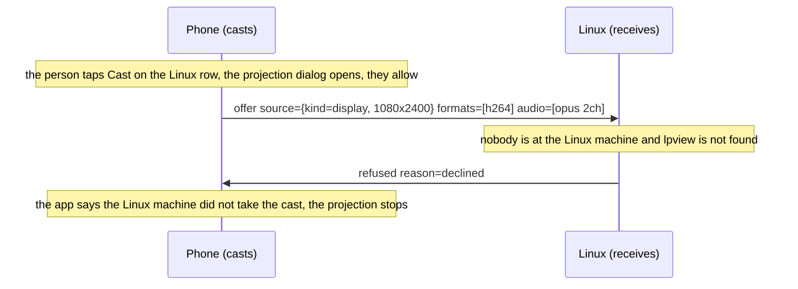
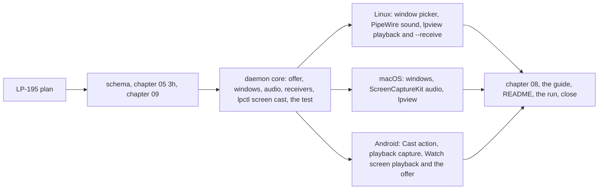

# Milestone 9: a screen or a window cast to another of the person's devices, with its sound

**Status:** Draft, for acceptance by the owner. Raised as the epic LP-193 on 2026-11-08, the
day milestone 8 closed, at the owner's request: cast my screen or one application to a remote
device, with its sound, and hear a device I watch or control. These are the window share and
the audio with the picture that milestone 8 section 7 named as its candidates; the cast
direction is new. The daemon core, the encoders, `lpview` and the Watch screen of milestone 8
carry it, so the new work is a second way to start a share, a second kind of source, a sound
capture and a player on each platform, and the receivers.

## 1. Goal

One person, the Linux machine, the Mac and the Android phone of milestone 8. After this
milestone a share of the `screen` family can start from the sharing side: the person at a
device picks a display or a window and a device to cast to, and the picture appears there, in
`lpview` on a desktop or the Watch screen on the phone, without anyone at the receiver asking
for it. Every share, cast or watched, can carry the shared device's sound beside its picture,
so a desktop watched from the phone is heard as well as seen, and a film cast from the phone to
a desktop plays with its soundtrack. A share ends cleanly however it ends, as before.

Screen sharing stays `device`-scoped (chapter 10 section 3), offered by the binding standing
in for the principal under ADR 0040, and between one person's own devices it needs no LP
prompt: the platform's own consent is the gate (milestone 8 decision 6). A cast puts that
consent where the person is, since the picker or dialog now appears on the device they are
holding.

## 2. Non-goals for this milestone

Sound alone (music from the phone to a desktop's speakers is an `audio` family of its own,
section 7); the microphone and the camera (milestone 10); a cast to a group device such as a
TV (a device-scoped grant across people under chapter 10 section 6, which comes with groups);
recording; more than one receiver per cast (a second receiver is a second share and a second
encode); driving a window (its place on the screen moves, so no input region is set for it);
a window as a source on Linux without the portal, since `wlr-screencopy` copies outputs only;
the phone choosing between one app and the whole screen, which its dialog decides; a QUIC
datagram path (ADR 0041 stays deferred, and would carry audio and video alike); any codec
beyond H.264 and Opus; and any change to the protocol's sessions or trust.

## 3. Decisions

Protocol decisions are unchanged: a capability is advertised in a manifest, used on its own
stream, and a same-person use needs no prompt (chapter 05, ADR 0008, ADR 0015, ADR 0036). ADR
0036 says every stream begins with a header naming its purpose and says nothing about which
side opens it; the clipboard's stream is opened by whichever side has a change. What this
milestone pins:

1. **A share may start from either side.** Today the viewer opens the stream and sends
   `start`. A cast is the sharer opening the stream and sending `offer`: its `source`
   (decision 2), the `formats` it encodes now in preference order, the `maxFrameRate` it will
   pace to, and the `audio` formats it can send (decision 3), absent when it has no sound to
   give. The receiver answers `start` exactly as a viewer does, naming no display since the
   stream has its source, with the formats, size, rate and audio it takes, and the share runs
   from `started` on as milestone 8 defines it: the same `frame`, `keyframe` and `stop`, the
   same chunking and pacing, the same `input` across the second stream for a display. A
   receiver that does not take the offer answers `refused`, which until now only a sharer
   sent, with `declined` (nobody took it within a minute, or the person closed it),
   `no-decoder` (none of the offered formats) or `busy`; the stream ends after it. A device
   that takes offers and shows them unasked says so with a new descriptor param, `receives`;
   a caster never offers to a device without it, and a milestone 8 device, which lacks it,
   is never sent an `offer` and never sees a change.
2. **Windows beside displays.** A `source` is a map with `kind` (`display` or `window`),
   `id`, `name`, `width`, `height` and `scale`, the display fields of milestone 8, and for a
   window the `app` that owns it. The `displays` answer gains `windows`, listed where the
   platform lets a sharer pick a window by id without a picker (macOS through
   ScreenCaptureKit); `start` may name a `window` instead of a `display`, and a sharer that
   has no such window refuses `no-display`. On Linux the portal's own picker chooses the
   window, so a Linux sharer lists none and a window leaves it only as a cast, from the
   picker on the caster's side. A window's picture is sized from the window at the start and
   that size holds for the share, as a display's does; a window that changes shape is fitted
   into the picture keeping its aspect, the spare area black, so the encoder and the decoder
   never restart. A window has no stable place on the screen, so no input region is set for
   it and a viewer does not drive it (section 2); a cast display is driven as a watched one.
3. **Sound rides on the share's stream.** The audio format of this milestone is Opus at 48
   kHz, in a `format` map of `codec` `opus` and `channels` (2 for a device's sound, 1 for a
   microphone later), negotiated as the picture's is under ADR 0044: the descriptor gains
   `audioEncodes` and `audioDecodes`, `start` carries `audio`, the formats the viewer takes
   in its order (absent when it wants none), `offer` what the sharer can give, and `started`
   the `audio` format settled on, absent when the share is silent. An `audio` message is one
   Opus packet of 20 ms: `seq`, `at` (the capture time of its first sample in microseconds on
   the share's clock, the clock `frame` uses) and `bytes`. It travels on the share's stream
   between the `frame` chunks, so a share stays one stream with one lifetime and one clock,
   and the datagram path, when ADR 0041 comes, carries both the same way. Sound is never
   dropped for flow control; a frame is, as before. Fifty messages a second of a few hundred
   bytes cost nothing against the picture.
4. **The viewer plays as it draws, and the offset is measured.** A viewer draws each frame as
   it comes (LP-176) and plays each packet as it comes through a jitter buffer of at most 60
   ms, so sound and picture each arrive as early as they can and the clock of decision 3 is
   recorded, not enforced. The run measures the offset between a flash and a beep on the
   shared screen as seen and heard on each viewer; if it is beyond 80 ms on any pair, the
   viewer holds the earlier of the two back by the measured amount, and that is an
   implementation decision, not a protocol one. On the desktops `lpview` plays through the
   platform's audio output and `lpview --mute` and `lpctl screen start --audio` exist; on the
   phone the Watch screen plays through `AudioTrack` after `MediaCodec` decodes.
5. **Capturing sound on each platform.** Linux: the default sink's monitor through PipeWire
   into ffmpeg's `libopus`, a child process as the picture's encoder is, and the daemon
   advertises `audioEncodes` only when the probe finds both. macOS: ScreenCaptureKit's
   `capturesAudio` on the same stream as the picture (macOS 13 and later; an older Mac shares
   silently), into `libopus` the same way. Android: `AudioPlaybackCapture` under the media
   projection (API 29, which is the app's minimum) into `MediaCodec`'s Opus encoder; apps that
   opt out of capture, and calls, which Android never captures, are silent, and the platform
   notes say so.
6. **Receivers.** On a desktop the daemon receiving an offer starts `lpview --receive
   <device>` from beside its own executable (`~/.local/bin`), and `lpview` takes the offer over
   the control socket (`screen.accept`), which answers `start`; closing its window ends the
   share with `viewer`, and no viewer within a minute answers `refused` `declined`. A desktop
   advertises `receives` when it `views` and `lpview` is found. On the phone the node hands
   the offer to the app: in front, the Watch screen opens at once; in the background, a
   notification "Linux is casting to this phone" opens it on a tap, dismissed it declines,
   and with the accessibility service on (LP-166) the screen wakes and opens as a share
   request does. The phone advertises `receives` always.
7. **Casting.** `lpctl screen cast <device> [--display ID | --window ID] [--no-audio]` on the
   desktops: on Linux `--window` opens the portal picker on window sources, whose choice is
   the source, and that pick is not kept in the store, since a window is chosen each time;
   on the Mac `lpctl screen windows` lists them and `--window` names one. `lpctl screen
   status` shows casts beside shares and watches, and `stop` ends them. On the phone a Cast
   action on a device's row opens the media projection dialog at once, since the app is in
   front, and the offer follows the consent; the dialog's choice of one app or the whole
   screen is cast as it comes, reported as a display source. While a cast runs the caster
   shows what it shows for a share: the notification with Stop on Linux and the phone, the
   menu bar indicator on the Mac.
8. **Consent is the platform's, unchanged.** A cast starts under the same gates as a share
   (milestone 8 decision 6), now on the device the person holds, which removes the risk of a
   dialog across the room; a withdrawn consent ends a cast with `consent` as before. The
   receiver asks nothing: the picture is a push to the person's own device, as a notification
   is (chapter 10 section 6).
9. **Chapter 09.** Sound adds what is heard to what is seen: calls on speaker, voice messages,
   the audio of a meeting. It travels only on the authenticated pairwise session to a device
   of the same person, nothing of it is stored, and the sharing indicator or notification
   covers it. A received cast is heard in the receiver's room, which the person chose by
   casting there; a receiver that is lost shows and plays whatever is cast to it until it is
   revoked, the same weight on revocation as milestone 8 added.

10. **Existing protocols where they fit.** The project builds on open standards and bridges
    rather than replaces (ADR 0010), so each piece of this milestone is checked against what
    exists. The codecs are standards already: H.264 as the Annex B byte stream of ITU-T H.264,
    and Opus as RFC 6716, in the 20 ms packets RFC 7587 carries it in. The transport is LP's
    own session on purpose: the open protocols that cast a screen either need a stack LP
    already has (WebRTC brings ICE, DTLS and SRTP for a session LP has authenticated and
    encrypted, and RTSP with RTP is unencrypted on its own) or are closed or licensed
    (Google Cast, AirPlay, Miracast's specification and its Wi-Fi Direct link), and none runs
    on the pairwise session that chapter 09 relies on. Leaving AirPlay and Google Cast out
    is the project's stance as much as a constraint: they are the closed systems LP is an
    open alternative to, in which the maker decides which devices may show which screens,
    and the documentation says so wherever one of their capabilities is absent. What LP
    does take from them is the
    shape: a `frame` and an `audio` message carry what an RTP header carries (a sequence
    number, a timestamp, a marker for the last chunk) and a `keyframe` is RTCP's picture loss
    indication, so the datagram path of ADR 0041 can carry RTP packets as the IETF's RTP over
    QUIC does, and a bridge from an LP cast to a Miracast or Cast receiver, or to a browser
    over WebRTC, repackages the same H.264 and Opus without transcoding. Those bridges are the
    interop work of section 7, on a hub or a desktop, never in the core. On the receiving
    side the sinks are the platform's own: PipeWire and CoreAudio for playback, and for
    milestone 10's camera V4L2 and PipeWire, the APIs the platform's programs already read.

No decision above changes an accepted ADR: the messages are a family's under ADR 0008, a
cast's stream carries the same header under ADR 0036 and its 1 MiB bound stands, the audio
format is negotiated under ADR 0044 as the picture's is, and the grant rule is chapter 10's.
The datagram ADR stays named and deferred.

## 4. Exit criteria

- A window of the Linux machine is cast to the Mac and shown in `lpview` there with its sound,
  and a window of the Mac is cast to the Linux machine the same way; the Linux display is cast
  to the phone and shown on the Watch screen with its sound.
- The phone's screen is cast to a desktop from the phone, the projection dialog appearing at
  once, and a film playing on the phone is heard on the desktop.
- A desktop watched from the phone or from the other desktop is heard, and `lpview --mute`
  and a `start` without `audio` give a silent share.
- The offset between a flash and a beep on the shared screen, as seen and heard on the viewer,
  is measured for each pair and recorded; decision 4 says what follows from it.
- A cast is declined (the notification dismissed on the phone, `lpview` closed on a desktop)
  and the caster says so; a cast ends cleanly when the caster stops it, when the receiver
  closes, when the platform withdraws consent, and when the session drops; the next one works.
- A window that is resized during a cast stays in the picture, letterboxed, and the share
  does not restart.
- A cast display is driven from the receiver as a watched display is; a cast window is not,
  and `lpview` says so.
- Clipboard text still crosses in under a second while a cast with sound runs.
- A device running the milestone 8 build is never offered a cast, sees no `audio` and nothing
  else changes for it.
- CI compiles the schema and the two-daemon test covers the offer answered by `start`, the
  offer refused `declined` and `no-decoder`, a window source and `no-display` for a window the
  sharer lacks, audio messages between frame chunks with their clock, a silent share, and a
  stop from each side, with synthetic frames and packets and no encoder.
- Everything is recorded on LP-193 from a run with the real devices.

## 5. Work breakdown

- LP-195. This plan.
- **Schema and spec.** `offer`, `source`, `windows`, `window` in `start`, `receives`,
  `audioEncodes`, `audioDecodes`, `audio` in `start`, `offer` and `started`, the `audio`
  message, the new `refused` reasons; chapter 05 section 3h; chapter 09 (decision 9).
- **Daemon core, `lpctl screen cast` and the two-daemon test.** `lp-core` types; the screen
  sync's offer path on both ends, `Capture` listing windows and taking a window source, a
  `Sound` capture beside it, the audio interleaving and clock, the receivers' control
  messages (`screen.offered`, `screen.accept`) and the `lpview` launch; `lpctl screen cast`,
  `windows` and `status`; the test. `09-implementation-decisions.md` records the choices
  as they are made, the audio player first.
- **Linux.** The portal picker on window sources, the PipeWire monitor capture into
  `libopus`, the probe, `lpview --receive` and its playback.
- **macOS.** `SCShareableContent` windows, the window filter, `capturesAudio`, `lpview` there.
- **Android.** The Cast action and the offer, `AudioPlaybackCapture` into the Opus encoder,
  the Watch screen's playback, the offered-cast notification.
- **Chapter 08, the guide, README, the run.** The platform notes, the guide's screen page,
  the README, CLAUDE.md, the run with the real devices recorded on LP-193, the measurements,
  and the milestone status.

## 6. Risks

- **An audio player in `lpview`.** The viewer has no sound output today. A library such as
  `cpal` reaches the platform's output directly and is the proposal; a child `pw-play` on
  Linux has no counterpart on the Mac. The implementation decisions pick and record the
  latency it adds.
- **Sync.** Decision 4 records the offset rather than enforcing it; a pair that drifts beyond
  what a viewer can watch forces the hold-back there, and the run is where it shows.
- **Launching a window from the daemon.** The Linux daemon runs as a systemd user unit and
  needs the session's display environment to start `lpview`, which it already waits for
  (chapter 08); on the Mac the launchd agent runs in the user's session. A daemon that cannot
  start it advertises no `receives`.
- **Window capture on Linux.** The portal picker on window sources depends on the backend;
  xdg-desktop-portal-hyprland offers it, others may not, and the screencopy fallback never
  will. A Linux machine without it casts displays only.
- **The Mac's audio.** `capturesAudio` needs macOS 13; the owner's Mac is newer, an older one
  shares silently and the platform notes say so.
- **Playback capture on Android.** Apps may opt out, and the system never captures calls, so
  a cast from the phone may be silent where the person expects sound; the app says when no
  sound is being captured.
- **Echo.** A desktop watched with sound from a phone in the same room plays twice; the
  viewer's mute is the remedy, and the guide says so.

## 7. After this milestone

Candidates, in no order: an `audio` family of its own, for sound alone to a device's speakers
and a microphone alone from a device; milestone 10, the camera; ADR 0041 and the datagram
path for frames, packets and input events, carrying RTP packets as RTP over QUIC does
(decision 10); AV1 where the hardware has it; a cast to a group device such as a TV, which
needs groups and the device-scoped grant rules; and the interop bridges of ADR 0010 for a
cast to receivers people already own, a Miracast or Google Cast television from a hub or a
desktop, and a browser over WebRTC, each repackaging the share's H.264 and Opus.
