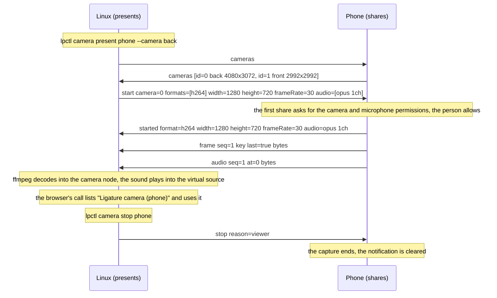
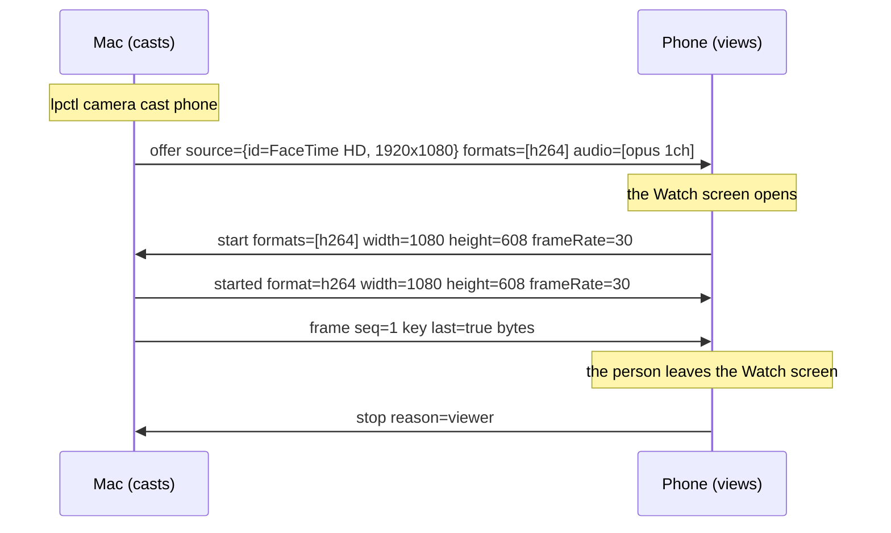
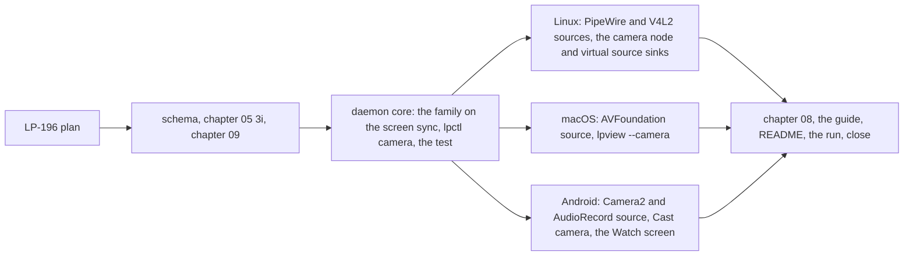

# Milestone 10: a camera on one of the person's devices used from another, as a picture and as a webcam

**Status:** Accepted by the owner on 2026-11-09; the tasks are LP-205 to LP-210 under the epic
LP-194. Raised as the epic LP-194 on 2026-11-08 at the
owner's request, with milestone 9: send a camera's feed the way a screen is sent, and let a
device use another device's camera for a conference call. The capture, encoding, transport,
viewers and sound of milestones 8 and 9 carry it; the new work is a camera as a source on each
platform and, where the platform allows, a received camera presented to the platform's other
programs as a camera and a microphone.

## 1. Goal

One person, the Linux machine, the Mac and the Android phone of milestone 9. After this
milestone a camera on any of the three, with the device's microphone, is sent live to another:
watched in `lpview` or the app, or cast from the device that holds the camera, as a screen is.
On a desktop that can do it, a received camera is presented to the platform's programs as a
camera device and its sound as a microphone, so a video call in a browser on the Linux
machine uses the phone's camera and microphone as if they were plugged in. A share ends
cleanly however it ends.

A camera is `device`-scoped (chapter 10 section 3), offered by the binding standing in for
the principal under ADR 0040 as the screen is, and between one person's own devices it needs
no LP prompt: the platform's own camera and microphone consent is the gate.

## 2. Non-goals for this milestone

Camera controls (zoom, focus, exposure, the torch, switching cameras mid-share: a second
camera is a second share); photos and recording; more than one consumer per camera; the Mac
presenting a received camera (decision 6 says why); the phone presenting one (Android has no
virtual camera without root); a camera to another person's device (groups); sound alone or a
microphone alone (the `audio` family of milestone 9 section 7); the datagram path (ADR 0041);
any codec beyond H.264 and Opus; and any change to sessions or trust.

## 3. Decisions

Protocol decisions are unchanged (chapter 05, ADR 0008, ADR 0015, ADR 0036); a new family
needs no ADR of its own, since ADR 0008 covers it, and gets a schema and a chapter 05 section.
What this milestone pins:

1. **One family, device-scoped, on the shapes of `screen`.**
   `org.ligatureprotocol.capability.camera` (chapter 05 section 3i,
   `schemas/capability.camera.schema.json`), `scope` `device`, offered under ADR 0040. Its
   messages are the screen family's under its own type names: `cameras` (the listing, decision
   2), `start`, `offer` (a cast of a camera, milestone 9 decision 1), `started`, `refused`,
   `frame`, `audio`, `keyframe` and `stop`, with the same fields, chunking, pacing, clock and
   negotiation (ADR 0044), and the schema refers to the screen schema's definitions for the
   shared shapes rather than copying them. The params are `shares` (this device captures a
   camera), `views` (it shows one), `receives` (it takes a camera offered to it, as a screen's
   cast is taken), `presents` (it presents a received camera to its platform's programs as a
   camera device, and the sound as a microphone where it can; an `offer` carries `present`
   when the caster asks for that rather than a picture in a window),
   `encodes`, `decodes`, `audioEncodes`, `audioDecodes`, `maxWidth`, `maxHeight` and
   `maxFrameRate`. A camera is its own family rather than a kind of screen source because it
   is a different device under chapter 10, a different consent on every platform, is never
   driven, and is sunk differently: a screen is shown, a camera is shown or presented.
2. **The listing.** `cameras` without a list asks, and is answered with each camera's `id`
   (stable for the session), `name`, `facing` (`front`, `back` or `external`), the largest
   `width` and `height` it captures and its `frameRates`. `start` names a camera (the first
   listed when it names none) and the picture, rate and audio wanted, as a screen `start`
   does; the sharer picks a capture size no larger than asked, keeping the camera's aspect,
   and answers `started`. The share's `audio`, when asked for and given, is the sharing
   device's microphone: Opus, 48 kHz, one channel, on the share's stream as milestone 9 has
   it.
3. **A camera's encoder aims at a rate, not a quantiser.** A screen changes in patches and is
   coded at a constant quantiser with a frame only on change (milestone 8); a camera's
   picture changes everywhere every frame, so its encoder is rate-controlled at a bit rate
   from the size and rate (the settings VA-API and VideoToolbox already use), x264 at a
   constant rate factor rather than a quantiser, and a frame goes at the agreed rate always.
   Keyframes are as before: at the start, on request, and a long safety net. The latency
   target as a webcam is 150 ms glass to glass, the plan's figure of milestone 8, since a
   call's own delay sits on top of it.
4. **Sources per platform.** Linux: cameras through PipeWire where the machine's cameras are
   behind it (laptop cameras on libcamera, such as this machine's IPU6, appear only there),
   read directly, since the Camera portal is for sandboxed programs, with ffmpeg's `v4l2`
   input as the fallback for a plain V4L2 device; the microphone from PipeWire's default
   source; both into the child encoders of milestones 8 and 9. A share reads the camera and
   the microphone it started with and never another in their place. macOS: AVFoundation's capture
   devices into the `LiveEncoder` of milestone 8 through `lp-macos`, the microphone through
   the same session, both behind the Camera and Microphone permissions granted once to the
   LP-94 bundle. Android: Camera2 into the encoder's input surface and `AudioRecord` into the
   Opus encoder, in a foreground service of the camera and microphone types, behind the
   camera and record-audio permissions, which the app asks for on the first share.
5. **Sinks: shown, and presented on Linux.** Shown, a camera is what a screen is: `lpview
   <device> --camera [ID]` on the desktops and the Watch screen on the phone, without input.
   Presented, on Linux, the daemon decodes the share through ffmpeg into a PipeWire camera
   node, named "Ligature camera (<device>)", which is what the Camera portal and the
   programs that read cameras through PipeWire list, and into a V4L2 loopback device as well
   where one exists (`v4l2loopback`, the out-of-tree module the user installs, with
   `exclusive_caps` so browsers list it), for the programs that read V4L2 alone. The sound
   is played into a PipeWire virtual source, "Ligature microphone (<device>)", which
   programs pick as a microphone. PipeWire and V4L2 are what every Linux program reads a
   camera and a microphone through, so nothing in the browser changes. `lpctl camera present
   <device> [--camera ID]` starts a presented share and `stop` ends it, and a cast (`offer`)
   from a device to a Linux machine that `presents` is presented rather than shown when the
   caster asks for that (`lpctl camera cast <device> --present`, the phone's Cast camera
   action with "as webcam" on); `presents` is advertised when either sink can be made.
6. **What the Mac and the phone cannot do, and why.** A camera presented to macOS programs is a
   Core Media I/O camera extension, a system extension that macOS loads only from a Developer
   ID signed and notarised application with the system-extension entitlement; the project's
   bundle is ad hoc signed (LP-94) and its releases are signed with minisign, not by Apple
   (ADR 0042). So the Mac shares and shows a camera but advertises no `presents`, and the guide
   says why; a Developer ID signature is a project decision for later, named in section 7.
   The limit is Apple's: a person may not add a camera to the programs on their own Mac
   without Apple's signature on the software, and the guide says so in those terms.
   Android has no virtual camera for other apps without root, so the phone shares and shows
   and never presents. The platform notes name both.
7. **Consent and indicators.** Android asks for the camera and microphone permissions once,
   and shows its own green indicator while the service captures; the app's notification
   carries Stop sharing, as the screen's does. macOS asks once per bundle and shows the camera's
   indicator light and the microphone indicator. Linux asks nothing of a program that is not
   sandboxed, so the daemon posts "Sharing <camera> with <device>" with a Stop action for
   the share's life, as it does for a screen, and does not share when it cannot. A withdrawn
   permission ends the share with `consent`.
8. **Chapter 09.** A camera on a phone left in a room shows the room to any of the person's
   devices, and its microphone hears it, which is the screen's sensitivity turned outward. It
   travels only on the authenticated pairwise session to a device of the same person, nothing
   of it is stored, the platform's indicator or the daemon's notification shows for the
   share's life, and a lost device that can start a camera until revoked adds the same weight
   to revocation. The threat model says so beside the screen's paragraph.
9. **Existing protocols.** As milestone 9 decision 10: H.264 and Opus are the codecs, the
   messages carry what RTP carries so the datagram path and any bridge repackage without
   transcoding, and the sinks are V4L2 and PipeWire, the platform's own. A camera presented
   over the network to programs that speak a standard camera protocol (an IP camera over RTSP,
   an ONVIF device) is a bridge of ADR 0010, for section 7.

No decision above changes an accepted ADR: the family is a capability under ADR 0008 offered
under ADR 0040, its shapes are the screen family's under ADR 0036's bound and ADR 0044's
negotiation, and the grant rule is chapter 10's.

## 4. Exit criteria

- The phone's back camera and microphone are the camera and microphone of a video call in a
  browser on the Linux machine, listed by the names of decision 5, with the glass-to-glass
  latency of the picture measured and recorded; the call's far end sees and hears the room.
- The Mac's camera is presented on the Linux machine the same way, and the Linux machine's
  camera is watched on the phone and in `lpview` on the Mac.
- A camera is cast from the phone to the Linux machine and presented there, and from the Mac to
  the phone and shown there.
- A share ends cleanly when the consumer stops it, when the sharer stops it, when the platform
  withdraws its permission, and when the session drops; the camera node and the virtual
  source are released and the next share works.
- The Mac and the phone advertise no `presents`, and the guide and the platform notes name why.
- A share without audio gives a camera and no microphone; the microphone's sound is heard in
  the call within the measured offset.
- A device running the milestone 9 build sees no `camera` descriptor and nothing else changes.
- CI compiles the schema (with its references into the screen schema), builds the daemon on
  both desktops and the APK, and the two-daemon test covers the listing, a start by id and by
  default, the offer and its refusal, audio between frame chunks, and a stop from each side,
  with synthetic frames and no camera.
- Everything is recorded on LP-194 from a run with the real devices.

## 5. Work breakdown

- LP-196. This plan.
- **Schema and spec.** `schemas/capability.camera.schema.json` referring to the screen schema;
  chapter 05 section 3i; chapter 09 (decision 8).
- **Daemon core, `lpctl camera` and the two-daemon test.** `lp-core` types; the screen sync
  generalised over a family and a source kind, so one sync carries both; a `CameraCapture`
  trait; the presenting sink as a trait with a fake; `lpctl camera list`, `start`, `present`,
  `cast`, `stop`, `status`; the test. `10-implementation-decisions.md` records the choices as
  they are made, the Linux camera path first.
- **Linux.** PipeWire and V4L2 sources with the probe, the microphone, the camera node, the
  loopback device and the virtual source with their names, the notification, `lpview --camera`.
- **macOS.** AVFoundation in `lp-macos`, the permissions, `lpview --camera`.
- **Android.** The camera service, the permissions, the Cast camera action, the Watch screen.
- **Chapter 08, the guide, README, the run.** The platform notes, a guide page on cameras, the
  README, CLAUDE.md, the run with the real devices recorded on LP-194, the measurements, and
  the milestone status.

## 6. Risks

- **The kernel module.** `v4l2loopback` is out of tree, installed by the user through DKMS,
  and may lag a kernel; a Linux machine without it presents through the PipeWire node alone,
  which a program that reads V4L2 alone does not list, and the guide says which programs
  those are and how to install the module.
- **Linux camera stacks.** A laptop camera behind libcamera is reachable only through
  PipeWire; the probe records what it found, and a USB camera is the fallback for the run.
- **Latency as a webcam.** A decode into the camera node adds a hop to milestone 8's
  figures, which were 100 to 270 ms by pair; the run measures and the rate-controlled
  encoder's settings are tuned there.
- **Phone cameras.** Camera2 on LineageOS varies by device; the share picks a size the camera
  supports no larger than asked, and the run on the owner's Pixel is the evidence.
- **Permissions on the Mac.** Camera and Microphone are two more grants to the bundle, applied
  on the next start as Screen Recording was; `lpctl permissions` lists them.
- **Privacy.** A camera started remotely without the indicator being seen is the threat of
  decision 8; the indicators are the platform's and the notification the daemon's, and the
  run checks each shows.

## 7. After this milestone

Candidates, in no order: a Developer ID signature for the Mac bundle, which unlocks the camera
extension and other system extensions; the phone as a webcam over USB (UVC gadget mode, where
the device supports it); camera controls; the `audio` family; ADR 0041; bridges of ADR 0010
presenting a camera as an RTSP or ONVIF source, and taking an IP camera in as an LP camera.
