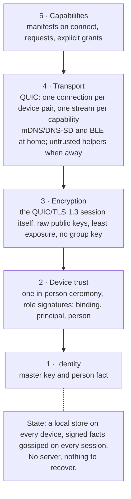

# Ligature Protocol Specification: Overview

**Status:** Draft. This document is incomplete and will change without notice.

## 1. Introduction

Ligature Protocol (LP) binds the devices belonging to one person into a single trusted
group so that any device can discover and use the capabilities of the others. It is
designed for Linux desktops first, with macOS desktops, Android phones and tablets, home
hubs and (within platform limits) iPhones as peers ([ADR 0033](../adr/0033-supported-
platforms.md)). This chapter sets out the goals, the layering, and how the remaining
chapters fit together.

## 2. Goals and non-goals

LP is for devices owned by an individual or by a co-habitation group such as a household;
every person who is trusted is someone the user meets in person. It aims to be local-
first, self-hostable, end-to-end encrypted, and built on existing open standards. It does
not aim to be a general messaging protocol, a file-sync engine, or a replacement for the
protocols it bridges to. It does not cover device security: how a device authenticates its
local user, locks, or protects its storage is the device's and the user's concern ([ADR
0024](../adr/0024-device-security-out-of-scope.md)); the protocol defines who is
authenticated behind a request and which keys are trusted, and takes a present session as
whatever the device reports. Shared devices with several user accounts, and groups of
identities such as a household, are first-class goals (chapter 10).

## 3. Terminology

Terms such as *master key*, *binding*, *principal*, *introducer*, *capability*, *grant*
and *gossip* are defined in the [glossary](../glossary.md). Normative keywords (MUST, SHOULD,
MAY) follow RFC 2119 and RFC 8174 once this document leaves draft status.

## 4. Layering

LP is organised as five layers plus a shared-state store:

1. **Identity** (chapter 01): a person is a master signing key, with a self-signing key, a
   user-signing key and a self-chosen display name carried in a signed person fact.
2. **Device trust** (chapter 02): one proximity ceremony signs a device's key with a role
   (binding, principal, person); one ceremony makes it available to all my devices.
3. **Encryption** (chapter 03): the pairwise QUIC/TLS session is the end-to-end layer; no
   device can decrypt what it does not need.
4. **Discovery and transport** (chapter 04): application-level QUIC authenticated by
   device keys; mDNS/DNS-SD and BLE locally; replaceable, untrusted helpers (discovery,
   hole punching, relays) remotely.
5. **Capabilities** (chapter 05): typed capability descriptors, requests and grants.

There is no shared database: each device keeps a local store of signed facts and gossips
them to peers (chapter 06). There is nothing to recover; chapter 07 describes rebuilding
after loss or compromise. Chapters 08 and 09 cover
platform constraints and the threat model. Chapter 10 covers shared multi-user devices and
groups of identities.

## 5. Document conventions

Each chapter states its intent per section and lists open questions inline. Wire formats,
message encodings and state machines are deliberately absent from this draft and will be
added once the architecture decisions in `docs/adr/` are accepted.

## 6. Schemas and encoding

Records and messages are defined in JSON Schema 2020-12 under `schemas/`, with reverse-DNS
type names ([ADR 0020](../adr/0020-json-schema-and-reverse-dns-names.md)), and encoded as
CBOR on the wire ([ADR 0025](../adr/0025-cbor-wire-encoding.md)).
