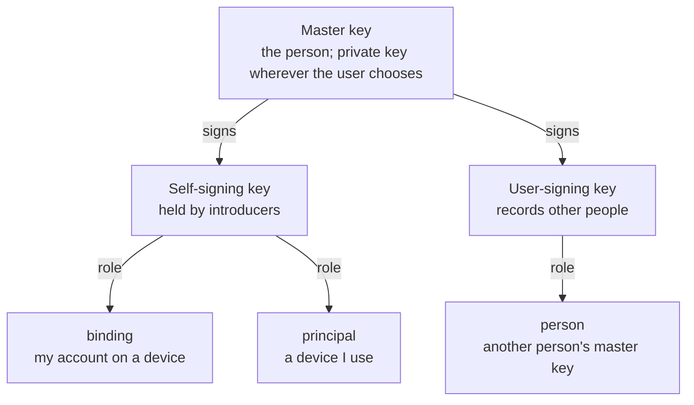

# 01. Identity

**Status:** Draft.

## 1. Intent

A person is identified by a **master signing key**. It is created on their first device,
it signs the keys that sign their devices, and other people pin it after verifying it in
person. There is no account, no server and no name required. See
[ADR 0017](../adr/0017-master-key-identity-and-proximity-ceremony.md).

## 2. The master key

The master public key is the person as far as the protocol is concerned. Its textual form
is a multibase string with a multicodec prefix, so the algorithm is self-describing. The
algorithm is Ed25519 ([ADR 0027](../adr/0027-ed25519.md)), so every key renders as
`z6Mk…`. Signatures over device bindings, device principals and known persons (chapter 02)
must chain to it. A master key does not expire; rebuilding (chapter 07) is a response to
loss or compromise, not a scheduled event.

## 3. Key structure and configuration

Every person has three keys ([ADR 0031](../adr/0031-split-keys-from-the-start.md)):

- the **master key**, which is the person;
- a **self-signing key**, signed by the master key and held by every device the user marks
  as an *introducer*, used to sign bindings and principals;
- a **user-signing key**, signed by the master key, used to sign known persons and group
  acceptances.

Two things are the user's choice, made to their own requirements: where the master private
key lives (on the first device, or offline or derived from a passphrase) and which devices
are introducers. A strict setup limits introducers to one or two devices; everything else
can be paired but cannot pair others.

All three keys and the display name travel together in the signed person fact.

## 4. Referring to other people

Another person is known by their master key once it has been verified in person in the
ceremony of chapter 02 and signed with the *person* role. There is no remote path to this;
the in-person step is a security feature
([ADR 0030](../adr/0030-in-person-verification-mandatory.md)).

Each person has a **person fact** (see
[`org.ligatureprotocol.person`](../../schemas/person.schema.json)): their master key, their
self-chosen display name, and their self-signing and user-signing public keys with the
master key's signatures over them, carried in an envelope signed by the self-signing key
(chapter 06 section 3). It is handed
over in the ceremony and gossiped like any other fact (chapter 06); it is what a verifier
uses to check a binding's signature back to the master key, and what a prompt shows instead
of the key ([ADR 0032](../adr/0032-no-publication-self-asserted-names.md)). Whether an
implementation lets a user relabel a known person locally is a user-interface matter that
no other device sees.
