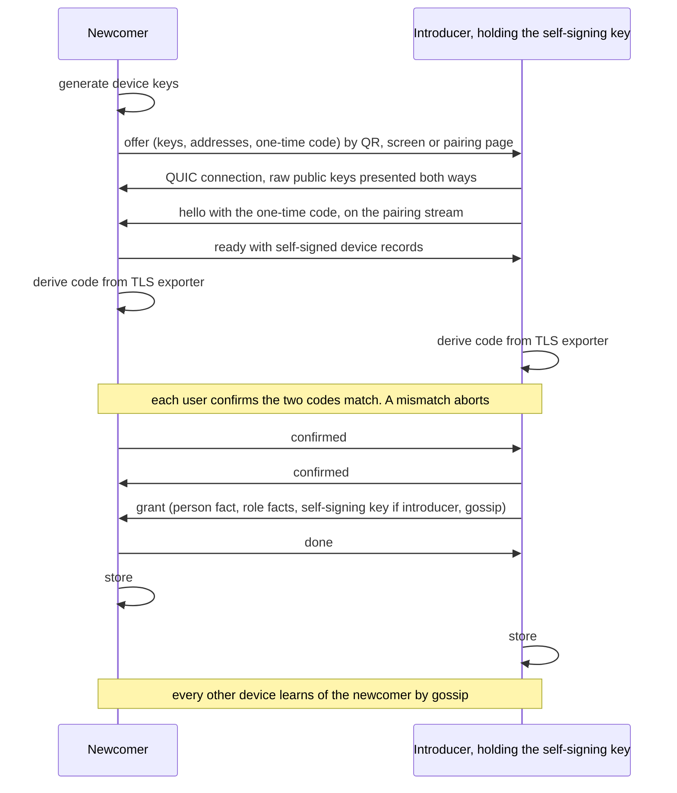
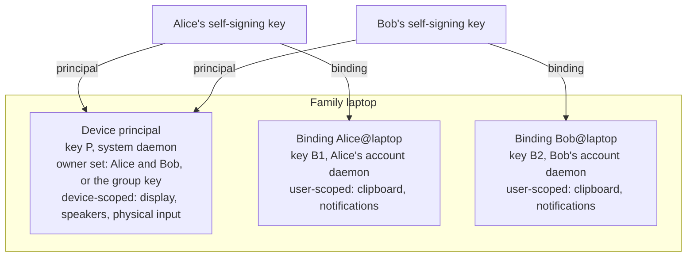

# 02. Device Binding

**Status:** Draft.

## 1. Intent

Devices join a person's device set through one **proximity ceremony**: an existing
device that can introduce verifies a key physically in front of it and signs that key with
a role. One ceremony makes the newcomer available to every device the person owns. See
[ADR 0017](../adr/0017-master-key-identity-and-proximity-ceremony.md) and
[ADR 0003](../adr/0003-device-cross-signing.md).

## 2. Keys on a device

- **Device principal key.** One per physical device, held by the system-level daemon. It
  owns the device-scoped capabilities (chapter 10).
- **Binding key.** One per account per device, held by that account's daemon. It owns the
  account holder's user-scoped capabilities on that device. A personal phone has one
  binding; a family laptop has one per account.
- **Self-signing key**, if this device is an introducer (chapter 01).

A device is identified by its key; there is no separate identifier, and a short fingerprint
shown in a terminal is presentation only
([ADR 0034](../adr/0034-keys-are-identifiers.md)). Its display name defaults to the host
name the operating system reports and the user may override it; the name is part of the
signed device record.

## 3. Roles

A signature made in the ceremony is its own fact
([`org.ligatureprotocol.role`](../../schemas/role.schema.json)) in an envelope (chapter 06
section 3), and carries exactly one role:

| Role | Signed key | Meaning for all my devices |
| --- | --- | --- |
| `binding` | A binding key | This is my account on that device: member of my device set, trusted for my user-scoped capabilities |
| `principal` | A device principal key | This is a device I use: I may request its device-scoped capabilities |
| `person` | Another master key | This is someone I know: their bindings are recognisably theirs and may ask me for grants |

A binding signature also records whether the new binding is an **introducer**, which the
user chooses at pairing time according to their requirements. Open question: whether a
`principal` signature should record owner rights separately from use rights (section 6).

## 4. The ceremony

1. The newcomer displays an **offer**, as a QR code and as text
   (`ligature:pair/1?b=…&p=…&a=…&c=…`): its binding and principal keys, the addresses it
   can be dialled at, and a one-time code. A headless device serves a page that shows it
   (section 5).
2. An introducer of mine reads the offer, dials it over QUIC with raw public keys, and
   refuses to go on unless the key the connection authenticates is the offer's binding key.
   It opens a stream with purpose `pairing` and sends `hello` with the one-time code, which
   proves it saw the offer; the newcomer answers `ready` with its self-signed device
   records ([`org.ligatureprotocol.pair`](../../schemas/pairing.schema.json)).
3. Both derive the short code from the TLS exporter and show it. Each side sends
   `confirmed` when its user says the codes match; either may send `abort`.
4. Only after both confirmations does the introducer send `grant`: its person fact, a
   `binding` role over the newcomer's binding key and a `principal` role over its
   principal key, the self-signing key if the newcomer is to be an introducer, and current
   gossip (chapter 06). The newcomer accepts the grant only after its own confirmation,
   only if the person fact verifies and both roles chain to it over exactly its own keys,
   and answers `done`.
5. Both sides store what they received. Every other device learns of it by gossip.

BLE, NFC or UWB ranging may be used to tighten the proximity check where hardware allows
but are never required. The short code is a six-digit short authentication string derived
from the TLS exporter of the pairing connection, so an interposed attacker holding two
sessions cannot show the same code to both sides
([ADR 0029](../adr/0029-ceremony-code-from-tls-exporter.md)): label
`EXPORTER-ligatureprotocol-pairing-sas`, context SHA-256 of the newcomer's binding key
followed by the introducer's key, 32 bytes of output, of which the first 20 bits are shown
as six decimal digits.

## 5. Headless devices

A device without a screen or camera (a hub, a NAS, a speaker) never relies on hardware
for pairing. It serves a basic web page on the local network, reachable by a URL it
prints at first boot, announces over mDNS, or exposes on a well-known port. The page shows
the fingerprint and code of step 1, and the ceremony proceeds from any trusted device
viewing it. Open question: whether that page should be served only until the first
binding or principal signature arrives, and what replaces it afterwards for adding further
owners.

## 6. Shared devices

A shared device has a principal and zero or more bindings. At pairing the introducer
chooses its **registration**: *personal*, in which case the introducer's person becomes
its owner and may add other owners; or *group*, in which case the introducer must be a
group admin, the owner set is the group key, and the device is added to the membership
document (chapter 10 section 5). A family tablet, a television or a lamp is registered to
the group, never to an individual. Pairing a binding on a shared device signs the binding
as `binding` and the principal as `principal` in one ceremony, since the account's daemon
can attest the principal key over local IPC. A binding on a group device should default to
not being an introducer, but the choice is the user's (chapter 01 section 3). Owners set
the device's policy for unattended requests. Open question: whether a person can hold a
`principal` signature for a device they neither own nor have an account on (a guest using
the speakers), or whether that is always a grant.

## 7. Revocation

A person revokes a binding, a principal or a known person by signing a revocation with
their self-signing key, which only their introducers hold
([`org.ligatureprotocol.revocation`](../../schemas/revocation.schema.json)). The revocation
names the person making it and is verified against that person's fact, and it is gossiped
to every peer (chapter 06). Whose revocation counts on a device follows
[ADR 0039](../adr/0039-revocation-scope-and-live-session-close.md): on the person's own
devices, every revocation they sign; on everyone else's, a revocation of the person's own
master key or of a device that person's role facts cover. One person's revocation of
another person's device changes nothing beyond their own devices. A revoked device cannot
announce its own revocation, so peers that were offline learn of it from the next trusted
device they meet, and a device that learns it closes any session it holds with the revoked
device at once. No fact undoes a revocation. Open question: whether a quorum should be
required when the device set is large.

## 8. Open questions

- How long a device may go without meeting any trusted peer before treating its trust
  store as stale (chapter 06 section 5).
- Whether a device may hold bindings for two people at once on an operating system with
  no account separation.
