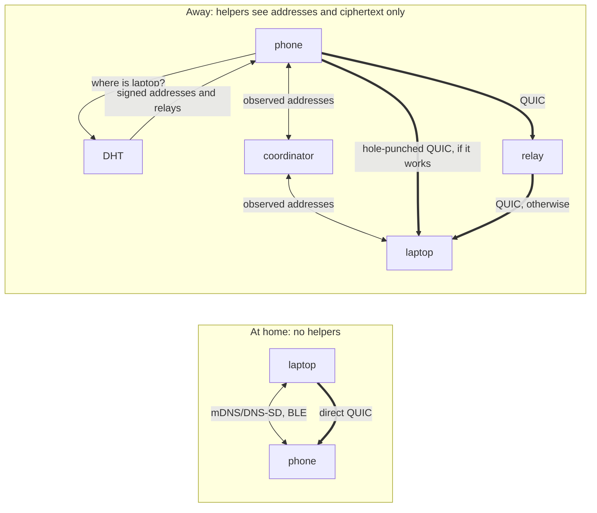

# 04. Discovery and Transport

**Status:** Draft.

## 1. Intent

Devices connect to each other directly over application-level QUIC (RFC 9000),
authenticating with their LP device keys. Locally they find each other with mDNS/DNS-SD
and BLE and need no server at all. When apart they use a small set of *helpers* for
discovery, hole-punch coordination and relaying. Helpers are replaceable and untrusted.
No traffic of any kind routes through a server LP depends on. See
[ADR 0011](../adr/0011-quic-application-transport.md),
[ADR 0012](../adr/0012-decentralised-untrusted-helpers.md) and
[ADR 0013](../adr/0013-wireguard-optional-integration.md).

## 2. Design rule for helpers

> Any helper may be operated by anyone, is listed in the user's own records, and is never
> trusted with plaintext or identity.

A malicious helper can at worst deny service; clients route around it. Every other section
of this chapter is constrained by this rule.

## 3. Transport: QUIC

### 3.1 Connections and streams

There is one QUIC connection per device pair and one stream per capability (clipboard,
files, remote input, notifications, media control, and so on), so a large file transfer
never stalls an interactive stream. The TLS handshake carries the ALPN token `ligature/1`,
which is the protocol version; no message carries one. Every stream is bidirectional and
its first frame is a stream header
([`org.ligatureprotocol.stream`](../../schemas/message.schema.json)) naming its purpose:
`gossip`, `manifest`, or a capability type. Whichever peer needs a stream opens it; the
dialer opens the gossip stream first. A receiver that does not understand a purpose closes
that stream and nothing else. A message on a stream is a frame: a 4-byte big-endian length
and one CBOR map with a `type` field, at most 1 MiB unless the capability says otherwise
([ADR 0036](../adr/0036-stream-framing-and-message-typing.md)). Open question: whether
some capabilities need several streams (for example one per file in flight).

### 3.2 Authentication

Peers authenticate with their LP device keys using TLS raw public keys (RFC 7250). There
are no certificate authorities. A connection proceeds past authentication only if the
presented key is a binding of mine, a principal I use, or a binding of a known person
(chapter 02); otherwise the only thing offered is the pairing ceremony. Open question:
whether to pin the exact key or accept any key whose signature chain to a known master key
verifies, learning the device on the spot.

### 3.3 Connection migration

QUIC connection migration keeps a session alive when a device changes network (Wi-Fi to
mobile data, roaming between access points). Open question: how migration interacts with
relay paths and with the per-epoch local identifiers in section 4.1.

### 3.4 End to end

The QUIC/TLS session is the end-to-end layer (chapter 03). A relay forwards packets and
terminates nothing, so it sees only ciphertext whether the path is direct or relayed.

## 4. Local path

### 4.1 mDNS/DNS-SD

Each device advertises a DNS-SD service instance. The TXT record carries a per-epoch
identifier that lets devices in the same set recognise each other without revealing the
user's identity to bystanders. Open question: the exact derivation of that identifier.

### 4.2 BLE

BLE advertisements let phones and low-power devices be discovered and woken, and are the
path to iPhone accessory profiles (chapter 08). Open question: whether LP defines its own
GATT service or only uses BLE to bootstrap a QUIC connection over IP.

### 4.3 Direct QUIC

Once a peer is found locally the device dials it directly. No helper is involved.

## 5. Remote path: three helper roles

### 5.1 Discovery: where is device X now?

Two options, both allowed and both usable together:

- **Signed address records in a DHT.** A device publishes a record of its current
  reachable addresses and relays, signed by its device key and keyed by that key's public
  part, to a DHT such as BitTorrent Mainline via pkarr, as iroh does. Anyone can look it
  up; only the key holder can publish a valid record.
- **Gossip.** Relays a device uses are signed facts gossiped like any other (chapter 06),
  so my devices learn each other's relays when they meet.

Open question: record lifetime, refresh cadence, and what a device does when the two
sources disagree.

### 5.2 Hole-punch coordination

When both peers are behind NAT, a coordinator exchanges their observed addresses so they
can attempt a direct QUIC connection. The coordinator learns public addresses and timing
but nothing else. Open question: whether the relay (5.3) always doubles as coordinator or
whether the roles can be split.

### 5.3 Relay

When hole punching fails (common on mobile and CGNAT networks) traffic is relayed. The
relay forwards QUIC packets it cannot decrypt. Anyone can run a relay.
The default personal relay is the user's always-on home hub, the same box that hosts their
Matter controller or media server. Clients can list several relays; a project-run relay may exist as
a swappable convenience default. Open question: relay selection and failover order, and
whether relays should be rate-limited per device key.

## 6. Situations

| Situation | Discovery | Path | Helpers used |
| --- | --- | --- | --- |
| At home, same LAN | mDNS/DNS-SD, BLE | Direct QUIC | None |
| Away, user has a home hub | DHT record, gossiped relays | Direct QUIC via hole punch, else relay through the hub | Hub as coordinator and relay |
| Away, no home hub | DHT record, gossiped relays | Direct QUIC via hole punch, else relay | Any relay listed in the user's records |
| Convenience default | DHT record | Direct QUIC via hole punch, else relay | Project-run relay, replaceable at any time |

In every row the helper sees only addresses and ciphertext. A pairing with a headless
device at home uses the device's own web page (chapter 02 section 5) over the LAN.

## 7. Optional: WireGuard / Headscale integration

LP does not depend on WireGuard. As an optional integration, LP can generate
Headscale/WireGuard peer configurations from the user's device list for users who want
full network access to their home (SSH, NAS, media). This is a convenience for other
software, not an LP transport, and the protocol must work identically without it. See
[ADR 0013](../adr/0013-wireguard-optional-integration.md).

## 8. Wake and presence

Devices should be able to wake peers and learn their presence cheaply. Open question: how
presence interacts with battery constraints on mobile platforms, and whether presence is
itself a capability (chapter 05).

## 9. Open questions

- Which QUIC implementation(s) the reference implementation should target, and whether
  iroh's endpoint abstraction is reusable directly.
- How multiple network paths to the same peer are ranked (direct over relay, IPv6 over
  IPv4, Wi-Fi over mobile).
- Whether IPv6 reachability should be preferred aggressively, since it often removes the
  need for hole punching (chapter 08).
