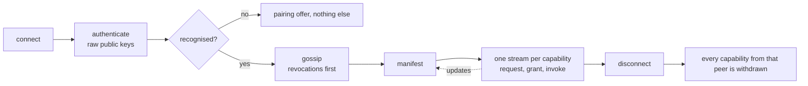

# 05. Capabilities

**Status:** Draft.

## 1. Intent

A device advertises the typed capabilities it offers *right now*. Peers discover them,
request access, and receive explicit grants. Capabilities are live: announced when a
session starts, updated while it lasts, withdrawn when it ends, and never persisted by
peers. See [ADR 0008](../adr/0008-capability-model.md) and
[ADR 0016](../adr/0016-no-required-shared-state.md).

## 2. Capability descriptors

A capability descriptor names a capability type (a reverse-DNS name such as
`org.ligatureprotocol.capability.clipboard`), its scope (`user` or `device`,
chapter 10), and type-specific parameters. The principal that offers it is the sender of
the manifest it arrives in. See
[`org.ligatureprotocol.capability`](../../schemas/capability.schema.json).

## 2a. Manifests and the live registry

After a session is authenticated (chapter 04) each side sends a **manifest**: the full list
of descriptors it currently offers. While the session lasts it sends updates as
capabilities appear (a display is plugged in) or disappear (a phone goes to the background
and loses clipboard access). When the session ends, every capability from that peer is
withdrawn. A device's view of the network is therefore the union of the manifests of the
peers it is connected to, and a hub's directory is nothing more than that.

A manifest is filtered by audience: to another person's device it lists only the
capabilities that person could use (for example `share`, and device-scoped capabilities
the group policy allows them), not everything the device offers. This is the least-exposure
rule of chapter 03 applied to metadata. Open question: whether a device may announce a
capability on behalf of a peer it is connected to, so that two devices with no direct path
can still see each other through a hub.

## 3. Initial capability families

The first families are: notifications, clipboard, files, share, remote input, media
control, telephony/SMS, displays, sensors. Each will become its own spec section with its
own schema; clipboard (section 3b) and share (section 3a) are specified so far.

## 3a. Sharing between people

`org.ligatureprotocol.capability.share` is the ad-hoc, AirDrop-like push of text, links or
files to a chosen device, usually another person's. It is user-scoped: it belongs to a
binding, so a share to the family laptop is a share to a particular account on it. The
receiver accepts or declines each share on the receiving device; acceptance is a one-time
grant, which the receiver may make standing for a particular sender. The payload travels
on the `share` stream of the pairwise session. `files` keeps its meaning of browsing and
transferring files among a person's own devices. See
[ADR 0022](../adr/0022-ad-hoc-sharing-between-people.md). Open question: size limits and
resumption for large shares, and whether a share may be addressed to several devices at
once (which is several sessions under chapter 03).

## 3b. Clipboard

`org.ligatureprotocol.capability.clipboard`
([schema](../../schemas/capability.clipboard.schema.json)) is the first family specified.
It is user-scoped: a binding offers it, and the same person's other bindings use it
without a prompt (section 4). A device advertises it only while it can reach its local
clipboard; the descriptor's `params` carry `maxBytes`, the largest text it accepts, and
`mimeTypes`, which is `text/plain` only in this version. On the capability's stream each
side sends a `set` message (the text and `setAt`, when the sender's clipboard took that
value) whenever its local clipboard changes. The receiver applies a `set` newer than what it
holds and ignores one equal to its current content, so two devices setting each other never
loop. Open question: other content types (images, files), and whether a device should be
able to ask for the current value rather than wait for a change.

## 4. Requests and grants

A device requests a capability from a peer; the peer (or the user, through the peer)
grants or denies. Grants are typed records with scope and expiry. See
[`org.ligatureprotocol.grant`](../../schemas/grant.schema.json).

Defaults follow identity boundaries (ADR 0015): a person's own devices may use that
person's user-scoped capabilities without a prompt; anything across identities needs an
explicit grant, approved by the person whose capability it is or, for a device-scoped
capability, by the person present on the device or the device's policy (chapter 10).
Standing grants are stored by the device that issued them and nowhere else (chapter 06).
Open question: whether a person may opt their own devices out of the implicit default.

## 5. Invocation

Once granted, a capability is invoked over its own stream in the pairwise QUIC session
(chapter 04), which is also the end-to-end encryption (chapter 03). Each capability family
defines its own operations. No wire format is defined in this draft.

## 6. Bridging

Capabilities may be backed by an external protocol (KDE Connect, LocalSend, Matter, MPRIS).
A bridge is just a device that advertises a capability on behalf of something else. See
[ADR 0010](../adr/0010-interop-bridges.md).

## 7. Open questions

- Versioning and negotiation of capability types.
- Schemas are JSON Schema 2020-12 ([ADR 0020](../adr/0020-json-schema-and-reverse-dns-names.md));
  the wire encoding is CBOR ([ADR 0025](../adr/0025-cbor-wire-encoding.md)).
- Capability discovery across group identities: what a member can see of another
  member's devices before asking.
