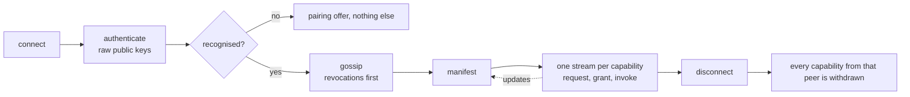

# 05. Capabilities

**Status:** Draft.

## 1. Intent

A device advertises the typed capabilities it offers *right now*. Peers discover them,
request access, and receive explicit grants. Capabilities are live: announced when a
session starts, updated while it lasts, withdrawn when it ends, and never persisted by
peers. See [ADR 0008](../adr/0008-capability-model.md) and
[ADR 0016](../adr/0016-no-required-shared-state.md).

## 2. Capability descriptors

A capability descriptor names a capability type (a reverse-DNS name such as
`org.ligatureprotocol.capability.clipboard`), its scope (`user` or `device`,
chapter 10), and type-specific parameters. The principal that offers it is the sender of
the manifest it arrives in. See
[`org.ligatureprotocol.capability`](../../schemas/capability.schema.json).

A family with two directions declares in its `params` which of them the device offers: `emits` and
`displays` for notifications (section 3c), `send` and `receive` for files (section 3d), `accepts`
and `provides` for input (section 3g), `shares` and `views` for screen (section 3h), and the same
shape for media control (control, be controlled) when it is specified. A device advertises the
family if it offers either direction; the peer reads the flags to know what it may send and what it
will receive. One stream per session carries both directions for the clipboard and notifications;
files, whose payloads are large, use a stream per transfer and per file (section 3d).

## 2a. Manifests and the live registry

After a session is authenticated and gossip has run (chapter 04, chapter 06) each side
opens a `manifest` stream to the other and sends a **manifest**
([`org.ligatureprotocol.manifest`](../../schemas/message.schema.json)): the full list of
descriptors it currently offers. While the session lasts it sends a new full manifest on
the same stream whenever a capability appears (a display is plugged in) or disappears (a
phone goes to the background and loses clipboard access); the newest replaces the last.
When the session ends, every capability from that peer is withdrawn. A device's view of
the network is therefore the union of the manifests of the peers it is connected to, and a
hub's directory is nothing more than that.

A manifest is filtered by audience: to another person's device it lists only the
capabilities that person could use (for example `share`, and device-scoped capabilities
the group policy allows them), not everything the device offers. This is the least-exposure
rule of chapter 03 applied to metadata. Open question: whether a device may announce a
capability on behalf of a peer it is connected to, so that two devices with no direct path
can still see each other through a hub.

## 3. Initial capability families

The first families are: notifications, clipboard, files, share, remote input, media
control, telephony/SMS, displays, sensors. Each will become its own spec section with its
own schema; share (section 3a), clipboard (section 3b), notifications (section 3c), files
(section 3d), input (section 3g) and screen (section 3h) are specified so far.

## 3a. Sharing between people

`org.ligatureprotocol.capability.share` is the ad-hoc, AirDrop-like push of text, links or
files to a chosen device, usually another person's. It is user-scoped: it belongs to a
binding, so a share to the family laptop is a share to a particular account on it. The
receiver accepts or declines each share on the receiving device; acceptance is a one-time
grant, which the receiver may make standing for a particular sender. The payload travels
on the `share` stream of the pairwise session. `files` (section 3d) is the transfer of
files among a person's own devices. See
[ADR 0022](../adr/0022-ad-hoc-sharing-between-people.md). Open question: size limits and
resumption for large shares, and whether a share may be addressed to several devices at
once (which is several sessions under chapter 03).

## 3b. Clipboard

`org.ligatureprotocol.capability.clipboard`
([schema](../../schemas/capability.clipboard.schema.json)) is the first family specified.
It is user-scoped: a binding offers it, and the same person's other bindings use it
without a prompt (section 4). A device advertises it only while it can reach its local
clipboard. The descriptor's `params` carry `mimeTypes`, the content types the device
accepts and can put on its clipboard; `maxBytes`, the push bound, 512 KiB by default and
never more than the frame limit of chapter 03 less 64 KiB of headroom; and `fetch`, whether
the device holds a promise for announced content and fetches it on paste.

A clipboard holds one selection in several representations at once (plain text and HTML
from a browser, PNG and TIFF for an image, a URI list for files). On the capability's
stream each side sends a `set` whenever its local clipboard changes: `setAt`, when the
clipboard took the value; `text`, the plain-text representation, present whenever the
source offers plain text so every receiver gets something; `parts`, the other
representations, each a `mime` with either the `bytes` or a file descriptor of section 3d;
and `files`, descriptors of a selection of files. A sender includes only parts whose `mime`
the receiver lists, with HTML as the interoperable rich-text form (RTF travels beside it
where the source has it, never alone) and no conversion between formats on the wire. A `set`
with neither `text`, `parts` nor `files` says the clipboard emptied.

**Push small, announce large.** Parts whose bytes fit within the receiver's `maxBytes`,
largest first until the budget is spent, are pushed in the `set`; the rest are announced,
each as a `file` descriptor with its `id`, `size`, `mime` and a required `sha256`. Files on
the clipboard are always announced. The receiver puts a promise for each announced part on
its local clipboard and, only when an application pastes that type, fetches the bytes with a
`files` transfer it starts (section 3d, a `request` for the id), delivered to the clipboard
rather than the download folder, and checked against the announced hash. The sender keeps
announced content on offer until its clipboard changes or an hour passes, then withdraws
it, so a later request is declined as `gone`; a receiver whose fetch fails, or whose
connection to the sender is lost, drops its promises and leaves its clipboard holding what
it was pushed. A device that advertises `fetch` false is sent only what fits in `maxBytes`
and no file parts.

The receiver applies a `set` newer than what it holds and ignores one equal to its current
content, where equality is the hash of the representation set (each part's `mime` and the
SHA-256 of its bytes, or its announced hash, in `mime` order, then the files by name), so
two devices setting each other never loop. A `get` on the same stream asks the peer for its
current value, which it answers with a `set` built the same way, or an empty one; a device
sends it on connecting so one that was away holds the latest copy. A device learns an id
only from a `set` it was sent: the sender's offers are never listed.

## 3c. Notifications

`org.ligatureprotocol.capability.notifications`
([schema](../../schemas/capability.notifications.schema.json)) carries what an app on one
device posts to every other device of the person that shows notifications. It is
user-scoped and needs no prompt between a person's own devices (section 4). The
descriptor's `params` say `emits` (this device forwards what its apps post), `displays`
(this device shows what it is sent) and `maxIconBytes`; a device that does one but not the
other, such as a Mac that may post but not read other applications' notifications
(chapter 08), advertises with one flag false. By default every notification a device
emits goes to every connected peer that displays; shaping that is a later configuration
matter and not part of the capability.

On the stream, `post` carries an `id` chosen by the emitting device and stable for the
notification's life, the app's identifier and display name, a title, a body, when it was
posted, and the hash of the app's icon; a `post` whose `id` is already shown replaces it.
`icon` carries that hash, a MIME type and the bytes, sent once per app per session before
the first `post` that names it and cached by the receiver for the session only. `dismiss`
names the emitting device (`origin`) and the `id`, since ids are per device, and goes in
one hop from the device where the user dismissed to the origin and to every displaying
peer: the origin cancels the real notification, the others clear their copies. Only a
dismissal the user makes on a device is ever sent; a received `dismiss` is acted on and
never forwarded, and a notification shown on behalf of another device is never emitted
again, so nothing cycles. An emitting device does not forward ongoing, silent or summary
notifications, nor those of apps the user excluded; what a receiver shows is what it is
sent. Nothing about a notification is stored: the receiver's copies, icon cache and id map
live for the session (chapter 09). Open question: replies and actions carried back to the
origin, and whether presence should ever narrow where a notification is shown.

## 3d. Files

`org.ligatureprotocol.capability.files`
([schema](../../schemas/capability.files.schema.json)) moves files among a person's own
devices: a file chosen on one lands on another, and a device fetches content another
device has offered. It is user-scoped and needs no prompt between a person's own devices
(section 4); anything across people is `share` (section 3a). The descriptor's `params` say
`send` (this device offers content and answers fetches), `receive` (it accepts pushed
files), `maxChunkBytes` (the largest chunk it takes, within the frame limit of ADR 0036)
and `maxStreams` (how many files it takes at once from one peer, so a small device may say
one and a server many). Nothing here is browsing: a device learns what another offers only
from an offer or from an announcement on another capability's stream, never by asking for
a list.

A **file** is described the same way whatever is behind it, a file on disk, bytes in
memory or a clipboard selection: an `id` the sender chose and keeps unique among what it
offers, a `name` that is a base name and never a path, the exact `size`, a `mime` type, and
optionally the `sha256` and the `modified` time. The definition is standalone so that other
families reference it; the clipboard's announcement of large content does.

A **transfer** is a control stream and one data stream per file, all with the capability
type as their purpose. Whoever starts the transfer opens the control stream and chooses a
`transfer` id that every stream of the transfer names: the sender for a push, whose first
message is an `offer` listing the files; the receiver for a fetch, whose first message is a
`request` naming the ids it wants, answered by an `offer` of those the sender still holds,
so an id missing from the offer is gone. The receiver answers an `offer` with an `accept`
naming the ids it will take, or either side sends a `decline` with a reason (`gone`,
`refused`, `too-large`, `no-space`, `busy`). For each accepted file the sender opens a data
stream whose first message is `begin` with the transfer and file id, followed by `chunk`
messages carrying the bytes in order and an `end` carrying the SHA-256 computed while
sending; it then finishes its side. The receiver checks the size against the descriptor
and the hash against what it wrote, answers `received` or `failed` with a reason on the
same stream, and finishes it. Once every accepted file has its answer both sides finish
the control stream. The sender keeps no more data streams open to a peer than that peer's
`maxStreams`, and files on different streams are independent of one another.

Either side cancels one file by resetting its data stream, with application error code 16
for a cancel the user asked for and 17 for a failure (the family's codes under
[ADR 0038](../adr/0038-stream-reset-codes-and-admission.md)), and the whole transfer by resetting
the control stream; a stream that ends before `end` is a failure. The receiver removes
whatever partial file it was writing. There is no cancel message, since it would queue
behind the chunks it is meant to stop. Progress is each side's own count of bytes against
`size`; nothing on the wire carries it.

A received file goes where the receiving side decides: by default the platform's download
folder (chapter 08), or wherever the capability that asked for a fetch wants the bytes. The
receiver keeps only the base name, drops control characters and a leading dot, and never
overwrites an existing file. A sender keeps what it offers in memory, by id, and withdraws
an id when the content is gone; a `request` for a withdrawn id is declined as `gone`.
Nothing about a transfer is stored beyond the received file itself (chapter 09). Open
question: resumption of an interrupted file by an offset in `begin`, and folders.

## 3g. Input

`org.ligatureprotocol.capability.input`
([schema](../../schemas/capability.input.schema.json)) lets the keyboard and mouse of one
device drive another: the pointer crosses the edge of one screen onto the next, as a
software KVM does, or a phone's screen is a touchpad for a desktop. It is the first
device-scoped family (chapter 10 section 3): a keyboard and mouse belong to the device, not
to an account on it, and a request to drive a device is answered by the person present on
it. Between one person's own devices that is implicit, as for user-scoped use (section 4);
across people it is the grant of chapter 10 section 6. On a device with one account the
account's daemon offers the family in its own manifest, standing in for the principal
([ADR 0040](../adr/0040-binding-stands-in-for-principal.md)). The descriptor's `params` say
`accepts` (this device injects what it is sent), `provides` (it captures its own keyboard
and mouse and sends them), `absolute` (it takes an entry and positions as fractions of its
screen, what a touchpad or a remote-desktop viewer sends) and `text` (it types a string of
characters, for a controller whose keyboard produces characters rather than keys). A
desktop advertises all four; a phone advertises `provides` only, since its platform lets
an application inject nothing (chapter 08).

A **drive** is one stream with the capability type as its purpose, opened by the
controller. Its first message is `enter`: the `edge` of the driven screen the pointer
crosses and `at`, its position along that edge as a fraction from the top or left end, or
`x` and `y` as fractions of the screen for an absolute entry. The driven device answers
`ready` with its screen's `width` and `height` in pixels and injects nothing before it
has. The controller then sends `events`, each message one input frame's worth of events
in order: `motion` (`dx`, `dy` in the controller's pixels, already accelerated there and
never again; the driven device scales them by the ratio of the two screens' widths, so a
sweep across one screen is a sweep across the other), `position` (`x`, `y` fractions, only
to a device that advertises `absolute`), `button` and `key` (`code`, `pressed`), `scroll`
(`dx`, `dy` in pixels, or in wheel steps when `discrete`) and `text` (a string, only to a
device that advertises `text`). Keys and buttons travel as Linux evdev codes, which name
physical keys as USB HID does: the driven device applies its own keyboard layout, so a
key typed on one layout into a device with another yields what that device's layout says,
as a keyboard plugged into it would. An unmapped code is dropped, never guessed.

The drive ends in one of three ways. The driven device sends `leave` when the pointer
reaches the edge it entered by, with `at` along it, and the controller takes the pointer
back there; a driven device never follows its own layout while driven, so two devices
need one mapping each and nothing cycles. Either side sends `release`: the controller on
its release chord or when it stops driving without an edge (a touchpad's user leaving the
screen), the driven device when it wants its input back. Or the stream ends, by reset or
by the session's end, which the driven device treats as `release`. In every case the
driven device lifts every key and button still held before anything else, so nothing
stays pressed; the controller releases its capture at once. Which edge of which screen
leads to which device is the controller's own setting, kept in its store and never on the
wire (chapter 06).

A controller that wants to know the round trip sets `seq` on an `events` message, and the
driven device answers `injected` with that `seq` once the batch has gone into its input
system; nothing else depends on it. Events are small and ordered, so a lost packet holds
back the events behind it on the stream; the reference implementation measures the round
trip, and QUIC datagrams for `events` are the remedy named if it calls for one, under an
ADR of their own beside [ADR 0036](../adr/0036-stream-framing-and-message-typing.md).
Nothing about a drive is stored (chapter 09). Open question: a layout shared across a
person's devices as a signed fact, so one device configures the whole set.

## 3h. Screen

`org.ligatureprotocol.capability.screen`
([schema](../../schemas/capability.screen.schema.json)) lets one device's display be
watched live on another of the person's devices, and, with input (section 3g), driven
from it. It is device-scoped, offered as input is
([ADR 0040](../adr/0040-binding-stands-in-for-principal.md)), and between one person's
own devices the protocol asks nothing: the platform's own consent, where the platform has
one, is the gate (chapter 08). The descriptor's `params` say `shares` (this device captures
and encodes a display), `views` (it decodes and shows one), `codecs` (what it encodes or
decodes, most preferred first; `h264` is the first and so far the only one, as an Annex B
byte stream with the parameter sets repeated in every keyframe so a decoder can start at
any keyframe), and as a viewer `maxWidth`, `maxHeight` and `maxFrameRate`, the largest and
fastest picture it takes.

A **share** is one stream with the capability type as its purpose, opened by the viewer.
`displays` without a list asks the sharer what it has and is answered by `displays` with
the list, each display an `id` stable for the session, a `name`, its `width` and `height`
and whether it is `primary`. `start` names a display (the primary one when it names
none), the `codec` and the largest `width` and `height` and fastest `frameRate` the viewer
wants; the sharer answers `started` with what it settled on, which may be smaller or
slower and never larger or faster, the picture scaled down keeping the display's aspect,
or `refused` with a reason (`consent`, `no-encoder`, `no-display`, `busy`) and ends the
stream. Then `frame` messages carry the encoded picture: each is one chunk of one frame
with the frame's `seq`, its capture time `at` in microseconds since the share started,
whether it is a `key` frame, whether this chunk is the `last`, and up to 256 KiB of
`bytes`, a frame being the concatenation of its chunks in order, so no message exceeds
the bound of [ADR 0036](../adr/0036-stream-framing-and-message-typing.md) and the bound
stands as it is. The sharer paces frames to the agreed rate and, when the stream's flow
control holds it back, drops frames rather than queues them, so the picture stays current
rather than complete; it sends a keyframe every few seconds and whenever the viewer sends
`keyframe`, after a loss or a late start. `stop` from either side, with a reason (`viewer`,
`sharer`, `consent`, `error`), ends the share and then the stream; a stream that ends
without one is a stop too, and either way the sharer ends its capture at once.

Driving a shared display is the input family on its own stream: the viewer sends an
absolute `enter` and `position` events as fractions of the shared display, computed from
where the pointer is in its picture through the `started` size, and keys, buttons, scroll
and `text` as section 3g has them; a multi-display sharer maps the fractions to the
display it is sharing. Viewing and driving are two streams of two families on one session,
and a viewer may watch without driving. One stream carries one share for its life; a
second viewer is a second share. Nothing of a share is stored, and the sharing device
shows that it shares, by the platform's indicator or a notification of its own, for the
share's life (chapter 09 section 4.4). Open question: audio with the picture, and a window
rather than a display.

## 4. Requests and grants

A device requests a capability from a peer; the peer (or the user, through the peer)
grants or denies. Grants are typed records with scope and expiry. See
[`org.ligatureprotocol.grant`](../../schemas/grant.schema.json).

Defaults follow identity boundaries (ADR 0015): a person's own devices may use that
person's user-scoped capabilities without a prompt; anything across identities needs an
explicit grant, approved by the person whose capability it is or, for a device-scoped
capability, by the person present on the device or the device's policy (chapter 10).
Standing grants are stored by the device that issued them and nowhere else (chapter 06).
Open question: whether a person may opt their own devices out of the implicit default.

## 5. Invocation

Once granted, a capability is invoked over its own stream in the pairwise QUIC session
(chapter 04), which is also the end-to-end encryption (chapter 03). Each capability family
defines its own operations. No wire format is defined in this draft.

## 6. Bridging

Capabilities may be backed by an external protocol (KDE Connect, LocalSend, Matter, MPRIS).
A bridge is just a device that advertises a capability on behalf of something else. See
[ADR 0010](../adr/0010-interop-bridges.md).

## 7. Open questions

- Versioning and negotiation of capability types.
- Schemas are JSON Schema 2020-12 ([ADR 0020](../adr/0020-json-schema-and-reverse-dns-names.md));
  the wire encoding is CBOR ([ADR 0025](../adr/0025-cbor-wire-encoding.md)).
- Capability discovery across group identities: what a member can see of another
  member's devices before asking.
