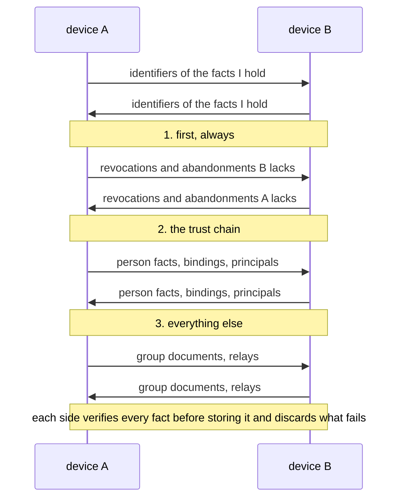

# 06. Local State and Gossip

**Status:** Draft.

## 1. Intent

Ligature Protocol has no shared database. Each device keeps a small local store of signed
facts, and devices exchange the facts the other lacks whenever they meet. Capabilities are
never stored; they are announced live (chapter 05). No off-device state is required at all. See
[ADR 0016](../adr/0016-no-required-shared-state.md).

## 2. What each device stores

- Its own binding and principal keys and, if it is an introducer, the self-signing key
  (chapters 01 and 02).
- The owner's master public key and the public keys of known persons.
- Device records it has learned, each with its role signature: bindings, principals and
  known persons (chapter 02, [`org.ligatureprotocol.device`](../../schemas/device.schema.json)).
- Revocations and key-abandonment statements it has learned (chapter 07).
- Grants it has issued (chapter 05). They are signed facts in the same store but are never
  gossiped: a grant concerns only the device that gave it.
- Group keys and membership documents for the groups it is party to or owned by
  (chapter 10).
- Relays it uses (chapter 04).

Nothing here is a cache of a remote truth; the local store *is* the truth as far as that
device knows. Received grants are not stored; the grantor re-sends what it allows on each
connection. A fact that fails to verify when the store is opened is quarantined and logged,
never silently deleted and never used.

## 3. Signed facts

Every fact that travels between devices is signed and self-verifying:

| Fact | Signed by | Verified against |
| --- | --- | --- |
| Person fact (master key, display name, self-signing and user-signing keys, each with the master key's signature) | The person's self-signing key | The master key itself; learned in the ceremony |
| Device record (key, name, platform, kind) | The device's own key | A role fact naming that key |
| Role fact (`binding` or `principal` over a device key) | My self-signing key | My master key, via my person fact |
| Role fact (`person` over a master key) | My user-signing key | My master key, via my person fact |
| Revocation or key abandonment (names the person making it and a subject) | That person's self-signing key, held by their introducers | That person's fact; whether it counts on a device follows [ADR 0039](../adr/0039-revocation-scope-and-live-session-close.md) |
| Group key introduction | The inviting admin's binding key | The admin's master key, already a known person |
| Group membership acceptance | The member's user-signing key | The member's master key, already known |
| Group membership document (versioned) | The group key | The group key learned at joining; a higher version replaces a lower |
| Relay list | The device's own key | The trust store |

Every signed fact travels in one envelope
([`org.ligatureprotocol.envelope`](../../schemas/envelope.schema.json)): its type, its
payload as the bytes the signer produced, the signing key, and an Ed25519 signature over
`"ligature/fact/1" || type || payload`
([ADR 0035](../adr/0035-byte-exact-signatures-forgiving-decoding.md)). A verifier checks
the signature over the bytes as received, resolves the signer to a trusted chain, then
decodes the payload and validates it against its schema. Facts are stored and forwarded
byte-exact and never re-encoded; a fact's identifier is the SHA-256 of its payload bytes.
Decoders accept any valid CBOR and ignore unknown fields. A device stores any fact whose
signature verifies against the signer it carries, and decides every time the fact is used,
against the chain of facts in its store at that moment, whether that signer is one to
listen to ([ADR 0039](../adr/0039-revocation-scope-and-live-session-close.md)): a role fact
counts when its signer is a subordinate key of a verified person fact, a revocation when
the ADR says so, and a fact signed by a key no chain reaches is kept but inert. So the
facts of an exchange may arrive in any order, and there is no external directory to
consult. Open question: whether facts carry a sequence number per
signer so that an older fact can never replace a newer one.

## 4. Gossip

When a session is established (chapter 04) the two devices exchange what the other lacks, in this
order: revocations, device bindings, group membership, then anything else. Both sides apply what
verifies and discard the rest. The exchange runs on the `gossip` stream in three messages
([`message.schema.json`](../../schemas/message.schema.json)): `gossip.have` lists the identifiers a
side holds, `gossip.want` the ones it asks for, and `gossip.fact` carries one envelope; an envelope
never travels outside a message ([ADR 0036](../adr/0036-stream-framing-and-message-typing.md)).
Gossip is small (a household has tens of facts, not millions), so a full exchange of fact
identifiers on every connect is acceptable. Open question: whether to use a Merkle-style summary
instead of a plain list once groups grow.

## 5. Revocation and the offline window

A revocation counts on a device when the person who signed it is the device's owner, when
its subject is that person's own master key (an abandonment, chapter 07), or when a role
fact of that person covers the subject, so a person can cut off their own device for
everyone but another person's device only on their own devices
([ADR 0039](../adr/0039-revocation-scope-and-live-session-close.md)). A device that learns
a revocation, by gossip or otherwise, re-decides the recognition of every connected peer
and closes the session of any it no longer trusts.

A device that was offline when a peer was revoked trusts that peer until it next meets any
other device carrying the revocation. Mitigations, all of which implementations should
apply:

- Gossip revocations first, before any capability traffic.
- A device that has seen no trusted peer for a configurable period treats its trust store
  as stale and requires a fresh binding check before honouring requests.
- Every session is freshly authenticated, and a session that outlives its peer's
  revocation is closed when the revocation is learnt, so a revoked device gains nothing
  from sessions it held before.

Open question: the default staleness period.

## 6. Backup

An implementation may export a device's local store, encrypted to a key only the user
holds, to any storage they choose. No other device depends on that backup
and the protocol does not define it. Open question: whether a standard backup format is
worth specifying so implementations can restore each other's exports.

## 7. Open questions

- How a device that has lost its local store but still holds its key re-learns the trust
  set: from any peer, by gossip, after the peer re-verifies it.
- Whether gossip should be filtered by audience: a known person's devices need my
  revocations and abandonments but not my bindings' display names.
