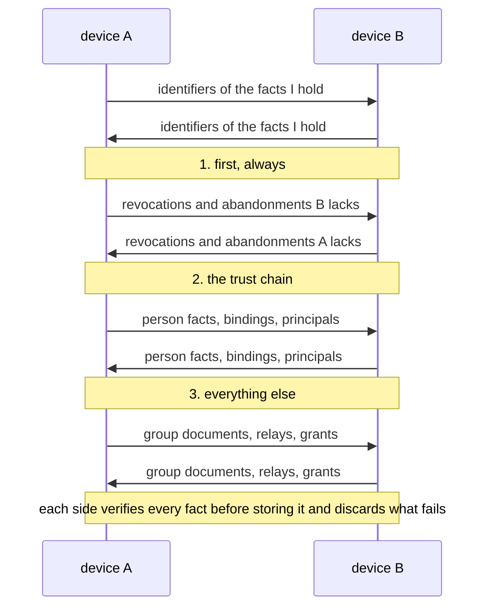

# 06. Local State and Gossip

**Status:** Draft.

## 1. Intent

Ligature Protocol has no shared database. Each device keeps a small local store of signed
facts, and devices exchange the facts the other lacks whenever they meet. Capabilities are
never stored; they are announced live (chapter 05). No off-device state is required at all. See
[ADR 0016](../adr/0016-no-required-shared-state.md).

## 2. What each device stores

- Its own binding and principal keys and, if it is an introducer, the self-signing key
  (chapters 01 and 02).
- The owner's master public key and the public keys of known persons.
- Device records it has learned, each with its role signature: bindings, principals and
  known persons (chapter 02, [`org.ligatureprotocol.device`](../../schemas/device.schema.json)).
- Revocations and key-abandonment statements it has learned (chapter 07).
- Grants it has issued (chapter 05) and, optionally, grants it has received.
- Group keys and membership documents for the groups it is party to or owned by
  (chapter 10).
- Relays it uses (chapter 04).

Nothing here is a cache of a remote truth; the local store *is* the truth as far as that
device knows. Open question: whether received grants should be stored or always re-sent by
the grantor on connect.

## 3. Signed facts

Every fact that travels between devices is signed and self-verifying:

| Fact | Signed by | Verified against |
| --- | --- | --- |
| Person fact (master key, display name, self-signing and user-signing keys, each with the master key's signature) | The person's self-signing key | The master key itself; learned in the ceremony |
| Device record (key, name, platform, kind) | The device's own key | A role fact naming that key |
| Role fact (`binding` or `principal` over a device key) | My self-signing key | My master key, via my person fact |
| Role fact (`person` over a master key) | My user-signing key | My master key, via my person fact |
| Revocation or key abandonment | An introducer's self-signing key | The relevant master key |
| Group key introduction | The inviting admin's binding key | The admin's master key, already a known person |
| Group membership acceptance | The member's user-signing key | The member's master key, already known |
| Group membership document (versioned) | The group key | The group key learned at joining; a higher version replaces a lower |
| Standing grant | The granting device's key | The trust store |
| Relay list | The device's own key | The trust store |

Every signed fact travels in one envelope
([`org.ligatureprotocol.envelope`](../../schemas/envelope.schema.json)): its type, its
payload as the bytes the signer produced, the signing key, and an Ed25519 signature over
`"ligature/fact/1" || type || payload`
([ADR 0035](../adr/0035-byte-exact-signatures-forgiving-decoding.md)). A verifier checks
the signature over the bytes as received, resolves the signer to a trusted chain, then
decodes the payload and validates it against its schema. Facts are stored and forwarded
byte-exact and never re-encoded; a fact's identifier is the SHA-256 of its payload bytes.
Decoders accept any valid CBOR and ignore unknown fields. A device accepts a fact only if
the signature verifies against a key it already trusts; there is no external directory to
consult. Open question: whether facts carry a sequence number per
signer so that an older fact can never replace a newer one.

## 4. Gossip

When a session is established (chapter 04) the two devices exchange what the other lacks,
in this order: revocations, device bindings, group membership, then anything else. Both
sides apply what verifies and discard the rest. Gossip is small (a household has tens of
facts, not millions), so a full exchange of fact identifiers on every connect is
acceptable. Open question: whether to use a Merkle-style summary instead of a plain list
once groups grow.

## 5. Revocation and the offline window

A device that was offline when a peer was revoked trusts that peer until it next meets any
other device carrying the revocation. Mitigations, all of which implementations should
apply:

- Gossip revocations first, before any capability traffic.
- A device that has seen no trusted peer for a configurable period treats its trust store
  as stale and requires a fresh binding check before honouring requests.
- Every session is freshly authenticated, so a revoked device gains nothing from sessions
  it held before.

Open question: the default staleness period.

## 6. Backup

An implementation may export a device's local store, encrypted to a key only the user
holds, to any storage they choose. No other device depends on that backup
and the protocol does not define it. Open question: whether a standard backup format is
worth specifying so implementations can restore each other's exports.

## 7. Open questions

- How a device that has lost its local store but still holds its key re-learns the trust
  set: from any peer, by gossip, after the peer re-verifies it.
- Whether gossip should be filtered by audience: a known person's devices need my
  revocations and abandonments but not my bindings' display names.
